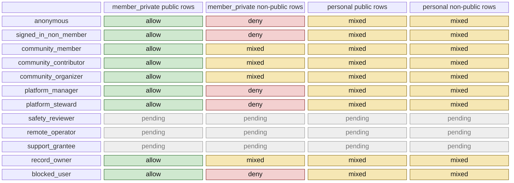
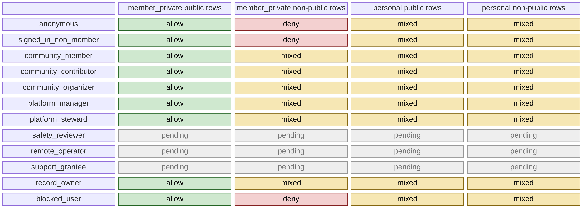

# Access contracts (pilot)

Generated by `rake better_together:access:docs`. Do not edit by hand. How to change an entry: [How to add or change an access contract entry](../../developers/access_contracts.md).

An access contract records what access we decided each persona should have to each record, in `config/access_contracts/*.yml`. A probe spec records what the policies actually do in `spec/access_contract/snapshot.json`. CI fails when the two differ, unless the difference is a recorded known deviation or an open decision.

## Pilot size

| Measure | Count |
| --- | --- |
| subsystems | 2 |
| resources | 6 |
| personas | 12 |
| cells | 900 |
| known deviations | 23 |
| undecided | 31 |

## Persona by classification heatmaps

Each cell summarizes the show and scope checks of every pilot resource with that classification. `allow` means every cell allows, `deny` means every cell denies, `mixed` means it depends on the resource, state or action.

### Intended (the contract)

[Open the SVG](../../diagrams/exports/svg/access_contract_heatmap_intended.svg) · [Mermaid source](../../diagrams/source/access_contract_heatmap_intended.mmd)

| Persona | member_private public rows | member_private non-public rows | personal public rows | personal non-public rows |
| --- | --- | --- | --- | --- |
| `anonymous` | allow | deny | mixed | mixed |
| `signed_in_non_member` | allow | deny | mixed | mixed |
| `community_member` | allow | mixed | mixed | mixed |
| `community_contributor` | allow | mixed | mixed | mixed |
| `community_organizer` | allow | mixed | mixed | mixed |
| `platform_manager` | allow | deny | mixed | mixed |
| `platform_steward` | allow | deny | mixed | mixed |
| `safety_reviewer` | pending | pending | pending | pending |
| `remote_operator` | pending | pending | pending | pending |
| `support_grantee` | pending | pending | pending | pending |
| `record_owner` | allow | mixed | mixed | mixed |
| `blocked_user` | allow | deny | mixed | mixed |

### Actual (the probe snapshot)

[Open the SVG](../../diagrams/exports/svg/access_contract_heatmap_actual.svg) · [Mermaid source](../../diagrams/source/access_contract_heatmap_actual.mmd)

| Persona | member_private public rows | member_private non-public rows | personal public rows | personal non-public rows |
| --- | --- | --- | --- | --- |
| `anonymous` | allow | deny | mixed | mixed |
| `signed_in_non_member` | allow | deny | mixed | mixed |
| `community_member` | allow | mixed | mixed | mixed |
| `community_contributor` | allow | mixed | mixed | mixed |
| `community_organizer` | allow | mixed | mixed | mixed |
| `platform_manager` | allow | mixed | mixed | mixed |
| `platform_steward` | allow | mixed | mixed | mixed |
| `safety_reviewer` | pending | pending | pending | pending |
| `remote_operator` | pending | pending | pending | pending |
| `support_grantee` | pending | pending | pending | pending |
| `record_owner` | allow | mixed | mixed | mixed |
| `blocked_user` | allow | deny | mixed | mixed |

## Pages

- [Communities](communities.md)
- [People](people.md)
- [Role by permission matrix](role_permission_matrix.md)
- [Open decisions](open_decisions.md)

## Invariants checked in CI

- Standing roles never read member private or personal data
- Every pilot policy has a contract entry
- Every routed pilot action authorizes or is allowlisted
- Every referenced permission is seeded, granted and checked
- Every rule is used and agrees with its cells

## Personas

| Persona | Status | Meaning |
| --- | --- | --- |
| `anonymous` | active | A visitor who is not signed in. |
| `signed_in_non_member` | active | A signed-in person with the platform member role and no membership in the community under test. |
| `community_member` | active | An active member of the community under test holding the community_member role. |
| `community_contributor` | active | An active member of the community under test holding the community_contributor role. |
| `community_organizer` | active | An active member of the community under test holding the community_organizer role. |
| `platform_manager` | active | A standing holder of the platform_manager role on the host platform. |
| `platform_steward` | active | A standing holder of the platform_steward role on the host platform (same seeded permissions as platform_manager today). |
| `safety_reviewer` | pending | A time-limited, logged reviewer of safety disclosures. No such role exists yet; cells are not probed. |
| `remote_operator` | pending | An operator of a remote or federated platform acting through a credential. Not modelled yet; cells are not probed. |
| `support_grantee` | pending | A person who holds an explicit, expiring break-glass grant for one record. Not modelled yet; cells are not probed. |
| `record_owner` | active | The creator or subject of the record itself (the community creator, the person themself, the blocker). |
| `blocked_user` | active | A person who has been blocked by the record's owner. |

## Classifications

| Classification | Standing roles may read | Meaning |
| --- | --- | --- |
| `public` | yes | Content published for anyone, including signed-out visitors. |
| `member_private` | no | Content shared inside a community or kept private to it (community records, memberships, invitations). |
| `personal` | no | Data about one person (profile, contact details, blocks). |
| `safety_sensitive` | no | Reports, disclosures and safety case data. Reviewed only through a logged safety review path. |
| `system` | yes | Platform configuration and structure. |
| `financial` | no | Billing, payment and tax data. |
