# Billing access contract

Plans, products, prices, orders, subscriptions, refunds and the platform billing screens.

Generated by `rake better_together:access:docs`.

## Inventory

| Resource | Model | Policy | Classification | Views | MCP tools | Jobs |
| --- | --- | --- | --- | --- | --- | --- |
| [Billing agreement requirement](#billing-agreement-requirement) (`billing_agreement_requirement`) | `BetterTogether::Billing::AgreementRequirement` | `BetterTogether::Billing::AgreementRequirementPolicy` | `system` | 0 files | none | none |
| [Billing processor setting](#billing-processor-setting) (`billing_processor_setting`) | `BetterTogether::Billing::ProcessorSetting` | `BetterTogether::Billing::ProcessorSettingPolicy` | `system` | 0 files | none | none |
| [Billing tax registration](#billing-tax-registration) (`billing_tax_registration`) | `BetterTogether::Billing::TaxRegistration` | `BetterTogether::Billing::TaxRegistrationPolicy` | `system` | 0 files | none | none |
| [Billing promotion](#billing-promotion) (`billing_promotion`) | `BetterTogether::Billing::Promotion` | `BetterTogether::Billing::PromotionPolicy` | `system` | 0 files | none | none |
| [Billing grant](#billing-grant) (`billing_grant`) | `BetterTogether::Billing::Grant` | `BetterTogether::Billing::GrantPolicy` | `system` | 0 files | none | none |
| [Billing offline payment](#billing-offline-payment) (`billing_offline_payment`) | `BetterTogether::Billing::OfflinePayment` | `BetterTogether::Billing::OfflinePaymentPolicy` | `financial` | 0 files | none | `expire_offline_payments_job`, `remind_offline_confirmations_job` |
| [Billing person lookup](#billing-person-lookup) (`billing_person_lookup`) | `BetterTogether::Person` | `BetterTogether::Billing::PersonLookupPolicy` | `personal` | 0 files | `application_tool`, `list_notifications_tool`, `search_people_tool` | `event_reminder_job`, `federated_linked_seed_pull_job`, `apply_platform_defaults_job` |
| [Billing event](#billing-event) (`billing_event`) | `BetterTogether::Billing::Event` | `BetterTogether::Billing::EventPolicy` | `financial` | 0 files | `create_event_tool`, `get_event_detail_tool`, `list_events_tool` | `dead_letter_stale_billing_events_job`, `enqueue_stuck_billing_events_job`, `process_billing_event_job`, `prune_stale_pay_webhooks_job`, `redact_expired_event_payloads_job`, `cleanup_notifications_job`, `event_next_occurrence_refresh_scan_job`, `event_reminder_job`, `event_reminder_scan_job`, `event_reminder_scheduler_job`, `hierarchy_resolution_job`, `webhook_delivery_job` |
| [Billing credit account](#billing-credit-account) (`billing_credit_account`) | `BetterTogether::Billing::CreditAccount` | `BetterTogether::Billing::CreditAccountPolicy` | `financial` | 0 files | none | none |
| [Billing entitlement](#billing-entitlement) (`billing_entitlement`) | `BetterTogether::Billing::Entitlement` | `BetterTogether::Billing::EntitlementPolicy` | `financial` | 0 files | none | `lapse_entitlements_job` |
| [Billing report](#billing-report) (`billing_report`) | `BetterTogether::Metrics::BillingReport` | `BetterTogether::Metrics::BillingReportPolicy` | `financial` | 0 files | none | `generate_billing_report_job` |
| [Billing plan](#billing-plan) (`billing_plan`) | `BetterTogether::Billing::Plan` | `BetterTogether::Billing::PlanPolicy` | `platform_shared` | 9 files | none | `sync_product_job` |
| [Billing product](#billing-product) (`billing_product`) | `BetterTogether::Billing::Product` | `BetterTogether::Billing::ProductPolicy` | `platform_shared` | 6 files | none | `sync_product_job` |
| [Billing price](#billing-price) (`billing_price`) | `BetterTogether::Billing::Price` | `BetterTogether::Billing::PricePolicy` | `platform_shared` | 1 files | none | none |
| [Billing order](#billing-order) (`billing_order`) | `BetterTogether::Billing::Order` | `BetterTogether::Billing::OrderPolicy` | `financial` | 8 files | `list_events_tool` | `expire_orders_job`, `lapse_entitlements_job` |
| [Billing refund request](#billing-refund-request) (`billing_refund_request`) | `BetterTogether::Billing::RefundRequest` | `BetterTogether::Billing::RefundRequestPolicy` | `financial` | 0 files | none | none |
| [Billing subscription term](#billing-subscription-term) (`billing_subscription_term`) | `BetterTogether::Billing::SubscriptionTerm` | `BetterTogether::Billing::SubscriptionTermPolicy` | `financial` | 0 files | none | `advance_subscriptions_job`, `generate_renewals_job`, `remind_offline_confirmations_job`, `remind_renewals_job`, `sync_entitlement_job` |
| [Billing hosted](#billing-hosted) (`billing_hosted`) | `BetterTogether::Billing::HostedAccount` | `BetterTogether::Billing::HostedBillingPolicy` | `system` | 0 files | none | none |

### Routed actions

| Controller action | Verb | Example path | Authorization check |
| --- | --- | --- | --- |
| `billing/agreement_requirements#activate_agreement` | PATCH | `/:locale/billing/agreement_requirements/:id/activate_agreement` | action (authorize or policy_scope in the action) |
| `billing/agreement_requirements#create` | POST | `/:locale/billing/agreement_requirements` | action (authorize or policy_scope in the action) |
| `billing/agreement_requirements#destroy` | DELETE | `/:locale/billing/agreement_requirements/:id` | action (authorize or policy_scope in the action) |
| `billing/agreement_requirements#edit` | GET | `/:locale/billing/agreement_requirements/:id/edit` | action (authorize or policy_scope in the action) |
| `billing/agreement_requirements#index` | GET | `/:locale/billing/agreement_requirements` | action (authorize or policy_scope in the action) |
| `billing/agreement_requirements#update` | PATCH | `/:locale/billing/agreement_requirements/:id` | action (authorize or policy_scope in the action) |
| `billing/allowances#index` | GET | `/:locale/billing/allowances` | action (authorize or policy_scope in the action) |
| `billing/allowances#update` | PATCH | `/:locale/billing/allowances/:id` | action (authorize or policy_scope in the action) |
| `billing/billing_addresses#create` | POST | `/:locale/billing/billing_addresses` | action (authorize or policy_scope in the action) |
| `billing/billing_addresses#default` | PATCH | `/:locale/billing/billing_addresses/:id/default` | action (authorize or policy_scope in the action) |
| `billing/billing_addresses#index` | GET | `/:locale/billing/billing_addresses` | action (authorize or policy_scope in the action) |
| `billing/catalog#index` | GET | `/:locale/billing/catalog` | action (authorize or policy_scope in the action) |
| `billing/catalog#product` | GET | `/:locale/billing/catalog/products/:id` | action (authorize or policy_scope in the action) |
| `billing/catalog#show` | GET | `/:locale/billing/catalog/:id` | action (authorize or policy_scope in the action) |
| `billing/checkouts#create` | POST | `/:locale/billing/checkout` | action (authorize or policy_scope in the action) |
| `billing/checkouts#new` | GET | `/:locale/billing/checkout/new` | action (authorize or policy_scope in the action) |
| `billing/credit_accounts#index` | GET | `/:locale/billing/credit_accounts` | action (authorize or policy_scope in the action) |
| `billing/credit_accounts#show` | GET | `/:locale/billing/credit_accounts/:id` | action (authorize or policy_scope in the action) |
| `billing/credit_grants#create` | POST | `/:locale/billing/credit_grants` | action (authorize or policy_scope in the action) |
| `billing/credits#show` | GET | `/:locale/billing/credit` | action (authorize or policy_scope in the action) |
| `billing/entitlements#index` | GET | `/:locale/billing/entitlements` | action (authorize or policy_scope in the action) |
| `billing/events#index` | GET | `/:locale/billing/events` | action (authorize or policy_scope in the action) |
| `billing/events#replay` | POST | `/:locale/billing/events/:id/replay` | action (authorize or policy_scope in the action) |
| `billing/events#show` | GET | `/:locale/billing/events/:id` | action (authorize or policy_scope in the action) |
| `billing/grants#create` | POST | `/:locale/billing/products/:product_id/grants` | action (authorize or policy_scope in the action) |
| `billing/grants#destroy` | DELETE | `/:locale/billing/products/:product_id/grants/:id` | action (authorize or policy_scope in the action) |
| `billing/grants#update` | PATCH | `/:locale/billing/products/:product_id/grants/:id` | action (authorize or policy_scope in the action) |
| `billing/hosted_billings#create` | POST | `/:locale/billing/hosted_billing` | action (authorize or policy_scope in the action) |
| `billing/hosted_billings#show` | GET | `/:locale/billing/hosted_billing` | action (authorize or policy_scope in the action) |
| `billing/hosted_platforms#index` | GET | `/:locale/billing/hosted_platforms` | action (authorize or policy_scope in the action) |
| `billing/hosted_platforms#resume` | PATCH | `/:locale/billing/hosted_platforms/:id/resume` | action (authorize or policy_scope in the action) |
| `billing/hosted_platforms#suspend` | PATCH | `/:locale/billing/hosted_platforms/:id/suspend` | action (authorize or policy_scope in the action) |
| `billing/hosting_plans#show` | GET | `/:locale/billing/hosting_plan` | action (authorize or policy_scope in the action) |
| `billing/hubs#show` | GET | `/:locale/billing` | action (authorize or policy_scope in the action) |
| `billing/notification_preferences#show` | GET | `/:locale/billing/notification_preferences` | action (authorize or policy_scope in the action) |
| `billing/notification_preferences#update` | PATCH | `/:locale/billing/notification_preferences` | action (authorize or policy_scope in the action) |
| `billing/offline_payments#bounce` | PATCH | `/:locale/billing/offline_payments/:id/bounce` | callback (authorization callback) |
| `billing/offline_payments#clear` | PATCH | `/:locale/billing/offline_payments/:id/clear` | callback (authorization callback) |
| `billing/offline_payments#index` | GET | `/:locale/billing/offline_payments` | action (authorize or policy_scope in the action) |
| `billing/offline_payments#receive` | PATCH | `/:locale/billing/offline_payments/:id/receive` | callback (authorization callback) |
| `billing/offline_payments#reject` | PATCH | `/:locale/billing/offline_payments/:id/reject` | callback (authorization callback) |
| `billing/order_claims#create` | POST | `/:locale/billing/orders/:order_id/claim` | action (authorize or policy_scope in the action) |
| `billing/order_documents#create` | POST | `/:locale/billing/orders/:order_id/documents` | action (authorize or policy_scope in the action) |
| `billing/order_payments#create` | POST | `/:locale/billing/orders/:order_id/payments` | action (authorize or policy_scope in the action) |
| `billing/orders#checkout_return` | GET | `/:locale/billing/orders/:id/checkout_return` | action (authorize or policy_scope in the action) |
| `billing/orders#index` | GET | `/:locale/billing/orders` | action (authorize or policy_scope in the action) |
| `billing/orders#pay` | POST | `/:locale/billing/orders/:id/pay` | action (authorize or policy_scope in the action) |
| `billing/orders#show` | GET | `/:locale/billing/orders/:id` | action (authorize or policy_scope in the action) |
| `billing/people#index` | GET | `/:locale/billing/people` | action (authorize or policy_scope in the action) |
| `billing/plans#create` | POST | `/:locale/billing/plans` | action (authorize or policy_scope in the action) |
| `billing/plans#edit` | GET | `/:locale/billing/plans/:id/edit` | action (authorize or policy_scope in the action) |
| `billing/plans#index` | GET | `/:locale/billing/plans` | action (authorize or policy_scope in the action) |
| `billing/plans#new` | GET | `/:locale/billing/plans/new` | action (authorize or policy_scope in the action) |
| `billing/plans#show` | GET | `/:locale/billing/plans/:id` | action (authorize or policy_scope in the action) |
| `billing/plans#snapshot` | GET | `/:locale/billing/plans/:id/snapshot` | action (authorize or policy_scope in the action) |
| `billing/plans#sync` | POST | `/:locale/billing/plans/:id/sync` | action (authorize or policy_scope in the action) |
| `billing/plans#update` | PATCH | `/:locale/billing/plans/:id` | action (authorize or policy_scope in the action) |
| `billing/prices#archive` | PATCH | `/:locale/billing/products/:product_id/prices/:id/archive` | action (authorize or policy_scope in the action) |
| `billing/prices#create` | POST | `/:locale/billing/products/:product_id/prices` | action (authorize or policy_scope in the action) |
| `billing/prices#new` | GET | `/:locale/billing/products/:product_id/prices/new` | action (authorize or policy_scope in the action) |
| `billing/processor_options#index` | GET | `/:locale/billing/processor_options` | action (authorize or policy_scope in the action) |
| `billing/processor_settings#edit` | GET | `/:locale/billing/processor_settings/:id/edit` | action (authorize or policy_scope in the action) |
| `billing/processor_settings#index` | GET | `/:locale/billing/processor_settings` | action (authorize or policy_scope in the action) |
| `billing/processor_settings#update` | PATCH | `/:locale/billing/processor_settings/:id` | action (authorize or policy_scope in the action) |
| `billing/products#create` | POST | `/:locale/billing/products` | action (authorize or policy_scope in the action) |
| `billing/products#edit` | GET | `/:locale/billing/products/:id/edit` | action (authorize or policy_scope in the action) |
| `billing/products#index` | GET | `/:locale/billing/products` | action (authorize or policy_scope in the action) |
| `billing/products#new` | GET | `/:locale/billing/products/new` | action (authorize or policy_scope in the action) |
| `billing/products#show` | GET | `/:locale/billing/products/:id` | action (authorize or policy_scope in the action) |
| `billing/products#update` | PATCH | `/:locale/billing/products/:id` | action (authorize or policy_scope in the action) |
| `billing/promotion_redemptions#create` | POST | `/:locale/billing/promotion_redemptions` | action (authorize or policy_scope in the action) |
| `billing/promotions#activate` | PATCH | `/:locale/billing/promotions/:id/activate` | callback (authorization callback) |
| `billing/promotions#create` | POST | `/:locale/billing/promotions` | action (authorize or policy_scope in the action) |
| `billing/promotions#deactivate` | PATCH | `/:locale/billing/promotions/:id/deactivate` | callback (authorization callback) |
| `billing/promotions#index` | GET | `/:locale/billing/promotions` | action (authorize or policy_scope in the action) |
| `billing/promotions#new` | GET | `/:locale/billing/promotions/new` | action (authorize or policy_scope in the action) |
| `billing/refund_requests#cancel` | POST | `/:locale/billing/orders/:order_id/refund_requests/:id/cancel` | action (authorize or policy_scope in the action) |
| `billing/refund_requests#create` | POST | `/:locale/billing/orders/:order_id/refund_requests` | action (authorize or policy_scope in the action) |
| `billing/refund_requests#new` | GET | `/:locale/billing/orders/:order_id/refund_requests/new` | action (authorize or policy_scope in the action) |
| `billing/sale_refund_requests#decide` | POST | `/:locale/billing/refund_requests/:id/decide` | action (authorize or policy_scope in the action) |
| `billing/sale_refund_requests#index` | GET | `/:locale/billing/refund_requests` | action (authorize or policy_scope in the action) |
| `billing/sale_refund_requests#show` | GET | `/:locale/billing/refund_requests/:id` | action (authorize or policy_scope in the action) |
| `billing/sale_refunds#create` | POST | `/:locale/billing/sales/:sale_id/refund` | action (authorize or policy_scope in the action) |
| `billing/sales#cancel` | POST | `/:locale/billing/sales/:id/cancel` | action (authorize or policy_scope in the action) |
| `billing/sales#index` | GET | `/:locale/billing/sales` | action (authorize or policy_scope in the action) |
| `billing/sales#return_payments` | POST | `/:locale/billing/sales/:id/return_payments` | action (authorize or policy_scope in the action) |
| `billing/sales#show` | GET | `/:locale/billing/sales/:id` | action (authorize or policy_scope in the action) |
| `billing/subscribers#cancel` | PATCH | `/:locale/billing/subscribers/:id/cancel` | action (authorize or policy_scope in the action) |
| `billing/subscribers#extend_grace` | PATCH | `/:locale/billing/subscribers/:id/extend_grace` | action (authorize or policy_scope in the action) |
| `billing/subscribers#index` | GET | `/:locale/billing/subscribers` | action (authorize or policy_scope in the action) |
| `billing/subscribers#move_to_current_price` | PATCH | `/:locale/billing/subscribers/:id/move_to_current_price` | action (authorize or policy_scope in the action) |
| `billing/subscribers#resume` | PATCH | `/:locale/billing/subscribers/:id/resume` | action (authorize or policy_scope in the action) |
| `billing/subscribers#show` | GET | `/:locale/billing/subscribers/:id` | action (authorize or policy_scope in the action) |
| `billing/subscribers#waive` | PATCH | `/:locale/billing/subscribers/:id/waive` | action (authorize or policy_scope in the action) |
| `billing/subscriptions#accept_agreements` | POST | `/:locale/billing/subscriptions/:id/accept_agreements` | action (authorize or policy_scope in the action) |
| `billing/subscriptions#cancel` | PATCH | `/:locale/billing/subscriptions/:id/cancel` | action (authorize or policy_scope in the action) |
| `billing/subscriptions#change_method` | PATCH | `/:locale/billing/subscriptions/:id/change_method` | action (authorize or policy_scope in the action) |
| `billing/subscriptions#change_plan` | POST | `/:locale/billing/subscriptions/:id/change_plan` | action (authorize or policy_scope in the action) |
| `billing/subscriptions#index` | GET | `/:locale/billing/subscriptions` | action (authorize or policy_scope in the action) |
| `billing/subscriptions#resume` | PATCH | `/:locale/billing/subscriptions/:id/resume` | action (authorize or policy_scope in the action) |
| `billing/subscriptions#show` | GET | `/:locale/billing/subscriptions/:id` | action (authorize or policy_scope in the action) |
| `billing/subscriptions#withdraw_plan_change` | DELETE | `/:locale/billing/subscriptions/:id/change_plan` | action (authorize or policy_scope in the action) |
| `billing/tax_registrations#create` | POST | `/:locale/billing/tax_registrations` | action (authorize or policy_scope in the action) |
| `billing/tax_registrations#edit` | GET | `/:locale/billing/tax_registrations/:id/edit` | action (authorize or policy_scope in the action) |
| `billing/tax_registrations#index` | GET | `/:locale/billing/tax_registrations` | action (authorize or policy_scope in the action) |
| `billing/tax_registrations#new` | GET | `/:locale/billing/tax_registrations/new` | action (authorize or policy_scope in the action) |
| `billing/tax_registrations#update` | PATCH | `/:locale/billing/tax_registrations/:id` | action (authorize or policy_scope in the action) |
| `billing/walk_up_sales#create` | POST | `/:locale/billing/walk_up_sale` | action (authorize or policy_scope in the action) |
| `billing/walk_up_sales#new` | GET | `/:locale/billing/walk_up_sale/new` | action (authorize or policy_scope in the action) |
| `metrics/billing_reports#create` | POST | `/:locale/host/metrics/billing_reports` | callback (authorization callback) |
| `metrics/billing_reports#destroy` | DELETE | `/:locale/host/metrics/billing_reports/:id` | action (authorize or policy_scope in the action) |
| `metrics/billing_reports#download` | GET | `/:locale/host/metrics/billing_reports/:id/download` | action (authorize or policy_scope in the action) |
| `metrics/billing_reports#index` | GET | `/:locale/host/metrics/billing_reports` | callback (authorization callback) |
| `metrics/billing_reports#new` | GET | `/:locale/host/metrics/billing_reports/new` | callback (authorization callback) |

### Policies not contracted yet

| Policy | Reason |
| --- | --- |
| `Billing::OwnerPolicy` | Abstract base that holds the tenant question; every policy below inherits it. |

## Billing agreement requirement

`BetterTogether::Billing::AgreementRequirement` · policy `BetterTogether::Billing::AgreementRequirementPolicy` · classification `system`

### Decision tree

Decision tree for show. Dashed red nodes are rules the app applies that the privacy rule does not intend.

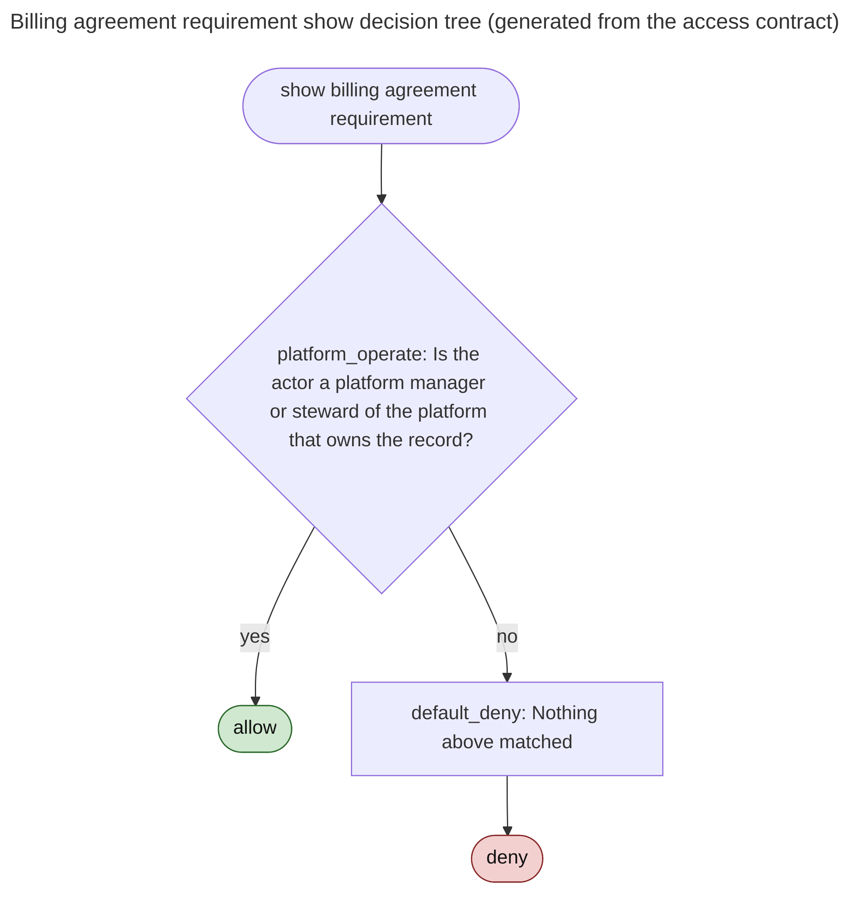

[Open the SVG](../../diagrams/exports/svg/access_contract_billing_agreement_requirement_decision_tree.svg) · [Mermaid source](../../diagrams/source/access_contract_billing_agreement_requirement_decision_tree.mmd)

### Rules in order

| # | Rule | Question | Decides | Note |
| --- | --- | --- | --- | --- |
| 1 | `platform_operate` | Is the actor a platform manager or steward of the platform that owns the record? | allow |  |
| 2 | `default_deny` | Nothing above matched | deny |  |

### index

| Persona | any |
| --- | --- |
| `anonymous` | deny default_deny |
| `signed_in_non_member` | deny default_deny |
| `community_member` | deny default_deny |
| `community_contributor` | deny default_deny |
| `community_organizer` | deny default_deny |
| `platform_manager` | allow platform_operate |
| `platform_steward` | allow platform_operate |
| `safety_reviewer` (pending) | pending |
| `remote_operator` (pending) | pending |
| `support_grantee` (pending) | pending |
| `record_owner` | n/a |
| `blocked_user` | n/a |

Reasons

- allow via `platform_operate`: Managers and stewards operate the agreement requirement of their own platform. (platform_manager, platform_steward)
- deny via `default_deny`: Needs platform billing authority, an account or ownership this person does not hold. (anonymous, community_contributor, community_member, community_organizer, signed_in_non_member)

### create

| Persona | new |
| --- | --- |
| `anonymous` | deny default_deny |
| `signed_in_non_member` | deny default_deny |
| `community_member` | deny default_deny |
| `community_contributor` | deny default_deny |
| `community_organizer` | deny default_deny |
| `platform_manager` | allow platform_operate |
| `platform_steward` | allow platform_operate |
| `safety_reviewer` (pending) | pending |
| `remote_operator` (pending) | pending |
| `support_grantee` (pending) | pending |
| `record_owner` | n/a |
| `blocked_user` | n/a |

Reasons

- allow via `platform_operate`: Managers and stewards operate the agreement requirement of their own platform. (platform_manager, platform_steward)
- deny via `default_deny`: Needs platform billing authority, an account or ownership this person does not hold. (anonymous, community_contributor, community_member, community_organizer, signed_in_non_member)

### destroy

| Persona | own_platform | other_platform |
| --- | --- | --- |
| `anonymous` | deny default_deny | deny default_deny |
| `signed_in_non_member` | deny default_deny | deny default_deny |
| `community_member` | deny default_deny | deny default_deny |
| `community_contributor` | deny default_deny | deny default_deny |
| `community_organizer` | deny default_deny | deny default_deny |
| `platform_manager` | allow platform_operate | deny default_deny |
| `platform_steward` | allow platform_operate | deny default_deny |
| `safety_reviewer` (pending) | pending | pending |
| `remote_operator` (pending) | pending | pending |
| `support_grantee` (pending) | pending | pending |
| `record_owner` | n/a | n/a |
| `blocked_user` | n/a | n/a |

Reasons

- allow via `platform_operate`: Managers and stewards operate the agreement requirement of their own platform. (platform_manager, platform_steward)
- deny via `default_deny`: Needs platform billing authority, an account or ownership this person does not hold. (anonymous, community_contributor, community_member, community_organizer, signed_in_non_member)
- deny via `default_deny`: Records of another platform are out of reach; tenant isolation. (anonymous, community_contributor, community_member, community_organizer, platform_manager, platform_steward, signed_in_non_member)

### show

| Persona | own_platform | other_platform |
| --- | --- | --- |
| `anonymous` | deny default_deny | deny default_deny |
| `signed_in_non_member` | deny default_deny | deny default_deny |
| `community_member` | deny default_deny | deny default_deny |
| `community_contributor` | deny default_deny | deny default_deny |
| `community_organizer` | deny default_deny | deny default_deny |
| `platform_manager` | deny default_deny | deny default_deny |
| `platform_steward` | deny default_deny | deny default_deny |
| `safety_reviewer` (pending) | pending | pending |
| `remote_operator` (pending) | pending | pending |
| `support_grantee` (pending) | pending | pending |
| `record_owner` | n/a | n/a |
| `blocked_user` | n/a | n/a |

Reasons

- deny via `default_deny`: Needs platform billing authority, an account or ownership this person does not hold. (anonymous, community_contributor, community_member, community_organizer, platform_manager, platform_steward, signed_in_non_member)

### update

| Persona | own_platform | other_platform |
| --- | --- | --- |
| `anonymous` | deny default_deny | deny default_deny |
| `signed_in_non_member` | deny default_deny | deny default_deny |
| `community_member` | deny default_deny | deny default_deny |
| `community_contributor` | deny default_deny | deny default_deny |
| `community_organizer` | deny default_deny | deny default_deny |
| `platform_manager` | allow platform_operate | deny default_deny |
| `platform_steward` | allow platform_operate | deny default_deny |
| `safety_reviewer` (pending) | pending | pending |
| `remote_operator` (pending) | pending | pending |
| `support_grantee` (pending) | pending | pending |
| `record_owner` | n/a | n/a |
| `blocked_user` | n/a | n/a |

Reasons

- allow via `platform_operate`: Managers and stewards operate the agreement requirement of their own platform. (platform_manager, platform_steward)
- deny via `default_deny`: Needs platform billing authority, an account or ownership this person does not hold. (anonymous, community_contributor, community_member, community_organizer, signed_in_non_member)
- deny via `default_deny`: Records of another platform are out of reach; tenant isolation. (anonymous, community_contributor, community_member, community_organizer, platform_manager, platform_steward, signed_in_non_member)

### edit

| Persona | own_platform | other_platform |
| --- | --- | --- |
| `anonymous` | deny default_deny | deny default_deny |
| `signed_in_non_member` | deny default_deny | deny default_deny |
| `community_member` | deny default_deny | deny default_deny |
| `community_contributor` | deny default_deny | deny default_deny |
| `community_organizer` | deny default_deny | deny default_deny |
| `platform_manager` | allow platform_operate | deny default_deny |
| `platform_steward` | allow platform_operate | deny default_deny |
| `safety_reviewer` (pending) | pending | pending |
| `remote_operator` (pending) | pending | pending |
| `support_grantee` (pending) | pending | pending |
| `record_owner` | n/a | n/a |
| `blocked_user` | n/a | n/a |

Reasons

- allow via `platform_operate`: Managers and stewards operate the agreement requirement of their own platform. (platform_manager, platform_steward)
- deny via `default_deny`: Needs platform billing authority, an account or ownership this person does not hold. (anonymous, community_contributor, community_member, community_organizer, signed_in_non_member)
- deny via `default_deny`: Records of another platform are out of reach; tenant isolation. (anonymous, community_contributor, community_member, community_organizer, platform_manager, platform_steward, signed_in_non_member)

### activate_agreement

| Persona | own_platform | other_platform |
| --- | --- | --- |
| `anonymous` | deny default_deny | deny default_deny |
| `signed_in_non_member` | deny default_deny | deny default_deny |
| `community_member` | deny default_deny | deny default_deny |
| `community_contributor` | deny default_deny | deny default_deny |
| `community_organizer` | deny default_deny | deny default_deny |
| `platform_manager` | allow platform_operate | deny default_deny |
| `platform_steward` | allow platform_operate | deny default_deny |
| `safety_reviewer` (pending) | pending | pending |
| `remote_operator` (pending) | pending | pending |
| `support_grantee` (pending) | pending | pending |
| `record_owner` | n/a | n/a |
| `blocked_user` | n/a | n/a |

Reasons

- allow via `platform_operate`: Managers and stewards operate the agreement requirement of their own platform. (platform_manager, platform_steward)
- deny via `default_deny`: Needs platform billing authority, an account or ownership this person does not hold. (anonymous, community_contributor, community_member, community_organizer, signed_in_non_member)
- deny via `default_deny`: Records of another platform are out of reach; tenant isolation. (anonymous, community_contributor, community_member, community_organizer, platform_manager, platform_steward, signed_in_non_member)

### scope

| Persona | own_platform | other_platform |
| --- | --- | --- |
| `anonymous` | deny default_deny | deny default_deny |
| `signed_in_non_member` | deny default_deny | deny default_deny |
| `community_member` | deny default_deny | deny default_deny |
| `community_contributor` | deny default_deny | deny default_deny |
| `community_organizer` | deny default_deny | deny default_deny |
| `platform_manager` | allow platform_operate | deny default_deny |
| `platform_steward` | allow platform_operate | deny default_deny |
| `safety_reviewer` (pending) | pending | pending |
| `remote_operator` (pending) | pending | pending |
| `support_grantee` (pending) | pending | pending |
| `record_owner` | n/a | n/a |
| `blocked_user` | n/a | n/a |

Reasons

- allow via `platform_operate`: Managers and stewards operate the agreement requirement of their own platform. (platform_manager, platform_steward)
- deny via `default_deny`: Needs platform billing authority, an account or ownership this person does not hold. (anonymous, community_contributor, community_member, community_organizer, signed_in_non_member)
- deny via `default_deny`: Records of another platform are out of reach; tenant isolation. (anonymous, community_contributor, community_member, community_organizer, platform_manager, platform_steward, signed_in_non_member)

## Billing processor setting

`BetterTogether::Billing::ProcessorSetting` · policy `BetterTogether::Billing::ProcessorSettingPolicy` · classification `system`

### Decision tree

Decision tree for show. Dashed red nodes are rules the app applies that the privacy rule does not intend.

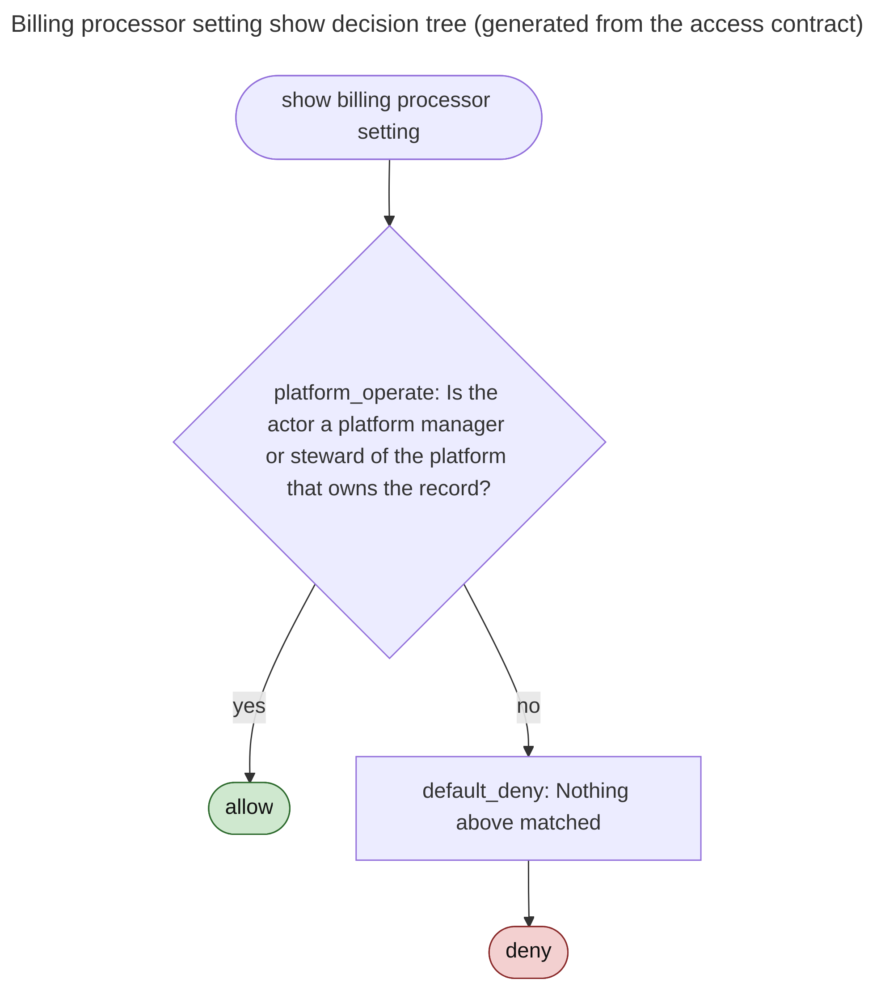

[Open the SVG](../../diagrams/exports/svg/access_contract_billing_processor_setting_decision_tree.svg) · [Mermaid source](../../diagrams/source/access_contract_billing_processor_setting_decision_tree.mmd)

### Rules in order

| # | Rule | Question | Decides | Note |
| --- | --- | --- | --- | --- |
| 1 | `platform_operate` | Is the actor a platform manager or steward of the platform that owns the record? | allow |  |
| 2 | `default_deny` | Nothing above matched | deny |  |

### index

| Persona | any |
| --- | --- |
| `anonymous` | deny default_deny |
| `signed_in_non_member` | deny default_deny |
| `community_member` | deny default_deny |
| `community_contributor` | deny default_deny |
| `community_organizer` | deny default_deny |
| `platform_manager` | allow platform_operate |
| `platform_steward` | allow platform_operate |
| `safety_reviewer` (pending) | pending |
| `remote_operator` (pending) | pending |
| `support_grantee` (pending) | pending |
| `record_owner` | n/a |
| `blocked_user` | n/a |

Reasons

- allow via `platform_operate`: Managers and stewards operate the processor setting of their own platform. (platform_manager, platform_steward)
- deny via `default_deny`: Needs platform billing authority, an account or ownership this person does not hold. (anonymous, community_contributor, community_member, community_organizer, signed_in_non_member)

### edit

| Persona | own_platform | other_platform |
| --- | --- | --- |
| `anonymous` | deny default_deny | deny default_deny |
| `signed_in_non_member` | deny default_deny | deny default_deny |
| `community_member` | deny default_deny | deny default_deny |
| `community_contributor` | deny default_deny | deny default_deny |
| `community_organizer` | deny default_deny | deny default_deny |
| `platform_manager` | allow platform_operate | deny default_deny |
| `platform_steward` | allow platform_operate | deny default_deny |
| `safety_reviewer` (pending) | pending | pending |
| `remote_operator` (pending) | pending | pending |
| `support_grantee` (pending) | pending | pending |
| `record_owner` | n/a | n/a |
| `blocked_user` | n/a | n/a |

Reasons

- allow via `platform_operate`: Managers and stewards operate the processor setting of their own platform. (platform_manager, platform_steward)
- deny via `default_deny`: Needs platform billing authority, an account or ownership this person does not hold. (anonymous, community_contributor, community_member, community_organizer, signed_in_non_member)
- deny via `default_deny`: Records of another platform are out of reach; tenant isolation. (anonymous, community_contributor, community_member, community_organizer, platform_manager, platform_steward, signed_in_non_member)

### update

| Persona | own_platform | other_platform |
| --- | --- | --- |
| `anonymous` | deny default_deny | deny default_deny |
| `signed_in_non_member` | deny default_deny | deny default_deny |
| `community_member` | deny default_deny | deny default_deny |
| `community_contributor` | deny default_deny | deny default_deny |
| `community_organizer` | deny default_deny | deny default_deny |
| `platform_manager` | allow platform_operate | deny default_deny |
| `platform_steward` | allow platform_operate | deny default_deny |
| `safety_reviewer` (pending) | pending | pending |
| `remote_operator` (pending) | pending | pending |
| `support_grantee` (pending) | pending | pending |
| `record_owner` | n/a | n/a |
| `blocked_user` | n/a | n/a |

Reasons

- allow via `platform_operate`: Managers and stewards operate the processor setting of their own platform. (platform_manager, platform_steward)
- deny via `default_deny`: Needs platform billing authority, an account or ownership this person does not hold. (anonymous, community_contributor, community_member, community_organizer, signed_in_non_member)
- deny via `default_deny`: Records of another platform are out of reach; tenant isolation. (anonymous, community_contributor, community_member, community_organizer, platform_manager, platform_steward, signed_in_non_member)

### show

| Persona | own_platform | other_platform |
| --- | --- | --- |
| `anonymous` | deny default_deny | deny default_deny |
| `signed_in_non_member` | deny default_deny | deny default_deny |
| `community_member` | deny default_deny | deny default_deny |
| `community_contributor` | deny default_deny | deny default_deny |
| `community_organizer` | deny default_deny | deny default_deny |
| `platform_manager` | allow platform_operate | deny default_deny |
| `platform_steward` | allow platform_operate | deny default_deny |
| `safety_reviewer` (pending) | pending | pending |
| `remote_operator` (pending) | pending | pending |
| `support_grantee` (pending) | pending | pending |
| `record_owner` | n/a | n/a |
| `blocked_user` | n/a | n/a |

Reasons

- allow via `platform_operate`: Managers and stewards operate the processor setting of their own platform. (platform_manager, platform_steward)
- deny via `default_deny`: Needs platform billing authority, an account or ownership this person does not hold. (anonymous, community_contributor, community_member, community_organizer, signed_in_non_member)
- deny via `default_deny`: Records of another platform are out of reach; tenant isolation. (anonymous, community_contributor, community_member, community_organizer, platform_manager, platform_steward, signed_in_non_member)

### destroy

| Persona | own_platform | other_platform |
| --- | --- | --- |
| `anonymous` | deny default_deny | deny default_deny |
| `signed_in_non_member` | deny default_deny | deny default_deny |
| `community_member` | deny default_deny | deny default_deny |
| `community_contributor` | deny default_deny | deny default_deny |
| `community_organizer` | deny default_deny | deny default_deny |
| `platform_manager` | deny default_deny | deny default_deny |
| `platform_steward` | deny default_deny | deny default_deny |
| `safety_reviewer` (pending) | pending | pending |
| `remote_operator` (pending) | pending | pending |
| `support_grantee` (pending) | pending | pending |
| `record_owner` | n/a | n/a |
| `blocked_user` | n/a | n/a |

Reasons

- deny via `default_deny`: Needs platform billing authority, an account or ownership this person does not hold. (anonymous, community_contributor, community_member, community_organizer, platform_manager, platform_steward, signed_in_non_member)

### scope

| Persona | own_platform | other_platform |
| --- | --- | --- |
| `anonymous` | deny default_deny | deny default_deny |
| `signed_in_non_member` | deny default_deny | deny default_deny |
| `community_member` | deny default_deny | deny default_deny |
| `community_contributor` | deny default_deny | deny default_deny |
| `community_organizer` | deny default_deny | deny default_deny |
| `platform_manager` | allow platform_operate | deny default_deny |
| `platform_steward` | allow platform_operate | deny default_deny |
| `safety_reviewer` (pending) | pending | pending |
| `remote_operator` (pending) | pending | pending |
| `support_grantee` (pending) | pending | pending |
| `record_owner` | n/a | n/a |
| `blocked_user` | n/a | n/a |

Reasons

- allow via `platform_operate`: Managers and stewards operate the processor setting of their own platform. (platform_manager, platform_steward)
- deny via `default_deny`: Needs platform billing authority, an account or ownership this person does not hold. (anonymous, community_contributor, community_member, community_organizer, signed_in_non_member)
- deny via `default_deny`: Records of another platform are out of reach; tenant isolation. (anonymous, community_contributor, community_member, community_organizer, platform_manager, platform_steward, signed_in_non_member)

## Billing tax registration

`BetterTogether::Billing::TaxRegistration` · policy `BetterTogether::Billing::TaxRegistrationPolicy` · classification `system`

### Decision tree

Decision tree for show. Dashed red nodes are rules the app applies that the privacy rule does not intend.

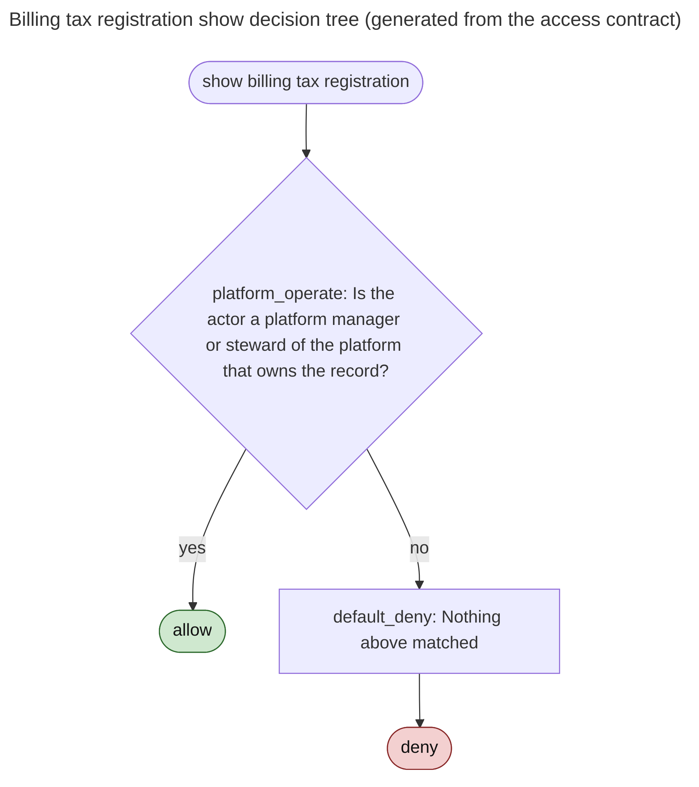

[Open the SVG](../../diagrams/exports/svg/access_contract_billing_tax_registration_decision_tree.svg) · [Mermaid source](../../diagrams/source/access_contract_billing_tax_registration_decision_tree.mmd)

### Rules in order

| # | Rule | Question | Decides | Note |
| --- | --- | --- | --- | --- |
| 1 | `platform_operate` | Is the actor a platform manager or steward of the platform that owns the record? | allow |  |
| 2 | `default_deny` | Nothing above matched | deny |  |

### index

| Persona | any |
| --- | --- |
| `anonymous` | deny default_deny |
| `signed_in_non_member` | deny default_deny |
| `community_member` | deny default_deny |
| `community_contributor` | deny default_deny |
| `community_organizer` | deny default_deny |
| `platform_manager` | allow platform_operate |
| `platform_steward` | allow platform_operate |
| `safety_reviewer` (pending) | pending |
| `remote_operator` (pending) | pending |
| `support_grantee` (pending) | pending |
| `record_owner` | n/a |
| `blocked_user` | n/a |

Reasons

- allow via `platform_operate`: Managers and stewards operate the tax registration of their own platform. (platform_manager, platform_steward)
- deny via `default_deny`: Needs platform billing authority, an account or ownership this person does not hold. (anonymous, community_contributor, community_member, community_organizer, signed_in_non_member)

### new

| Persona | new |
| --- | --- |
| `anonymous` | deny default_deny |
| `signed_in_non_member` | deny default_deny |
| `community_member` | deny default_deny |
| `community_contributor` | deny default_deny |
| `community_organizer` | deny default_deny |
| `platform_manager` | allow platform_operate |
| `platform_steward` | allow platform_operate |
| `safety_reviewer` (pending) | pending |
| `remote_operator` (pending) | pending |
| `support_grantee` (pending) | pending |
| `record_owner` | n/a |
| `blocked_user` | n/a |

Reasons

- allow via `platform_operate`: Managers and stewards operate the tax registration of their own platform. (platform_manager, platform_steward)
- deny via `default_deny`: Needs platform billing authority, an account or ownership this person does not hold. (anonymous, community_contributor, community_member, community_organizer, signed_in_non_member)

### create

| Persona | new |
| --- | --- |
| `anonymous` | deny default_deny |
| `signed_in_non_member` | deny default_deny |
| `community_member` | deny default_deny |
| `community_contributor` | deny default_deny |
| `community_organizer` | deny default_deny |
| `platform_manager` | allow platform_operate |
| `platform_steward` | allow platform_operate |
| `safety_reviewer` (pending) | pending |
| `remote_operator` (pending) | pending |
| `support_grantee` (pending) | pending |
| `record_owner` | n/a |
| `blocked_user` | n/a |

Reasons

- allow via `platform_operate`: Managers and stewards operate the tax registration of their own platform. (platform_manager, platform_steward)
- deny via `default_deny`: Needs platform billing authority, an account or ownership this person does not hold. (anonymous, community_contributor, community_member, community_organizer, signed_in_non_member)

### edit

| Persona | own_platform | other_platform |
| --- | --- | --- |
| `anonymous` | deny default_deny | deny default_deny |
| `signed_in_non_member` | deny default_deny | deny default_deny |
| `community_member` | deny default_deny | deny default_deny |
| `community_contributor` | deny default_deny | deny default_deny |
| `community_organizer` | deny default_deny | deny default_deny |
| `platform_manager` | allow platform_operate | deny default_deny |
| `platform_steward` | allow platform_operate | deny default_deny |
| `safety_reviewer` (pending) | pending | pending |
| `remote_operator` (pending) | pending | pending |
| `support_grantee` (pending) | pending | pending |
| `record_owner` | n/a | n/a |
| `blocked_user` | n/a | n/a |

Reasons

- allow via `platform_operate`: Managers and stewards operate the tax registration of their own platform. (platform_manager, platform_steward)
- deny via `default_deny`: Needs platform billing authority, an account or ownership this person does not hold. (anonymous, community_contributor, community_member, community_organizer, signed_in_non_member)
- deny via `default_deny`: Records of another platform are out of reach; tenant isolation. (anonymous, community_contributor, community_member, community_organizer, platform_manager, platform_steward, signed_in_non_member)

### update

| Persona | own_platform | other_platform |
| --- | --- | --- |
| `anonymous` | deny default_deny | deny default_deny |
| `signed_in_non_member` | deny default_deny | deny default_deny |
| `community_member` | deny default_deny | deny default_deny |
| `community_contributor` | deny default_deny | deny default_deny |
| `community_organizer` | deny default_deny | deny default_deny |
| `platform_manager` | allow platform_operate | deny default_deny |
| `platform_steward` | allow platform_operate | deny default_deny |
| `safety_reviewer` (pending) | pending | pending |
| `remote_operator` (pending) | pending | pending |
| `support_grantee` (pending) | pending | pending |
| `record_owner` | n/a | n/a |
| `blocked_user` | n/a | n/a |

Reasons

- allow via `platform_operate`: Managers and stewards operate the tax registration of their own platform. (platform_manager, platform_steward)
- deny via `default_deny`: Needs platform billing authority, an account or ownership this person does not hold. (anonymous, community_contributor, community_member, community_organizer, signed_in_non_member)
- deny via `default_deny`: Records of another platform are out of reach; tenant isolation. (anonymous, community_contributor, community_member, community_organizer, platform_manager, platform_steward, signed_in_non_member)

### show

| Persona | own_platform | other_platform |
| --- | --- | --- |
| `anonymous` | deny default_deny | deny default_deny |
| `signed_in_non_member` | deny default_deny | deny default_deny |
| `community_member` | deny default_deny | deny default_deny |
| `community_contributor` | deny default_deny | deny default_deny |
| `community_organizer` | deny default_deny | deny default_deny |
| `platform_manager` | deny default_deny | deny default_deny |
| `platform_steward` | deny default_deny | deny default_deny |
| `safety_reviewer` (pending) | pending | pending |
| `remote_operator` (pending) | pending | pending |
| `support_grantee` (pending) | pending | pending |
| `record_owner` | n/a | n/a |
| `blocked_user` | n/a | n/a |

Reasons

- deny via `default_deny`: Needs platform billing authority, an account or ownership this person does not hold. (anonymous, community_contributor, community_member, community_organizer, platform_manager, platform_steward, signed_in_non_member)

### destroy

| Persona | own_platform | other_platform |
| --- | --- | --- |
| `anonymous` | deny default_deny | deny default_deny |
| `signed_in_non_member` | deny default_deny | deny default_deny |
| `community_member` | deny default_deny | deny default_deny |
| `community_contributor` | deny default_deny | deny default_deny |
| `community_organizer` | deny default_deny | deny default_deny |
| `platform_manager` | deny default_deny | deny default_deny |
| `platform_steward` | deny default_deny | deny default_deny |
| `safety_reviewer` (pending) | pending | pending |
| `remote_operator` (pending) | pending | pending |
| `support_grantee` (pending) | pending | pending |
| `record_owner` | n/a | n/a |
| `blocked_user` | n/a | n/a |

Reasons

- deny via `default_deny`: Needs platform billing authority, an account or ownership this person does not hold. (anonymous, community_contributor, community_member, community_organizer, platform_manager, platform_steward, signed_in_non_member)

### scope

| Persona | own_platform | other_platform |
| --- | --- | --- |
| `anonymous` | deny default_deny | deny default_deny |
| `signed_in_non_member` | deny default_deny | deny default_deny |
| `community_member` | deny default_deny | deny default_deny |
| `community_contributor` | deny default_deny | deny default_deny |
| `community_organizer` | deny default_deny | deny default_deny |
| `platform_manager` | allow platform_operate | deny default_deny |
| `platform_steward` | allow platform_operate | deny default_deny |
| `safety_reviewer` (pending) | pending | pending |
| `remote_operator` (pending) | pending | pending |
| `support_grantee` (pending) | pending | pending |
| `record_owner` | n/a | n/a |
| `blocked_user` | n/a | n/a |

Reasons

- allow via `platform_operate`: Managers and stewards operate the tax registration of their own platform. (platform_manager, platform_steward)
- deny via `default_deny`: Needs platform billing authority, an account or ownership this person does not hold. (anonymous, community_contributor, community_member, community_organizer, signed_in_non_member)
- deny via `default_deny`: Records of another platform are out of reach; tenant isolation. (anonymous, community_contributor, community_member, community_organizer, platform_manager, platform_steward, signed_in_non_member)

## Billing promotion

`BetterTogether::Billing::Promotion` · policy `BetterTogether::Billing::PromotionPolicy` · classification `system`

### Decision tree

Decision tree for show. Dashed red nodes are rules the app applies that the privacy rule does not intend.

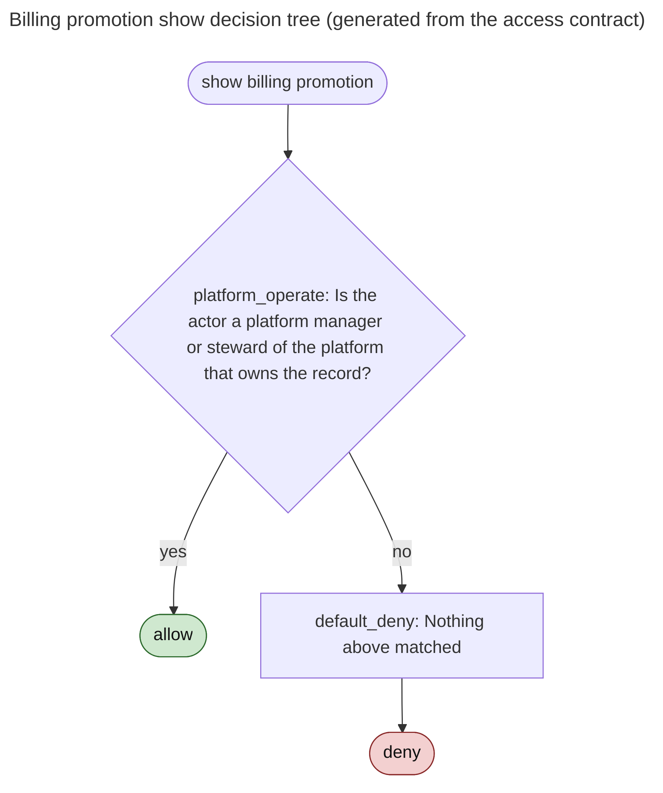

[Open the SVG](../../diagrams/exports/svg/access_contract_billing_promotion_decision_tree.svg) · [Mermaid source](../../diagrams/source/access_contract_billing_promotion_decision_tree.mmd)

### Rules in order

| # | Rule | Question | Decides | Note |
| --- | --- | --- | --- | --- |
| 1 | `platform_operate` | Is the actor a platform manager or steward of the platform that owns the record? | allow |  |
| 2 | `default_deny` | Nothing above matched | deny |  |

### index

| Persona | any |
| --- | --- |
| `anonymous` | deny default_deny |
| `signed_in_non_member` | deny default_deny |
| `community_member` | deny default_deny |
| `community_contributor` | deny default_deny |
| `community_organizer` | deny default_deny |
| `platform_manager` | allow platform_operate |
| `platform_steward` | allow platform_operate |
| `safety_reviewer` (pending) | pending |
| `remote_operator` (pending) | pending |
| `support_grantee` (pending) | pending |
| `record_owner` | n/a |
| `blocked_user` | n/a |

Reasons

- allow via `platform_operate`: Managers and stewards operate the promotion of their own platform. (platform_manager, platform_steward)
- deny via `default_deny`: Needs platform billing authority, an account or ownership this person does not hold. (anonymous, community_contributor, community_member, community_organizer, signed_in_non_member)

### new

| Persona | new |
| --- | --- |
| `anonymous` | deny default_deny |
| `signed_in_non_member` | deny default_deny |
| `community_member` | deny default_deny |
| `community_contributor` | deny default_deny |
| `community_organizer` | deny default_deny |
| `platform_manager` | allow platform_operate |
| `platform_steward` | allow platform_operate |
| `safety_reviewer` (pending) | pending |
| `remote_operator` (pending) | pending |
| `support_grantee` (pending) | pending |
| `record_owner` | n/a |
| `blocked_user` | n/a |

Reasons

- allow via `platform_operate`: Managers and stewards operate the promotion of their own platform. (platform_manager, platform_steward)
- deny via `default_deny`: Needs platform billing authority, an account or ownership this person does not hold. (anonymous, community_contributor, community_member, community_organizer, signed_in_non_member)

### create

| Persona | new |
| --- | --- |
| `anonymous` | deny default_deny |
| `signed_in_non_member` | deny default_deny |
| `community_member` | deny default_deny |
| `community_contributor` | deny default_deny |
| `community_organizer` | deny default_deny |
| `platform_manager` | allow platform_operate |
| `platform_steward` | allow platform_operate |
| `safety_reviewer` (pending) | pending |
| `remote_operator` (pending) | pending |
| `support_grantee` (pending) | pending |
| `record_owner` | n/a |
| `blocked_user` | n/a |

Reasons

- allow via `platform_operate`: Managers and stewards operate the promotion of their own platform. (platform_manager, platform_steward)
- deny via `default_deny`: Needs platform billing authority, an account or ownership this person does not hold. (anonymous, community_contributor, community_member, community_organizer, signed_in_non_member)

### activate

| Persona | own_platform | other_platform |
| --- | --- | --- |
| `anonymous` | deny default_deny | deny default_deny |
| `signed_in_non_member` | deny default_deny | deny default_deny |
| `community_member` | deny default_deny | deny default_deny |
| `community_contributor` | deny default_deny | deny default_deny |
| `community_organizer` | deny default_deny | deny default_deny |
| `platform_manager` | allow platform_operate | deny default_deny |
| `platform_steward` | allow platform_operate | deny default_deny |
| `safety_reviewer` (pending) | pending | pending |
| `remote_operator` (pending) | pending | pending |
| `support_grantee` (pending) | pending | pending |
| `record_owner` | n/a | n/a |
| `blocked_user` | n/a | n/a |

Reasons

- allow via `platform_operate`: Managers and stewards operate the promotion of their own platform. (platform_manager, platform_steward)
- deny via `default_deny`: Needs platform billing authority, an account or ownership this person does not hold. (anonymous, community_contributor, community_member, community_organizer, signed_in_non_member)
- deny via `default_deny`: Records of another platform are out of reach; tenant isolation. (anonymous, community_contributor, community_member, community_organizer, platform_manager, platform_steward, signed_in_non_member)

### deactivate

| Persona | own_platform | other_platform |
| --- | --- | --- |
| `anonymous` | deny default_deny | deny default_deny |
| `signed_in_non_member` | deny default_deny | deny default_deny |
| `community_member` | deny default_deny | deny default_deny |
| `community_contributor` | deny default_deny | deny default_deny |
| `community_organizer` | deny default_deny | deny default_deny |
| `platform_manager` | allow platform_operate | deny default_deny |
| `platform_steward` | allow platform_operate | deny default_deny |
| `safety_reviewer` (pending) | pending | pending |
| `remote_operator` (pending) | pending | pending |
| `support_grantee` (pending) | pending | pending |
| `record_owner` | n/a | n/a |
| `blocked_user` | n/a | n/a |

Reasons

- allow via `platform_operate`: Managers and stewards operate the promotion of their own platform. (platform_manager, platform_steward)
- deny via `default_deny`: Needs platform billing authority, an account or ownership this person does not hold. (anonymous, community_contributor, community_member, community_organizer, signed_in_non_member)
- deny via `default_deny`: Records of another platform are out of reach; tenant isolation. (anonymous, community_contributor, community_member, community_organizer, platform_manager, platform_steward, signed_in_non_member)

### show

| Persona | own_platform | other_platform |
| --- | --- | --- |
| `anonymous` | deny default_deny | deny default_deny |
| `signed_in_non_member` | deny default_deny | deny default_deny |
| `community_member` | deny default_deny | deny default_deny |
| `community_contributor` | deny default_deny | deny default_deny |
| `community_organizer` | deny default_deny | deny default_deny |
| `platform_manager` | deny default_deny | deny default_deny |
| `platform_steward` | deny default_deny | deny default_deny |
| `safety_reviewer` (pending) | pending | pending |
| `remote_operator` (pending) | pending | pending |
| `support_grantee` (pending) | pending | pending |
| `record_owner` | n/a | n/a |
| `blocked_user` | n/a | n/a |

Reasons

- deny via `default_deny`: Needs platform billing authority, an account or ownership this person does not hold. (anonymous, community_contributor, community_member, community_organizer, platform_manager, platform_steward, signed_in_non_member)

### update

| Persona | own_platform | other_platform |
| --- | --- | --- |
| `anonymous` | deny default_deny | deny default_deny |
| `signed_in_non_member` | deny default_deny | deny default_deny |
| `community_member` | deny default_deny | deny default_deny |
| `community_contributor` | deny default_deny | deny default_deny |
| `community_organizer` | deny default_deny | deny default_deny |
| `platform_manager` | deny default_deny | deny default_deny |
| `platform_steward` | deny default_deny | deny default_deny |
| `safety_reviewer` (pending) | pending | pending |
| `remote_operator` (pending) | pending | pending |
| `support_grantee` (pending) | pending | pending |
| `record_owner` | n/a | n/a |
| `blocked_user` | n/a | n/a |

Reasons

- deny via `default_deny`: Needs platform billing authority, an account or ownership this person does not hold. (anonymous, community_contributor, community_member, community_organizer, platform_manager, platform_steward, signed_in_non_member)

### destroy

| Persona | own_platform | other_platform |
| --- | --- | --- |
| `anonymous` | deny default_deny | deny default_deny |
| `signed_in_non_member` | deny default_deny | deny default_deny |
| `community_member` | deny default_deny | deny default_deny |
| `community_contributor` | deny default_deny | deny default_deny |
| `community_organizer` | deny default_deny | deny default_deny |
| `platform_manager` | deny default_deny | deny default_deny |
| `platform_steward` | deny default_deny | deny default_deny |
| `safety_reviewer` (pending) | pending | pending |
| `remote_operator` (pending) | pending | pending |
| `support_grantee` (pending) | pending | pending |
| `record_owner` | n/a | n/a |
| `blocked_user` | n/a | n/a |

Reasons

- deny via `default_deny`: Needs platform billing authority, an account or ownership this person does not hold. (anonymous, community_contributor, community_member, community_organizer, platform_manager, platform_steward, signed_in_non_member)

## Billing grant

`BetterTogether::Billing::Grant` · policy `BetterTogether::Billing::GrantPolicy` · classification `system`

### Decision tree

Decision tree for show. Dashed red nodes are rules the app applies that the privacy rule does not intend.

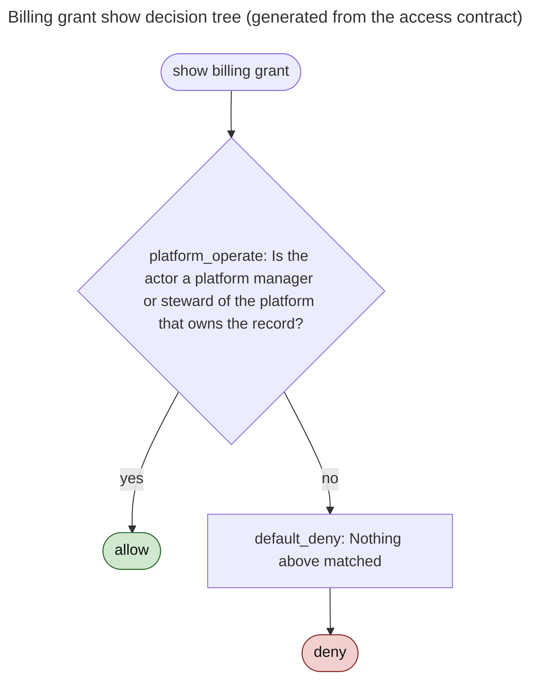

[Open the SVG](../../diagrams/exports/svg/access_contract_billing_grant_decision_tree.svg) · [Mermaid source](../../diagrams/source/access_contract_billing_grant_decision_tree.mmd)

### Rules in order

| # | Rule | Question | Decides | Note |
| --- | --- | --- | --- | --- |
| 1 | `platform_operate` | Is the actor a platform manager or steward of the platform that owns the record? | allow |  |
| 2 | `default_deny` | Nothing above matched | deny |  |

### create

| Persona | new |
| --- | --- |
| `anonymous` | deny default_deny |
| `signed_in_non_member` | deny default_deny |
| `community_member` | deny default_deny |
| `community_contributor` | deny default_deny |
| `community_organizer` | deny default_deny |
| `platform_manager` | allow platform_operate |
| `platform_steward` | allow platform_operate |
| `safety_reviewer` (pending) | pending |
| `remote_operator` (pending) | pending |
| `support_grantee` (pending) | pending |
| `record_owner` | n/a |
| `blocked_user` | n/a |

Reasons

- allow via `platform_operate`: Managers and stewards operate the grant of their own platform. (platform_manager, platform_steward)
- deny via `default_deny`: Needs platform billing authority, an account or ownership this person does not hold. (anonymous, community_contributor, community_member, community_organizer, signed_in_non_member)

### destroy

| Persona | own_platform | other_platform |
| --- | --- | --- |
| `anonymous` | deny default_deny | deny default_deny |
| `signed_in_non_member` | deny default_deny | deny default_deny |
| `community_member` | deny default_deny | deny default_deny |
| `community_contributor` | deny default_deny | deny default_deny |
| `community_organizer` | deny default_deny | deny default_deny |
| `platform_manager` | allow platform_operate | deny default_deny |
| `platform_steward` | allow platform_operate | deny default_deny |
| `safety_reviewer` (pending) | pending | pending |
| `remote_operator` (pending) | pending | pending |
| `support_grantee` (pending) | pending | pending |
| `record_owner` | n/a | n/a |
| `blocked_user` | n/a | n/a |

Reasons

- allow via `platform_operate`: Managers and stewards operate the grant of their own platform. (platform_manager, platform_steward)
- deny via `default_deny`: Needs platform billing authority, an account or ownership this person does not hold. (anonymous, community_contributor, community_member, community_organizer, signed_in_non_member)
- deny via `default_deny`: Records of another platform are out of reach; tenant isolation. (anonymous, community_contributor, community_member, community_organizer, platform_manager, platform_steward, signed_in_non_member)

### index

| Persona | any |
| --- | --- |
| `anonymous` | deny default_deny |
| `signed_in_non_member` | deny default_deny |
| `community_member` | deny default_deny |
| `community_contributor` | deny default_deny |
| `community_organizer` | deny default_deny |
| `platform_manager` | deny default_deny |
| `platform_steward` | deny default_deny |
| `safety_reviewer` (pending) | pending |
| `remote_operator` (pending) | pending |
| `support_grantee` (pending) | pending |
| `record_owner` | n/a |
| `blocked_user` | n/a |

Reasons

- deny via `default_deny`: Needs platform billing authority, an account or ownership this person does not hold. (anonymous, community_contributor, community_member, community_organizer, platform_manager, platform_steward, signed_in_non_member)

### show

| Persona | own_platform | other_platform |
| --- | --- | --- |
| `anonymous` | deny default_deny | deny default_deny |
| `signed_in_non_member` | deny default_deny | deny default_deny |
| `community_member` | deny default_deny | deny default_deny |
| `community_contributor` | deny default_deny | deny default_deny |
| `community_organizer` | deny default_deny | deny default_deny |
| `platform_manager` | deny default_deny | deny default_deny |
| `platform_steward` | deny default_deny | deny default_deny |
| `safety_reviewer` (pending) | pending | pending |
| `remote_operator` (pending) | pending | pending |
| `support_grantee` (pending) | pending | pending |
| `record_owner` | n/a | n/a |
| `blocked_user` | n/a | n/a |

Reasons

- deny via `default_deny`: Needs platform billing authority, an account or ownership this person does not hold. (anonymous, community_contributor, community_member, community_organizer, platform_manager, platform_steward, signed_in_non_member)

### update

| Persona | own_platform | other_platform |
| --- | --- | --- |
| `anonymous` | deny default_deny | deny default_deny |
| `signed_in_non_member` | deny default_deny | deny default_deny |
| `community_member` | deny default_deny | deny default_deny |
| `community_contributor` | deny default_deny | deny default_deny |
| `community_organizer` | deny default_deny | deny default_deny |
| `platform_manager` | allow platform_operate | deny default_deny |
| `platform_steward` | allow platform_operate | deny default_deny |
| `safety_reviewer` (pending) | pending | pending |
| `remote_operator` (pending) | pending | pending |
| `support_grantee` (pending) | pending | pending |
| `record_owner` | n/a | n/a |
| `blocked_user` | n/a | n/a |

Reasons

- allow via `platform_operate`: Managers and stewards operate the grant of their own platform. (platform_manager, platform_steward)
- deny via `default_deny`: Needs platform billing authority, an account or ownership this person does not hold. (anonymous, community_contributor, community_member, community_organizer, signed_in_non_member)
- deny via `default_deny`: Records of another platform are out of reach; tenant isolation. (anonymous, community_contributor, community_member, community_organizer, platform_manager, platform_steward, signed_in_non_member)

## Billing offline payment

`BetterTogether::Billing::OfflinePayment` · policy `BetterTogether::Billing::OfflinePaymentPolicy` · classification `financial`

### Decision tree

Decision tree for show. Dashed red nodes are rules the app applies that the privacy rule does not intend.

[Open the SVG](../../diagrams/exports/svg/access_contract_billing_offline_payment_decision_tree.svg) · [Mermaid source](../../diagrams/source/access_contract_billing_offline_payment_decision_tree.mmd)

### Rules in order

| # | Rule | Question | Decides | Note |
| --- | --- | --- | --- | --- |
| 1 | `platform_operate` | Is the actor a platform manager or steward of the platform that owns the record? | allow |  |
| 2 | `default_deny` | Nothing above matched | deny |  |

### index

| Persona | any |
| --- | --- |
| `anonymous` | deny default_deny |
| `signed_in_non_member` | deny default_deny |
| `community_member` | deny default_deny |
| `community_contributor` | deny default_deny |
| `community_organizer` | deny default_deny |
| `platform_manager` | allow platform_operate |
| `platform_steward` | allow platform_operate |
| `safety_reviewer` (pending) | pending |
| `remote_operator` (pending) | pending |
| `support_grantee` (pending) | pending |
| `record_owner` | n/a |
| `blocked_user` | n/a |

Reasons

- allow via `platform_operate`: Managers and stewards operate the offline payment of their own platform. (platform_manager, platform_steward)
- deny via `default_deny`: Needs platform billing authority, an account or ownership this person does not hold. (anonymous, community_contributor, community_member, community_organizer, signed_in_non_member)

### receive

| Persona | own_platform | other_platform |
| --- | --- | --- |
| `anonymous` | deny default_deny | deny default_deny |
| `signed_in_non_member` | deny default_deny | deny default_deny |
| `community_member` | deny default_deny | deny default_deny |
| `community_contributor` | deny default_deny | deny default_deny |
| `community_organizer` | deny default_deny | deny default_deny |
| `platform_manager` | allow platform_operate | deny default_deny |
| `platform_steward` | allow platform_operate | deny default_deny |
| `safety_reviewer` (pending) | pending | pending |
| `remote_operator` (pending) | pending | pending |
| `support_grantee` (pending) | pending | pending |
| `record_owner` | n/a | n/a |
| `blocked_user` | n/a | n/a |

Reasons

- allow via `platform_operate`: Managers and stewards operate the offline payment of their own platform. (platform_manager, platform_steward)
- deny via `default_deny`: Needs platform billing authority, an account or ownership this person does not hold. (anonymous, community_contributor, community_member, community_organizer, signed_in_non_member)
- deny via `default_deny`: Records of another platform are out of reach; tenant isolation. (anonymous, community_contributor, community_member, community_organizer, platform_manager, platform_steward, signed_in_non_member)

### reject

| Persona | own_platform | other_platform |
| --- | --- | --- |
| `anonymous` | deny default_deny | deny default_deny |
| `signed_in_non_member` | deny default_deny | deny default_deny |
| `community_member` | deny default_deny | deny default_deny |
| `community_contributor` | deny default_deny | deny default_deny |
| `community_organizer` | deny default_deny | deny default_deny |
| `platform_manager` | allow platform_operate | deny default_deny |
| `platform_steward` | allow platform_operate | deny default_deny |
| `safety_reviewer` (pending) | pending | pending |
| `remote_operator` (pending) | pending | pending |
| `support_grantee` (pending) | pending | pending |
| `record_owner` | n/a | n/a |
| `blocked_user` | n/a | n/a |

Reasons

- allow via `platform_operate`: Managers and stewards operate the offline payment of their own platform. (platform_manager, platform_steward)
- deny via `default_deny`: Needs platform billing authority, an account or ownership this person does not hold. (anonymous, community_contributor, community_member, community_organizer, signed_in_non_member)
- deny via `default_deny`: Records of another platform are out of reach; tenant isolation. (anonymous, community_contributor, community_member, community_organizer, platform_manager, platform_steward, signed_in_non_member)

### clear

| Persona | own_platform | other_platform |
| --- | --- | --- |
| `anonymous` | deny default_deny | deny default_deny |
| `signed_in_non_member` | deny default_deny | deny default_deny |
| `community_member` | deny default_deny | deny default_deny |
| `community_contributor` | deny default_deny | deny default_deny |
| `community_organizer` | deny default_deny | deny default_deny |
| `platform_manager` | allow platform_operate | deny default_deny |
| `platform_steward` | allow platform_operate | deny default_deny |
| `safety_reviewer` (pending) | pending | pending |
| `remote_operator` (pending) | pending | pending |
| `support_grantee` (pending) | pending | pending |
| `record_owner` | n/a | n/a |
| `blocked_user` | n/a | n/a |

Reasons

- allow via `platform_operate`: Managers and stewards operate the offline payment of their own platform. (platform_manager, platform_steward)
- deny via `default_deny`: Needs platform billing authority, an account or ownership this person does not hold. (anonymous, community_contributor, community_member, community_organizer, signed_in_non_member)
- deny via `default_deny`: Records of another platform are out of reach; tenant isolation. (anonymous, community_contributor, community_member, community_organizer, platform_manager, platform_steward, signed_in_non_member)

### bounce

| Persona | own_platform | other_platform |
| --- | --- | --- |
| `anonymous` | deny default_deny | deny default_deny |
| `signed_in_non_member` | deny default_deny | deny default_deny |
| `community_member` | deny default_deny | deny default_deny |
| `community_contributor` | deny default_deny | deny default_deny |
| `community_organizer` | deny default_deny | deny default_deny |
| `platform_manager` | allow platform_operate | deny default_deny |
| `platform_steward` | allow platform_operate | deny default_deny |
| `safety_reviewer` (pending) | pending | pending |
| `remote_operator` (pending) | pending | pending |
| `support_grantee` (pending) | pending | pending |
| `record_owner` | n/a | n/a |
| `blocked_user` | n/a | n/a |

Reasons

- allow via `platform_operate`: Managers and stewards operate the offline payment of their own platform. (platform_manager, platform_steward)
- deny via `default_deny`: Needs platform billing authority, an account or ownership this person does not hold. (anonymous, community_contributor, community_member, community_organizer, signed_in_non_member)
- deny via `default_deny`: Records of another platform are out of reach; tenant isolation. (anonymous, community_contributor, community_member, community_organizer, platform_manager, platform_steward, signed_in_non_member)

### show

| Persona | own_platform | other_platform |
| --- | --- | --- |
| `anonymous` | deny default_deny | deny default_deny |
| `signed_in_non_member` | deny default_deny | deny default_deny |
| `community_member` | deny default_deny | deny default_deny |
| `community_contributor` | deny default_deny | deny default_deny |
| `community_organizer` | deny default_deny | deny default_deny |
| `platform_manager` | deny default_deny | deny default_deny |
| `platform_steward` | deny default_deny | deny default_deny |
| `safety_reviewer` (pending) | pending | pending |
| `remote_operator` (pending) | pending | pending |
| `support_grantee` (pending) | pending | pending |
| `record_owner` | n/a | n/a |
| `blocked_user` | n/a | n/a |

Reasons

- deny via `default_deny`: Needs platform billing authority, an account or ownership this person does not hold. (anonymous, community_contributor, community_member, community_organizer, platform_manager, platform_steward, signed_in_non_member)

### create

| Persona | new |
| --- | --- |
| `anonymous` | deny default_deny |
| `signed_in_non_member` | deny default_deny |
| `community_member` | deny default_deny |
| `community_contributor` | deny default_deny |
| `community_organizer` | deny default_deny |
| `platform_manager` | deny default_deny |
| `platform_steward` | deny default_deny |
| `safety_reviewer` (pending) | pending |
| `remote_operator` (pending) | pending |
| `support_grantee` (pending) | pending |
| `record_owner` | n/a |
| `blocked_user` | n/a |

Reasons

- deny via `default_deny`: Needs platform billing authority, an account or ownership this person does not hold. (anonymous, community_contributor, community_member, community_organizer, platform_manager, platform_steward, signed_in_non_member)

### update

| Persona | own_platform | other_platform |
| --- | --- | --- |
| `anonymous` | deny default_deny | deny default_deny |
| `signed_in_non_member` | deny default_deny | deny default_deny |
| `community_member` | deny default_deny | deny default_deny |
| `community_contributor` | deny default_deny | deny default_deny |
| `community_organizer` | deny default_deny | deny default_deny |
| `platform_manager` | deny default_deny | deny default_deny |
| `platform_steward` | deny default_deny | deny default_deny |
| `safety_reviewer` (pending) | pending | pending |
| `remote_operator` (pending) | pending | pending |
| `support_grantee` (pending) | pending | pending |
| `record_owner` | n/a | n/a |
| `blocked_user` | n/a | n/a |

Reasons

- deny via `default_deny`: Needs platform billing authority, an account or ownership this person does not hold. (anonymous, community_contributor, community_member, community_organizer, platform_manager, platform_steward, signed_in_non_member)

### destroy

| Persona | own_platform | other_platform |
| --- | --- | --- |
| `anonymous` | deny default_deny | deny default_deny |
| `signed_in_non_member` | deny default_deny | deny default_deny |
| `community_member` | deny default_deny | deny default_deny |
| `community_contributor` | deny default_deny | deny default_deny |
| `community_organizer` | deny default_deny | deny default_deny |
| `platform_manager` | deny default_deny | deny default_deny |
| `platform_steward` | deny default_deny | deny default_deny |
| `safety_reviewer` (pending) | pending | pending |
| `remote_operator` (pending) | pending | pending |
| `support_grantee` (pending) | pending | pending |
| `record_owner` | n/a | n/a |
| `blocked_user` | n/a | n/a |

Reasons

- deny via `default_deny`: Needs platform billing authority, an account or ownership this person does not hold. (anonymous, community_contributor, community_member, community_organizer, platform_manager, platform_steward, signed_in_non_member)

## Billing person lookup

`BetterTogether::Person` · policy `BetterTogether::Billing::PersonLookupPolicy` · classification `personal`

### Decision tree

Decision tree for show. Dashed red nodes are rules the app applies that the privacy rule does not intend.

[Open the SVG](../../diagrams/exports/svg/access_contract_billing_person_lookup_decision_tree.svg) · [Mermaid source](../../diagrams/source/access_contract_billing_person_lookup_decision_tree.mmd)

### Rules in order

| # | Rule | Question | Decides | Note |
| --- | --- | --- | --- | --- |
| 1 | `platform_operate` | Is the actor a platform manager or steward of the platform that owns the record? | allow |  |
| 2 | `default_deny` | Nothing above matched | deny |  |

### index

| Persona | any |
| --- | --- |
| `anonymous` | deny default_deny |
| `signed_in_non_member` | deny default_deny |
| `community_member` | deny default_deny |
| `community_contributor` | deny default_deny |
| `community_organizer` | deny default_deny |
| `platform_manager` | allow platform_operate |
| `platform_steward` | allow platform_operate |
| `safety_reviewer` (pending) | pending |
| `remote_operator` (pending) | pending |
| `support_grantee` (pending) | pending |
| `record_owner` | n/a |
| `blocked_user` | n/a |

Reasons

- allow via `platform_operate`: Managers and stewards operate the person lookup of their own platform. (platform_manager, platform_steward)
- deny via `default_deny`: Needs platform billing authority, an account or ownership this person does not hold. (anonymous, community_contributor, community_member, community_organizer, signed_in_non_member)

## Billing event

`BetterTogether::Billing::Event` · policy `BetterTogether::Billing::EventPolicy` · classification `financial`

### Decision tree

Decision tree for show. Dashed red nodes are rules the app applies that the privacy rule does not intend.

[Open the SVG](../../diagrams/exports/svg/access_contract_billing_event_decision_tree.svg) · [Mermaid source](../../diagrams/source/access_contract_billing_event_decision_tree.mmd)

### Rules in order

| # | Rule | Question | Decides | Note |
| --- | --- | --- | --- | --- |
| 1 | `platform_operate` | Is the actor a platform manager or steward of the platform that owns the record? | allow |  |
| 2 | `default_deny` | Nothing above matched | deny |  |

### index

| Persona | any |
| --- | --- |
| `anonymous` | deny default_deny |
| `signed_in_non_member` | deny default_deny |
| `community_member` | deny default_deny |
| `community_contributor` | deny default_deny |
| `community_organizer` | deny default_deny |
| `platform_manager` | allow platform_operate |
| `platform_steward` | allow platform_operate |
| `safety_reviewer` (pending) | pending |
| `remote_operator` (pending) | pending |
| `support_grantee` (pending) | pending |
| `record_owner` | n/a |
| `blocked_user` | n/a |

Reasons

- allow via `platform_operate`: Managers and stewards operate the event of their own platform. (platform_manager, platform_steward)
- deny via `default_deny`: Needs platform billing authority, an account or ownership this person does not hold. (anonymous, community_contributor, community_member, community_organizer, signed_in_non_member)

### show

| Persona | own_platform | other_platform |
| --- | --- | --- |
| `anonymous` | deny default_deny | deny default_deny |
| `signed_in_non_member` | deny default_deny | deny default_deny |
| `community_member` | deny default_deny | deny default_deny |
| `community_contributor` | deny default_deny | deny default_deny |
| `community_organizer` | deny default_deny | deny default_deny |
| `platform_manager` | deny (app: allow) [^1] | deny default_deny |
| `platform_steward` | deny (app: allow) [^1] | deny default_deny |
| `safety_reviewer` (pending) | pending | pending |
| `remote_operator` (pending) | pending | pending |
| `support_grantee` (pending) | pending | pending |
| `record_owner` | n/a | n/a |
| `blocked_user` | n/a | n/a |

[^1]: BL-1, known deviation: Platform operators read buyers financial records.

Reasons

- deny via `default_deny`: Needs platform billing authority, an account or ownership this person does not hold. (anonymous, community_contributor, community_member, community_organizer, signed_in_non_member)
- deny via `default_deny`: No standing role reads buyers' financial records or platform money figures. (platform_manager, platform_steward)
- deny via `default_deny`: Records of another platform are out of reach; tenant isolation. (anonymous, community_contributor, community_member, community_organizer, platform_manager, platform_steward, signed_in_non_member)

### replay

| Persona | own_platform | other_platform |
| --- | --- | --- |
| `anonymous` | deny default_deny | deny default_deny |
| `signed_in_non_member` | deny default_deny | deny default_deny |
| `community_member` | deny default_deny | deny default_deny |
| `community_contributor` | deny default_deny | deny default_deny |
| `community_organizer` | deny default_deny | deny default_deny |
| `platform_manager` | allow platform_operate | deny default_deny |
| `platform_steward` | allow platform_operate | deny default_deny |
| `safety_reviewer` (pending) | pending | pending |
| `remote_operator` (pending) | pending | pending |
| `support_grantee` (pending) | pending | pending |
| `record_owner` | n/a | n/a |
| `blocked_user` | n/a | n/a |

Reasons

- allow via `platform_operate`: Managers and stewards operate the event of their own platform. (platform_manager, platform_steward)
- deny via `default_deny`: Needs platform billing authority, an account or ownership this person does not hold. (anonymous, community_contributor, community_member, community_organizer, signed_in_non_member)
- deny via `default_deny`: Records of another platform are out of reach; tenant isolation. (anonymous, community_contributor, community_member, community_organizer, platform_manager, platform_steward, signed_in_non_member)

### create

| Persona | new |
| --- | --- |
| `anonymous` | deny default_deny |
| `signed_in_non_member` | deny default_deny |
| `community_member` | deny default_deny |
| `community_contributor` | deny default_deny |
| `community_organizer` | deny default_deny |
| `platform_manager` | deny default_deny |
| `platform_steward` | deny default_deny |
| `safety_reviewer` (pending) | pending |
| `remote_operator` (pending) | pending |
| `support_grantee` (pending) | pending |
| `record_owner` | n/a |
| `blocked_user` | n/a |

Reasons

- deny via `default_deny`: Needs platform billing authority, an account or ownership this person does not hold. (anonymous, community_contributor, community_member, community_organizer, platform_manager, platform_steward, signed_in_non_member)

### update

| Persona | own_platform | other_platform |
| --- | --- | --- |
| `anonymous` | deny default_deny | deny default_deny |
| `signed_in_non_member` | deny default_deny | deny default_deny |
| `community_member` | deny default_deny | deny default_deny |
| `community_contributor` | deny default_deny | deny default_deny |
| `community_organizer` | deny default_deny | deny default_deny |
| `platform_manager` | deny default_deny | deny default_deny |
| `platform_steward` | deny default_deny | deny default_deny |
| `safety_reviewer` (pending) | pending | pending |
| `remote_operator` (pending) | pending | pending |
| `support_grantee` (pending) | pending | pending |
| `record_owner` | n/a | n/a |
| `blocked_user` | n/a | n/a |

Reasons

- deny via `default_deny`: Needs platform billing authority, an account or ownership this person does not hold. (anonymous, community_contributor, community_member, community_organizer, platform_manager, platform_steward, signed_in_non_member)

### destroy

| Persona | own_platform | other_platform |
| --- | --- | --- |
| `anonymous` | deny default_deny | deny default_deny |
| `signed_in_non_member` | deny default_deny | deny default_deny |
| `community_member` | deny default_deny | deny default_deny |
| `community_contributor` | deny default_deny | deny default_deny |
| `community_organizer` | deny default_deny | deny default_deny |
| `platform_manager` | deny default_deny | deny default_deny |
| `platform_steward` | deny default_deny | deny default_deny |
| `safety_reviewer` (pending) | pending | pending |
| `remote_operator` (pending) | pending | pending |
| `support_grantee` (pending) | pending | pending |
| `record_owner` | n/a | n/a |
| `blocked_user` | n/a | n/a |

Reasons

- deny via `default_deny`: Needs platform billing authority, an account or ownership this person does not hold. (anonymous, community_contributor, community_member, community_organizer, platform_manager, platform_steward, signed_in_non_member)

### scope

| Persona | own_platform | other_platform |
| --- | --- | --- |
| `anonymous` | deny default_deny | deny default_deny |
| `signed_in_non_member` | deny default_deny | deny default_deny |
| `community_member` | deny default_deny | deny default_deny |
| `community_contributor` | deny default_deny | deny default_deny |
| `community_organizer` | deny default_deny | deny default_deny |
| `platform_manager` | deny (app: allow) [^1] | deny default_deny |
| `platform_steward` | deny (app: allow) [^1] | deny default_deny |
| `safety_reviewer` (pending) | pending | pending |
| `remote_operator` (pending) | pending | pending |
| `support_grantee` (pending) | pending | pending |
| `record_owner` | n/a | n/a |
| `blocked_user` | n/a | n/a |

[^1]: BL-1, known deviation: Platform operators read buyers financial records.

Reasons

- deny via `default_deny`: Needs platform billing authority, an account or ownership this person does not hold. (anonymous, community_contributor, community_member, community_organizer, signed_in_non_member)
- deny via `default_deny`: No standing role reads buyers' financial records or platform money figures. (platform_manager, platform_steward)
- deny via `default_deny`: Records of another platform are out of reach; tenant isolation. (anonymous, community_contributor, community_member, community_organizer, platform_manager, platform_steward, signed_in_non_member)

## Billing credit account

`BetterTogether::Billing::CreditAccount` · policy `BetterTogether::Billing::CreditAccountPolicy` · classification `financial`

### Decision tree

Decision tree for show. Dashed red nodes are rules the app applies that the privacy rule does not intend.

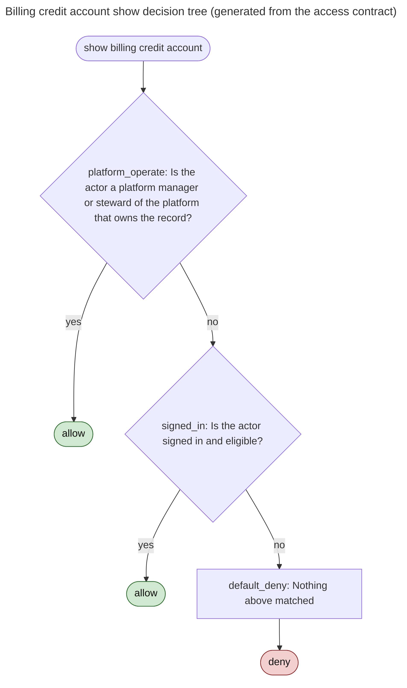

[Open the SVG](../../diagrams/exports/svg/access_contract_billing_credit_account_decision_tree.svg) · [Mermaid source](../../diagrams/source/access_contract_billing_credit_account_decision_tree.mmd)

### Rules in order

| # | Rule | Question | Decides | Note |
| --- | --- | --- | --- | --- |
| 1 | `platform_operate` | Is the actor a platform manager or steward of the platform that owns the record? | allow |  |
| 2 | `signed_in` | Is the actor signed in and eligible? | allow |  |
| 3 | `default_deny` | Nothing above matched | deny |  |

### own

| Persona | any |
| --- | --- |
| `anonymous` | deny default_deny |
| `signed_in_non_member` | allow signed_in |
| `community_member` | allow signed_in |
| `community_contributor` | allow signed_in |
| `community_organizer` | allow signed_in |
| `platform_manager` | allow signed_in |
| `platform_steward` | allow signed_in |
| `safety_reviewer` (pending) | pending |
| `remote_operator` (pending) | pending |
| `support_grantee` (pending) | pending |
| `record_owner` | n/a |
| `blocked_user` | n/a |

Reasons

- allow via `signed_in`: Any signed-in person who qualifies may use the credit account. (community_contributor, community_member, community_organizer, platform_manager, platform_steward, signed_in_non_member)
- deny via `default_deny`: Needs platform billing authority, an account or ownership this person does not hold. (anonymous)

### index

| Persona | any |
| --- | --- |
| `anonymous` | deny default_deny |
| `signed_in_non_member` | deny default_deny |
| `community_member` | deny default_deny |
| `community_contributor` | deny default_deny |
| `community_organizer` | deny default_deny |
| `platform_manager` | allow platform_operate |
| `platform_steward` | allow platform_operate |
| `safety_reviewer` (pending) | pending |
| `remote_operator` (pending) | pending |
| `support_grantee` (pending) | pending |
| `record_owner` | n/a |
| `blocked_user` | n/a |

Reasons

- allow via `platform_operate`: Managers and stewards operate the credit account of their own platform. (platform_manager, platform_steward)
- deny via `default_deny`: Needs platform billing authority, an account or ownership this person does not hold. (anonymous, community_contributor, community_member, community_organizer, signed_in_non_member)

### show

| Persona | own_platform | other_platform |
| --- | --- | --- |
| `anonymous` | deny default_deny | deny default_deny |
| `signed_in_non_member` | deny default_deny | deny default_deny |
| `community_member` | deny default_deny | deny default_deny |
| `community_contributor` | deny default_deny | deny default_deny |
| `community_organizer` | deny default_deny | deny default_deny |
| `platform_manager` | deny (app: allow) [^1] | deny default_deny |
| `platform_steward` | deny (app: allow) [^1] | deny default_deny |
| `safety_reviewer` (pending) | pending | pending |
| `remote_operator` (pending) | pending | pending |
| `support_grantee` (pending) | pending | pending |
| `record_owner` | n/a | n/a |
| `blocked_user` | n/a | n/a |

[^1]: BL-1, known deviation: Platform operators read buyers financial records.

Reasons

- deny via `default_deny`: Needs platform billing authority, an account or ownership this person does not hold. (anonymous, community_contributor, community_member, community_organizer, signed_in_non_member)
- deny via `default_deny`: No standing role reads buyers' financial records or platform money figures. (platform_manager, platform_steward)
- deny via `default_deny`: Records of another platform are out of reach; tenant isolation. (anonymous, community_contributor, community_member, community_organizer, platform_manager, platform_steward, signed_in_non_member)

### grant

| Persona | any |
| --- | --- |
| `anonymous` | deny default_deny |
| `signed_in_non_member` | deny default_deny |
| `community_member` | deny default_deny |
| `community_contributor` | deny default_deny |
| `community_organizer` | deny default_deny |
| `platform_manager` | allow platform_operate |
| `platform_steward` | allow platform_operate |
| `safety_reviewer` (pending) | pending |
| `remote_operator` (pending) | pending |
| `support_grantee` (pending) | pending |
| `record_owner` | n/a |
| `blocked_user` | n/a |

Reasons

- allow via `platform_operate`: Managers and stewards operate the credit account of their own platform. (platform_manager, platform_steward)
- deny via `default_deny`: Needs platform billing authority, an account or ownership this person does not hold. (anonymous, community_contributor, community_member, community_organizer, signed_in_non_member)

### create

| Persona | new |
| --- | --- |
| `anonymous` | deny default_deny |
| `signed_in_non_member` | deny default_deny |
| `community_member` | deny default_deny |
| `community_contributor` | deny default_deny |
| `community_organizer` | deny default_deny |
| `platform_manager` | deny default_deny |
| `platform_steward` | deny default_deny |
| `safety_reviewer` (pending) | pending |
| `remote_operator` (pending) | pending |
| `support_grantee` (pending) | pending |
| `record_owner` | n/a |
| `blocked_user` | n/a |

Reasons

- deny via `default_deny`: Needs platform billing authority, an account or ownership this person does not hold. (anonymous, community_contributor, community_member, community_organizer, platform_manager, platform_steward, signed_in_non_member)

### update

| Persona | own_platform | other_platform |
| --- | --- | --- |
| `anonymous` | deny default_deny | deny default_deny |
| `signed_in_non_member` | deny default_deny | deny default_deny |
| `community_member` | deny default_deny | deny default_deny |
| `community_contributor` | deny default_deny | deny default_deny |
| `community_organizer` | deny default_deny | deny default_deny |
| `platform_manager` | deny default_deny | deny default_deny |
| `platform_steward` | deny default_deny | deny default_deny |
| `safety_reviewer` (pending) | pending | pending |
| `remote_operator` (pending) | pending | pending |
| `support_grantee` (pending) | pending | pending |
| `record_owner` | n/a | n/a |
| `blocked_user` | n/a | n/a |

Reasons

- deny via `default_deny`: Needs platform billing authority, an account or ownership this person does not hold. (anonymous, community_contributor, community_member, community_organizer, platform_manager, platform_steward, signed_in_non_member)

### destroy

| Persona | own_platform | other_platform |
| --- | --- | --- |
| `anonymous` | deny default_deny | deny default_deny |
| `signed_in_non_member` | deny default_deny | deny default_deny |
| `community_member` | deny default_deny | deny default_deny |
| `community_contributor` | deny default_deny | deny default_deny |
| `community_organizer` | deny default_deny | deny default_deny |
| `platform_manager` | deny default_deny | deny default_deny |
| `platform_steward` | deny default_deny | deny default_deny |
| `safety_reviewer` (pending) | pending | pending |
| `remote_operator` (pending) | pending | pending |
| `support_grantee` (pending) | pending | pending |
| `record_owner` | n/a | n/a |
| `blocked_user` | n/a | n/a |

Reasons

- deny via `default_deny`: Needs platform billing authority, an account or ownership this person does not hold. (anonymous, community_contributor, community_member, community_organizer, platform_manager, platform_steward, signed_in_non_member)

## Billing entitlement

`BetterTogether::Billing::Entitlement` · policy `BetterTogether::Billing::EntitlementPolicy` · classification `financial`

### Decision tree

Decision tree for show. Dashed red nodes are rules the app applies that the privacy rule does not intend.

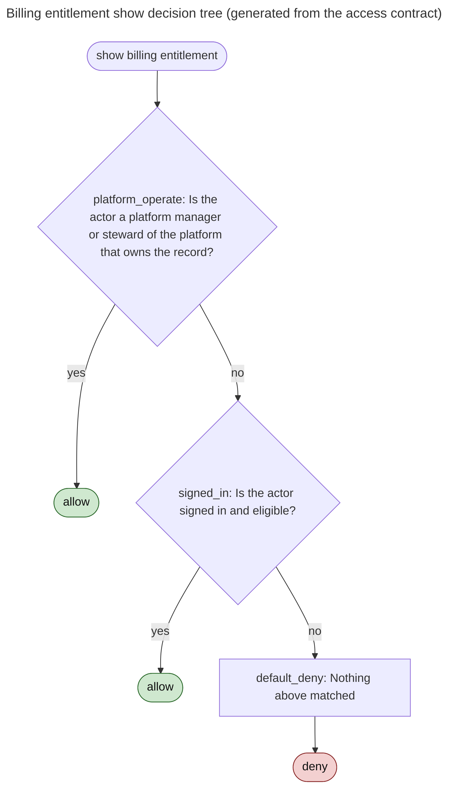

[Open the SVG](../../diagrams/exports/svg/access_contract_billing_entitlement_decision_tree.svg) · [Mermaid source](../../diagrams/source/access_contract_billing_entitlement_decision_tree.mmd)

### Rules in order

| # | Rule | Question | Decides | Note |
| --- | --- | --- | --- | --- |
| 1 | `platform_operate` | Is the actor a platform manager or steward of the platform that owns the record? | allow |  |
| 2 | `signed_in` | Is the actor signed in and eligible? | allow |  |
| 3 | `default_deny` | Nothing above matched | deny |  |

### own

| Persona | any |
| --- | --- |
| `anonymous` | deny default_deny |
| `signed_in_non_member` | allow signed_in |
| `community_member` | allow signed_in |
| `community_contributor` | allow signed_in |
| `community_organizer` | allow signed_in |
| `platform_manager` | allow signed_in |
| `platform_steward` | allow signed_in |
| `safety_reviewer` (pending) | pending |
| `remote_operator` (pending) | pending |
| `support_grantee` (pending) | pending |
| `record_owner` | n/a |
| `blocked_user` | n/a |

Reasons

- allow via `signed_in`: Any signed-in person who qualifies may use the entitlement. (community_contributor, community_member, community_organizer, platform_manager, platform_steward, signed_in_non_member)
- deny via `default_deny`: Needs platform billing authority, an account or ownership this person does not hold. (anonymous)

### allowances

| Persona | any |
| --- | --- |
| `anonymous` | deny default_deny |
| `signed_in_non_member` | deny default_deny |
| `community_member` | deny default_deny |
| `community_contributor` | deny default_deny |
| `community_organizer` | deny default_deny |
| `platform_manager` | allow platform_operate |
| `platform_steward` | allow platform_operate |
| `safety_reviewer` (pending) | pending |
| `remote_operator` (pending) | pending |
| `support_grantee` (pending) | pending |
| `record_owner` | n/a |
| `blocked_user` | n/a |

Reasons

- allow via `platform_operate`: Managers and stewards operate the entitlement of their own platform. (platform_manager, platform_steward)
- deny via `default_deny`: Needs platform billing authority, an account or ownership this person does not hold. (anonymous, community_contributor, community_member, community_organizer, signed_in_non_member)

### set_enforcement

| Persona | any |
| --- | --- |
| `anonymous` | deny default_deny |
| `signed_in_non_member` | deny default_deny |
| `community_member` | deny default_deny |
| `community_contributor` | deny default_deny |
| `community_organizer` | deny default_deny |
| `platform_manager` | allow platform_operate |
| `platform_steward` | allow platform_operate |
| `safety_reviewer` (pending) | pending |
| `remote_operator` (pending) | pending |
| `support_grantee` (pending) | pending |
| `record_owner` | n/a |
| `blocked_user` | n/a |

Reasons

- allow via `platform_operate`: Managers and stewards operate the entitlement of their own platform. (platform_manager, platform_steward)
- deny via `default_deny`: Needs platform billing authority, an account or ownership this person does not hold. (anonymous, community_contributor, community_member, community_organizer, signed_in_non_member)

### index

| Persona | any |
| --- | --- |
| `anonymous` | deny default_deny |
| `signed_in_non_member` | deny default_deny |
| `community_member` | deny default_deny |
| `community_contributor` | deny default_deny |
| `community_organizer` | deny default_deny |
| `platform_manager` | deny default_deny |
| `platform_steward` | deny default_deny |
| `safety_reviewer` (pending) | pending |
| `remote_operator` (pending) | pending |
| `support_grantee` (pending) | pending |
| `record_owner` | n/a |
| `blocked_user` | n/a |

Reasons

- deny via `default_deny`: Needs platform billing authority, an account or ownership this person does not hold. (anonymous, community_contributor, community_member, community_organizer, platform_manager, platform_steward, signed_in_non_member)

### show

| Persona | own_platform | other_platform |
| --- | --- | --- |
| `anonymous` | deny default_deny | deny default_deny |
| `signed_in_non_member` | deny default_deny | deny default_deny |
| `community_member` | deny default_deny | deny default_deny |
| `community_contributor` | deny default_deny | deny default_deny |
| `community_organizer` | deny default_deny | deny default_deny |
| `platform_manager` | deny default_deny | deny default_deny |
| `platform_steward` | deny default_deny | deny default_deny |
| `safety_reviewer` (pending) | pending | pending |
| `remote_operator` (pending) | pending | pending |
| `support_grantee` (pending) | pending | pending |
| `record_owner` | n/a | n/a |
| `blocked_user` | n/a | n/a |

Reasons

- deny via `default_deny`: Needs platform billing authority, an account or ownership this person does not hold. (anonymous, community_contributor, community_member, community_organizer, platform_manager, platform_steward, signed_in_non_member)

### create

| Persona | new |
| --- | --- |
| `anonymous` | deny default_deny |
| `signed_in_non_member` | deny default_deny |
| `community_member` | deny default_deny |
| `community_contributor` | deny default_deny |
| `community_organizer` | deny default_deny |
| `platform_manager` | deny default_deny |
| `platform_steward` | deny default_deny |
| `safety_reviewer` (pending) | pending |
| `remote_operator` (pending) | pending |
| `support_grantee` (pending) | pending |
| `record_owner` | n/a |
| `blocked_user` | n/a |

Reasons

- deny via `default_deny`: Needs platform billing authority, an account or ownership this person does not hold. (anonymous, community_contributor, community_member, community_organizer, platform_manager, platform_steward, signed_in_non_member)

### update

| Persona | own_platform | other_platform |
| --- | --- | --- |
| `anonymous` | deny default_deny | deny default_deny |
| `signed_in_non_member` | deny default_deny | deny default_deny |
| `community_member` | deny default_deny | deny default_deny |
| `community_contributor` | deny default_deny | deny default_deny |
| `community_organizer` | deny default_deny | deny default_deny |
| `platform_manager` | deny default_deny | deny default_deny |
| `platform_steward` | deny default_deny | deny default_deny |
| `safety_reviewer` (pending) | pending | pending |
| `remote_operator` (pending) | pending | pending |
| `support_grantee` (pending) | pending | pending |
| `record_owner` | n/a | n/a |
| `blocked_user` | n/a | n/a |

Reasons

- deny via `default_deny`: Needs platform billing authority, an account or ownership this person does not hold. (anonymous, community_contributor, community_member, community_organizer, platform_manager, platform_steward, signed_in_non_member)

### destroy

| Persona | own_platform | other_platform |
| --- | --- | --- |
| `anonymous` | deny default_deny | deny default_deny |
| `signed_in_non_member` | deny default_deny | deny default_deny |
| `community_member` | deny default_deny | deny default_deny |
| `community_contributor` | deny default_deny | deny default_deny |
| `community_organizer` | deny default_deny | deny default_deny |
| `platform_manager` | deny default_deny | deny default_deny |
| `platform_steward` | deny default_deny | deny default_deny |
| `safety_reviewer` (pending) | pending | pending |
| `remote_operator` (pending) | pending | pending |
| `support_grantee` (pending) | pending | pending |
| `record_owner` | n/a | n/a |
| `blocked_user` | n/a | n/a |

Reasons

- deny via `default_deny`: Needs platform billing authority, an account or ownership this person does not hold. (anonymous, community_contributor, community_member, community_organizer, platform_manager, platform_steward, signed_in_non_member)

## Billing report

`BetterTogether::Metrics::BillingReport` · policy `BetterTogether::Metrics::BillingReportPolicy` · classification `financial`

### Decision tree

Decision tree for show. Dashed red nodes are rules the app applies that the privacy rule does not intend.

[Open the SVG](../../diagrams/exports/svg/access_contract_billing_report_decision_tree.svg) · [Mermaid source](../../diagrams/source/access_contract_billing_report_decision_tree.mmd)

### Rules in order

| # | Rule | Question | Decides | Note |
| --- | --- | --- | --- | --- |
| 1 | `platform_operate` | Is the actor a platform manager or steward of the platform that owns the record? | allow |  |
| 2 | `default_deny` | Nothing above matched | deny |  |

### index

| Persona | any |
| --- | --- |
| `anonymous` | deny default_deny |
| `signed_in_non_member` | deny default_deny |
| `community_member` | deny default_deny |
| `community_contributor` | deny default_deny |
| `community_organizer` | deny default_deny |
| `platform_manager` | allow platform_operate |
| `platform_steward` | allow platform_operate |
| `safety_reviewer` (pending) | pending |
| `remote_operator` (pending) | pending |
| `support_grantee` (pending) | pending |
| `record_owner` | n/a |
| `blocked_user` | n/a |

Reasons

- allow via `platform_operate`: Managers and stewards operate the report of their own platform. (platform_manager, platform_steward)
- deny via `default_deny`: Needs platform billing authority, an account or ownership this person does not hold. (anonymous, community_contributor, community_member, community_organizer, signed_in_non_member)

### show

| Persona | own_platform | other_platform |
| --- | --- | --- |
| `anonymous` | deny default_deny | deny default_deny |
| `signed_in_non_member` | deny default_deny | deny default_deny |
| `community_member` | deny default_deny | deny default_deny |
| `community_contributor` | deny default_deny | deny default_deny |
| `community_organizer` | deny default_deny | deny default_deny |
| `platform_manager` | deny (app: allow) [^1] | deny default_deny |
| `platform_steward` | deny (app: allow) [^1] | deny default_deny |
| `safety_reviewer` (pending) | pending | pending |
| `remote_operator` (pending) | pending | pending |
| `support_grantee` (pending) | pending | pending |
| `record_owner` | n/a | n/a |
| `blocked_user` | n/a | n/a |

[^1]: BL-1, known deviation: Platform operators read buyers financial records.

Reasons

- deny via `default_deny`: Needs platform billing authority, an account or ownership this person does not hold. (anonymous, community_contributor, community_member, community_organizer, signed_in_non_member)
- deny via `default_deny`: No standing role reads buyers' financial records or platform money figures. (platform_manager, platform_steward)
- deny via `default_deny`: Records of another platform are out of reach; tenant isolation. (anonymous, community_contributor, community_member, community_organizer, platform_manager, platform_steward, signed_in_non_member)

### create

| Persona | new |
| --- | --- |
| `anonymous` | deny default_deny |
| `signed_in_non_member` | deny default_deny |
| `community_member` | deny default_deny |
| `community_contributor` | deny default_deny |
| `community_organizer` | deny default_deny |
| `platform_manager` | allow platform_operate |
| `platform_steward` | allow platform_operate |
| `safety_reviewer` (pending) | pending |
| `remote_operator` (pending) | pending |
| `support_grantee` (pending) | pending |
| `record_owner` | n/a |
| `blocked_user` | n/a |

Reasons

- allow via `platform_operate`: Managers and stewards operate the report of their own platform. (platform_manager, platform_steward)
- deny via `default_deny`: Needs platform billing authority, an account or ownership this person does not hold. (anonymous, community_contributor, community_member, community_organizer, signed_in_non_member)

### destroy

| Persona | own_platform | other_platform |
| --- | --- | --- |
| `anonymous` | deny default_deny | deny default_deny |
| `signed_in_non_member` | deny default_deny | deny default_deny |
| `community_member` | deny default_deny | deny default_deny |
| `community_contributor` | deny default_deny | deny default_deny |
| `community_organizer` | deny default_deny | deny default_deny |
| `platform_manager` | allow platform_operate | deny default_deny |
| `platform_steward` | allow platform_operate | deny default_deny |
| `safety_reviewer` (pending) | pending | pending |
| `remote_operator` (pending) | pending | pending |
| `support_grantee` (pending) | pending | pending |
| `record_owner` | n/a | n/a |
| `blocked_user` | n/a | n/a |

Reasons

- allow via `platform_operate`: Managers and stewards operate the report of their own platform. (platform_manager, platform_steward)
- deny via `default_deny`: Needs platform billing authority, an account or ownership this person does not hold. (anonymous, community_contributor, community_member, community_organizer, signed_in_non_member)
- deny via `default_deny`: Records of another platform are out of reach; tenant isolation. (anonymous, community_contributor, community_member, community_organizer, platform_manager, platform_steward, signed_in_non_member)

### download

| Persona | own_platform | other_platform |
| --- | --- | --- |
| `anonymous` | deny default_deny | deny default_deny |
| `signed_in_non_member` | deny default_deny | deny default_deny |
| `community_member` | deny default_deny | deny default_deny |
| `community_contributor` | deny default_deny | deny default_deny |
| `community_organizer` | deny default_deny | deny default_deny |
| `platform_manager` | deny (app: allow) [^1] | deny default_deny |
| `platform_steward` | deny (app: allow) [^1] | deny default_deny |
| `safety_reviewer` (pending) | pending | pending |
| `remote_operator` (pending) | pending | pending |
| `support_grantee` (pending) | pending | pending |
| `record_owner` | n/a | n/a |
| `blocked_user` | n/a | n/a |

[^1]: BL-1, known deviation: Platform operators read buyers financial records.

Reasons

- deny via `default_deny`: Needs platform billing authority, an account or ownership this person does not hold. (anonymous, community_contributor, community_member, community_organizer, signed_in_non_member)
- deny via `default_deny`: No standing role reads buyers' financial records or platform money figures. (platform_manager, platform_steward)
- deny via `default_deny`: Records of another platform are out of reach; tenant isolation. (anonymous, community_contributor, community_member, community_organizer, platform_manager, platform_steward, signed_in_non_member)

## Billing plan

`BetterTogether::Billing::Plan` · policy `BetterTogether::Billing::PlanPolicy` · classification `platform_shared`

### Decision tree

Decision tree for show. Dashed red nodes are rules the app applies that the privacy rule does not intend.

[Open the SVG](../../diagrams/exports/svg/access_contract_billing_plan_decision_tree.svg) · [Mermaid source](../../diagrams/source/access_contract_billing_plan_decision_tree.mmd)

### Rules in order

| # | Rule | Question | Decides | Note |
| --- | --- | --- | --- | --- |
| 1 | `platform_operate` | Is the actor a platform manager or steward of the platform that owns the record? | allow |  |
| 2 | `open_to_all` | Is the item listed and open to everyone? | allow |  |
| 3 | `default_deny` | Nothing above matched | deny |  |

### index

| Persona | any |
| --- | --- |
| `anonymous` | deny default_deny |
| `signed_in_non_member` | deny default_deny |
| `community_member` | deny default_deny |
| `community_contributor` | deny default_deny |
| `community_organizer` | deny default_deny |
| `platform_manager` | allow platform_operate |
| `platform_steward` | allow platform_operate |
| `safety_reviewer` (pending) | pending |
| `remote_operator` (pending) | pending |
| `support_grantee` (pending) | pending |
| `record_owner` | n/a |
| `blocked_user` | n/a |

Reasons

- allow via `platform_operate`: Managers and stewards operate the plan of their own platform. (platform_manager, platform_steward)
- deny via `default_deny`: Needs platform billing authority, an account or ownership this person does not hold. (anonymous, community_contributor, community_member, community_organizer, signed_in_non_member)

### show

| Persona | public | hidden | draft | members_only | other_platform |
| --- | --- | --- | --- | --- | --- |
| `anonymous` | deny default_deny | deny default_deny | deny default_deny | deny default_deny | deny default_deny |
| `signed_in_non_member` | deny default_deny | deny default_deny | deny default_deny | deny default_deny | deny default_deny |
| `community_member` | deny default_deny | deny default_deny | deny default_deny | deny default_deny | deny default_deny |
| `community_contributor` | deny default_deny | deny default_deny | deny default_deny | deny default_deny | deny default_deny |
| `community_organizer` | deny default_deny | deny default_deny | deny default_deny | deny default_deny | deny default_deny |
| `platform_manager` | allow platform_operate | allow platform_operate | allow platform_operate | allow platform_operate | deny default_deny |
| `platform_steward` | allow platform_operate | allow platform_operate | allow platform_operate | allow platform_operate | deny default_deny |
| `safety_reviewer` (pending) | pending | pending | pending | pending | pending |
| `remote_operator` (pending) | pending | pending | pending | pending | pending |
| `support_grantee` (pending) | pending | pending | pending | pending | pending |
| `record_owner` | n/a | n/a | n/a | n/a | n/a |
| `blocked_user` | n/a | n/a | n/a | n/a | n/a |

Reasons

- allow via `platform_operate`: Managers and stewards operate the plan of their own platform. (platform_manager, platform_steward)
- deny via `default_deny`: Not offered to this person: unlisted, retired or limited to qualifying members. (anonymous, community_contributor, community_member, community_organizer, signed_in_non_member)
- deny via `default_deny`: Records of another platform are out of reach; tenant isolation. (anonymous, community_contributor, community_member, community_organizer, platform_manager, platform_steward, signed_in_non_member)

### new

| Persona | new |
| --- | --- |
| `anonymous` | deny default_deny |
| `signed_in_non_member` | deny default_deny |
| `community_member` | deny default_deny |
| `community_contributor` | deny default_deny |
| `community_organizer` | deny default_deny |
| `platform_manager` | allow platform_operate |
| `platform_steward` | allow platform_operate |
| `safety_reviewer` (pending) | pending |
| `remote_operator` (pending) | pending |
| `support_grantee` (pending) | pending |
| `record_owner` | n/a |
| `blocked_user` | n/a |

Reasons

- allow via `platform_operate`: Managers and stewards operate the plan of their own platform. (platform_manager, platform_steward)
- deny via `default_deny`: Needs platform billing authority, an account or ownership this person does not hold. (anonymous, community_contributor, community_member, community_organizer, signed_in_non_member)

### create

| Persona | new |
| --- | --- |
| `anonymous` | deny default_deny |
| `signed_in_non_member` | deny default_deny |
| `community_member` | deny default_deny |
| `community_contributor` | deny default_deny |
| `community_organizer` | deny default_deny |
| `platform_manager` | allow platform_operate |
| `platform_steward` | allow platform_operate |
| `safety_reviewer` (pending) | pending |
| `remote_operator` (pending) | pending |
| `support_grantee` (pending) | pending |
| `record_owner` | n/a |
| `blocked_user` | n/a |

Reasons

- allow via `platform_operate`: Managers and stewards operate the plan of their own platform. (platform_manager, platform_steward)
- deny via `default_deny`: Needs platform billing authority, an account or ownership this person does not hold. (anonymous, community_contributor, community_member, community_organizer, signed_in_non_member)

### edit

| Persona | public | hidden | draft | members_only | other_platform |
| --- | --- | --- | --- | --- | --- |
| `anonymous` | deny default_deny | deny default_deny | deny default_deny | deny default_deny | deny default_deny |
| `signed_in_non_member` | deny default_deny | deny default_deny | deny default_deny | deny default_deny | deny default_deny |
| `community_member` | deny default_deny | deny default_deny | deny default_deny | deny default_deny | deny default_deny |
| `community_contributor` | deny default_deny | deny default_deny | deny default_deny | deny default_deny | deny default_deny |
| `community_organizer` | deny default_deny | deny default_deny | deny default_deny | deny default_deny | deny default_deny |
| `platform_manager` | allow platform_operate | allow platform_operate | allow platform_operate | allow platform_operate | deny default_deny |
| `platform_steward` | allow platform_operate | allow platform_operate | allow platform_operate | allow platform_operate | deny default_deny |
| `safety_reviewer` (pending) | pending | pending | pending | pending | pending |
| `remote_operator` (pending) | pending | pending | pending | pending | pending |
| `support_grantee` (pending) | pending | pending | pending | pending | pending |
| `record_owner` | n/a | n/a | n/a | n/a | n/a |
| `blocked_user` | n/a | n/a | n/a | n/a | n/a |

Reasons

- allow via `platform_operate`: Managers and stewards operate the plan of their own platform. (platform_manager, platform_steward)
- deny via `default_deny`: Not offered to this person: unlisted, retired or limited to qualifying members. (anonymous, community_contributor, community_member, community_organizer, signed_in_non_member)
- deny via `default_deny`: Records of another platform are out of reach; tenant isolation. (anonymous, community_contributor, community_member, community_organizer, platform_manager, platform_steward, signed_in_non_member)

### update

| Persona | public | hidden | draft | members_only | other_platform |
| --- | --- | --- | --- | --- | --- |
| `anonymous` | deny default_deny | deny default_deny | deny default_deny | deny default_deny | deny default_deny |
| `signed_in_non_member` | deny default_deny | deny default_deny | deny default_deny | deny default_deny | deny default_deny |
| `community_member` | deny default_deny | deny default_deny | deny default_deny | deny default_deny | deny default_deny |
| `community_contributor` | deny default_deny | deny default_deny | deny default_deny | deny default_deny | deny default_deny |
| `community_organizer` | deny default_deny | deny default_deny | deny default_deny | deny default_deny | deny default_deny |
| `platform_manager` | allow platform_operate | allow platform_operate | allow platform_operate | allow platform_operate | deny default_deny |
| `platform_steward` | allow platform_operate | allow platform_operate | allow platform_operate | allow platform_operate | deny default_deny |
| `safety_reviewer` (pending) | pending | pending | pending | pending | pending |
| `remote_operator` (pending) | pending | pending | pending | pending | pending |
| `support_grantee` (pending) | pending | pending | pending | pending | pending |
| `record_owner` | n/a | n/a | n/a | n/a | n/a |
| `blocked_user` | n/a | n/a | n/a | n/a | n/a |

Reasons

- allow via `platform_operate`: Managers and stewards operate the plan of their own platform. (platform_manager, platform_steward)
- deny via `default_deny`: Not offered to this person: unlisted, retired or limited to qualifying members. (anonymous, community_contributor, community_member, community_organizer, signed_in_non_member)
- deny via `default_deny`: Records of another platform are out of reach; tenant isolation. (anonymous, community_contributor, community_member, community_organizer, platform_manager, platform_steward, signed_in_non_member)

### sync

| Persona | public | hidden | draft | members_only | other_platform |
| --- | --- | --- | --- | --- | --- |
| `anonymous` | deny default_deny | deny default_deny | deny default_deny | deny default_deny | deny default_deny |
| `signed_in_non_member` | deny default_deny | deny default_deny | deny default_deny | deny default_deny | deny default_deny |
| `community_member` | deny default_deny | deny default_deny | deny default_deny | deny default_deny | deny default_deny |
| `community_contributor` | deny default_deny | deny default_deny | deny default_deny | deny default_deny | deny default_deny |
| `community_organizer` | deny default_deny | deny default_deny | deny default_deny | deny default_deny | deny default_deny |
| `platform_manager` | allow platform_operate | allow platform_operate | allow platform_operate | allow platform_operate | deny default_deny |
| `platform_steward` | allow platform_operate | allow platform_operate | allow platform_operate | allow platform_operate | deny default_deny |
| `safety_reviewer` (pending) | pending | pending | pending | pending | pending |
| `remote_operator` (pending) | pending | pending | pending | pending | pending |
| `support_grantee` (pending) | pending | pending | pending | pending | pending |
| `record_owner` | n/a | n/a | n/a | n/a | n/a |
| `blocked_user` | n/a | n/a | n/a | n/a | n/a |

Reasons

- allow via `platform_operate`: Managers and stewards operate the plan of their own platform. (platform_manager, platform_steward)
- deny via `default_deny`: Not offered to this person: unlisted, retired or limited to qualifying members. (anonymous, community_contributor, community_member, community_organizer, signed_in_non_member)
- deny via `default_deny`: Records of another platform are out of reach; tenant isolation. (anonymous, community_contributor, community_member, community_organizer, platform_manager, platform_steward, signed_in_non_member)

### snapshot

| Persona | public | hidden | draft | members_only | other_platform |
| --- | --- | --- | --- | --- | --- |
| `anonymous` | deny default_deny | deny default_deny | deny default_deny | deny default_deny | deny default_deny |
| `signed_in_non_member` | deny default_deny | deny default_deny | deny default_deny | deny default_deny | deny default_deny |
| `community_member` | deny default_deny | deny default_deny | deny default_deny | deny default_deny | deny default_deny |
| `community_contributor` | deny default_deny | deny default_deny | deny default_deny | deny default_deny | deny default_deny |
| `community_organizer` | deny default_deny | deny default_deny | deny default_deny | deny default_deny | deny default_deny |
| `platform_manager` | allow platform_operate | allow platform_operate | allow platform_operate | allow platform_operate | deny default_deny |
| `platform_steward` | allow platform_operate | allow platform_operate | allow platform_operate | allow platform_operate | deny default_deny |
| `safety_reviewer` (pending) | pending | pending | pending | pending | pending |
| `remote_operator` (pending) | pending | pending | pending | pending | pending |
| `support_grantee` (pending) | pending | pending | pending | pending | pending |
| `record_owner` | n/a | n/a | n/a | n/a | n/a |
| `blocked_user` | n/a | n/a | n/a | n/a | n/a |

Reasons

- allow via `platform_operate`: Managers and stewards operate the plan of their own platform. (platform_manager, platform_steward)
- deny via `default_deny`: Not offered to this person: unlisted, retired or limited to qualifying members. (anonymous, community_contributor, community_member, community_organizer, signed_in_non_member)
- deny via `default_deny`: Records of another platform are out of reach; tenant isolation. (anonymous, community_contributor, community_member, community_organizer, platform_manager, platform_steward, signed_in_non_member)

### lookup

| Persona | any |
| --- | --- |
| `anonymous` | deny default_deny |
| `signed_in_non_member` | deny default_deny |
| `community_member` | deny default_deny |
| `community_contributor` | deny default_deny |
| `community_organizer` | deny default_deny |
| `platform_manager` | allow platform_operate |
| `platform_steward` | allow platform_operate |
| `safety_reviewer` (pending) | pending |
| `remote_operator` (pending) | pending |
| `support_grantee` (pending) | pending |
| `record_owner` | n/a |
| `blocked_user` | n/a |

Reasons

- allow via `platform_operate`: Managers and stewards operate the plan of their own platform. (platform_manager, platform_steward)
- deny via `default_deny`: Needs platform billing authority, an account or ownership this person does not hold. (anonymous, community_contributor, community_member, community_organizer, signed_in_non_member)

### destroy

| Persona | public | hidden | draft | members_only | other_platform |
| --- | --- | --- | --- | --- | --- |
| `anonymous` | deny default_deny | deny default_deny | deny default_deny | deny default_deny | deny default_deny |
| `signed_in_non_member` | deny default_deny | deny default_deny | deny default_deny | deny default_deny | deny default_deny |
| `community_member` | deny default_deny | deny default_deny | deny default_deny | deny default_deny | deny default_deny |
| `community_contributor` | deny default_deny | deny default_deny | deny default_deny | deny default_deny | deny default_deny |
| `community_organizer` | deny default_deny | deny default_deny | deny default_deny | deny default_deny | deny default_deny |
| `platform_manager` | deny default_deny | deny default_deny | deny default_deny | deny default_deny | deny default_deny |
| `platform_steward` | deny default_deny | deny default_deny | deny default_deny | deny default_deny | deny default_deny |
| `safety_reviewer` (pending) | pending | pending | pending | pending | pending |
| `remote_operator` (pending) | pending | pending | pending | pending | pending |
| `support_grantee` (pending) | pending | pending | pending | pending | pending |
| `record_owner` | n/a | n/a | n/a | n/a | n/a |
| `blocked_user` | n/a | n/a | n/a | n/a | n/a |

Reasons

- deny via `default_deny`: Not offered to this person: unlisted, retired or limited to qualifying members. (anonymous, community_contributor, community_member, community_organizer, platform_manager, platform_steward, signed_in_non_member)

### catalog

| Persona | any |
| --- | --- |
| `anonymous` | allow open_to_all |
| `signed_in_non_member` | allow open_to_all |
| `community_member` | allow open_to_all |
| `community_contributor` | allow open_to_all |
| `community_organizer` | allow open_to_all |
| `platform_manager` | allow open_to_all |
| `platform_steward` | allow open_to_all |
| `safety_reviewer` (pending) | pending |
| `remote_operator` (pending) | pending |
| `support_grantee` (pending) | pending |
| `record_owner` | n/a |
| `blocked_user` | n/a |

Reasons

- allow via `open_to_all`: Listed plan items are open to anyone. (anonymous, community_contributor, community_member, community_organizer, platform_manager, platform_steward, signed_in_non_member)

### catalog_show

| Persona | public | hidden | draft | members_only | other_platform |
| --- | --- | --- | --- | --- | --- |
| `anonymous` | allow open_to_all | deny default_deny | deny default_deny | deny default_deny | deny default_deny |
| `signed_in_non_member` | allow open_to_all | deny default_deny | deny default_deny | deny default_deny | deny default_deny |
| `community_member` | allow open_to_all | deny default_deny | deny default_deny | deny default_deny | deny default_deny |
| `community_contributor` | allow open_to_all | deny default_deny | deny default_deny | deny default_deny | deny default_deny |
| `community_organizer` | allow open_to_all | deny default_deny | deny default_deny | deny default_deny | deny default_deny |
| `platform_manager` | allow open_to_all | deny default_deny | deny default_deny | deny default_deny | deny default_deny |
| `platform_steward` | allow open_to_all | deny default_deny | deny default_deny | deny default_deny | deny default_deny |
| `safety_reviewer` (pending) | pending | pending | pending | pending | pending |
| `remote_operator` (pending) | pending | pending | pending | pending | pending |
| `support_grantee` (pending) | pending | pending | pending | pending | pending |
| `record_owner` | n/a | n/a | n/a | n/a | n/a |
| `blocked_user` | n/a | n/a | n/a | n/a | n/a |

Reasons

- allow via `open_to_all`: Listed plan items are open to anyone. (anonymous, community_contributor, community_member, community_organizer, platform_manager, platform_steward, signed_in_non_member)
- deny via `default_deny`: Not offered to this person: unlisted, retired or limited to qualifying members. (anonymous, community_contributor, community_member, community_organizer, platform_manager, platform_steward, signed_in_non_member)

### offer

| Persona | public | hidden | draft | members_only | other_platform |
| --- | --- | --- | --- | --- | --- |
| `anonymous` | allow open_to_all | allow open_to_all | deny default_deny | deny default_deny | deny default_deny |
| `signed_in_non_member` | allow open_to_all | allow open_to_all | deny default_deny | deny default_deny | deny default_deny |
| `community_member` | allow open_to_all | allow open_to_all | deny default_deny | deny default_deny | deny default_deny |
| `community_contributor` | allow open_to_all | allow open_to_all | deny default_deny | deny default_deny | deny default_deny |
| `community_organizer` | allow open_to_all | allow open_to_all | deny default_deny | deny default_deny | deny default_deny |
| `platform_manager` | allow open_to_all | allow open_to_all | deny default_deny | deny default_deny | deny default_deny |
| `platform_steward` | allow open_to_all | allow open_to_all | deny default_deny | deny default_deny | deny default_deny |
| `safety_reviewer` (pending) | pending | pending | pending | pending | pending |
| `remote_operator` (pending) | pending | pending | pending | pending | pending |
| `support_grantee` (pending) | pending | pending | pending | pending | pending |
| `record_owner` | n/a | n/a | n/a | n/a | n/a |
| `blocked_user` | n/a | n/a | n/a | n/a | n/a |

Reasons

- allow via `open_to_all`: Listed plan items are open to anyone. (anonymous, community_contributor, community_member, community_organizer, platform_manager, platform_steward, signed_in_non_member)
- deny via `default_deny`: Not offered to this person: unlisted, retired or limited to qualifying members. (anonymous, community_contributor, community_member, community_organizer, platform_manager, platform_steward, signed_in_non_member)

### purchase

| Persona | public | hidden | draft | members_only | other_platform |
| --- | --- | --- | --- | --- | --- |
| `anonymous` | allow open_to_all | allow open_to_all | allow open_to_all | deny default_deny | deny default_deny |
| `signed_in_non_member` | allow open_to_all | allow open_to_all | allow open_to_all | deny default_deny | deny default_deny |
| `community_member` | allow open_to_all | allow open_to_all | allow open_to_all | deny default_deny | deny default_deny |
| `community_contributor` | allow open_to_all | allow open_to_all | allow open_to_all | deny default_deny | deny default_deny |
| `community_organizer` | allow open_to_all | allow open_to_all | allow open_to_all | deny default_deny | deny default_deny |
| `platform_manager` | allow open_to_all | allow open_to_all | allow open_to_all | deny default_deny | deny default_deny |
| `platform_steward` | allow open_to_all | allow open_to_all | allow open_to_all | deny default_deny | deny default_deny |
| `safety_reviewer` (pending) | pending | pending | pending | pending | pending |
| `remote_operator` (pending) | pending | pending | pending | pending | pending |
| `support_grantee` (pending) | pending | pending | pending | pending | pending |
| `record_owner` | n/a | n/a | n/a | n/a | n/a |
| `blocked_user` | n/a | n/a | n/a | n/a | n/a |

Reasons

- allow via `open_to_all`: Listed plan items are open to anyone. (anonymous, community_contributor, community_member, community_organizer, platform_manager, platform_steward, signed_in_non_member)
- deny via `default_deny`: Not offered to this person: unlisted, retired or limited to qualifying members. (anonymous, community_contributor, community_member, community_organizer, platform_manager, platform_steward, signed_in_non_member)

### scope

| Persona | public | hidden | draft | members_only | other_platform |
| --- | --- | --- | --- | --- | --- |
| `anonymous` | deny default_deny | deny default_deny | deny default_deny | deny default_deny | deny default_deny |
| `signed_in_non_member` | deny default_deny | deny default_deny | deny default_deny | deny default_deny | deny default_deny |
| `community_member` | deny default_deny | deny default_deny | deny default_deny | deny default_deny | deny default_deny |
| `community_contributor` | deny default_deny | deny default_deny | deny default_deny | deny default_deny | deny default_deny |
| `community_organizer` | deny default_deny | deny default_deny | deny default_deny | deny default_deny | deny default_deny |
| `platform_manager` | allow platform_operate | allow platform_operate | allow platform_operate | allow platform_operate | deny default_deny |
| `platform_steward` | allow platform_operate | allow platform_operate | allow platform_operate | allow platform_operate | deny default_deny |
| `safety_reviewer` (pending) | pending | pending | pending | pending | pending |
| `remote_operator` (pending) | pending | pending | pending | pending | pending |
| `support_grantee` (pending) | pending | pending | pending | pending | pending |
| `record_owner` | n/a | n/a | n/a | n/a | n/a |
| `blocked_user` | n/a | n/a | n/a | n/a | n/a |

Reasons

- allow via `platform_operate`: Managers and stewards operate the plan of their own platform. (platform_manager, platform_steward)
- deny via `default_deny`: Not offered to this person: unlisted, retired or limited to qualifying members. (anonymous, community_contributor, community_member, community_organizer, signed_in_non_member)
- deny via `default_deny`: Records of another platform are out of reach; tenant isolation. (anonymous, community_contributor, community_member, community_organizer, platform_manager, platform_steward, signed_in_non_member)

## Billing product

`BetterTogether::Billing::Product` · policy `BetterTogether::Billing::ProductPolicy` · classification `platform_shared`

### Decision tree

Decision tree for show. Dashed red nodes are rules the app applies that the privacy rule does not intend.

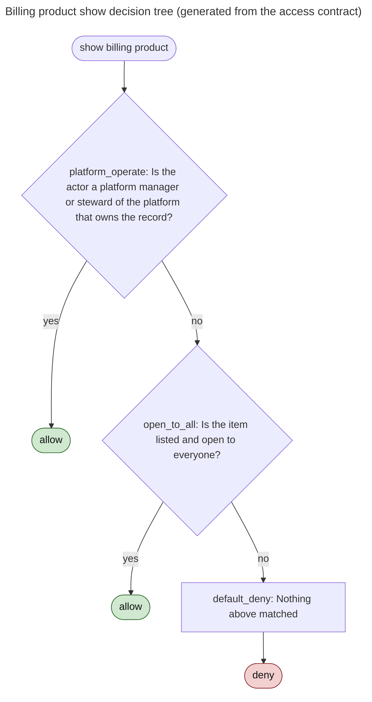

[Open the SVG](../../diagrams/exports/svg/access_contract_billing_product_decision_tree.svg) · [Mermaid source](../../diagrams/source/access_contract_billing_product_decision_tree.mmd)

### Rules in order

| # | Rule | Question | Decides | Note |
| --- | --- | --- | --- | --- |
| 1 | `platform_operate` | Is the actor a platform manager or steward of the platform that owns the record? | allow |  |
| 2 | `open_to_all` | Is the item listed and open to everyone? | allow |  |
| 3 | `default_deny` | Nothing above matched | deny |  |

### index

| Persona | any |
| --- | --- |
| `anonymous` | deny default_deny |
| `signed_in_non_member` | deny default_deny |
| `community_member` | deny default_deny |
| `community_contributor` | deny default_deny |
| `community_organizer` | deny default_deny |
| `platform_manager` | allow platform_operate |
| `platform_steward` | allow platform_operate |
| `safety_reviewer` (pending) | pending |
| `remote_operator` (pending) | pending |
| `support_grantee` (pending) | pending |
| `record_owner` | n/a |
| `blocked_user` | n/a |

Reasons

- allow via `platform_operate`: Managers and stewards operate the product of their own platform. (platform_manager, platform_steward)
- deny via `default_deny`: Needs platform billing authority, an account or ownership this person does not hold. (anonymous, community_contributor, community_member, community_organizer, signed_in_non_member)

### show

| Persona | public | hidden | draft | members_only | other_platform |
| --- | --- | --- | --- | --- | --- |
| `anonymous` | deny default_deny | deny default_deny | deny default_deny | deny default_deny | deny default_deny |
| `signed_in_non_member` | deny default_deny | deny default_deny | deny default_deny | deny default_deny | deny default_deny |
| `community_member` | deny default_deny | deny default_deny | deny default_deny | deny default_deny | deny default_deny |
| `community_contributor` | deny default_deny | deny default_deny | deny default_deny | deny default_deny | deny default_deny |
| `community_organizer` | deny default_deny | deny default_deny | deny default_deny | deny default_deny | deny default_deny |
| `platform_manager` | allow platform_operate | allow platform_operate | allow platform_operate | allow platform_operate | deny default_deny |
| `platform_steward` | allow platform_operate | allow platform_operate | allow platform_operate | allow platform_operate | deny default_deny |
| `safety_reviewer` (pending) | pending | pending | pending | pending | pending |
| `remote_operator` (pending) | pending | pending | pending | pending | pending |
| `support_grantee` (pending) | pending | pending | pending | pending | pending |
| `record_owner` | n/a | n/a | n/a | n/a | n/a |
| `blocked_user` | n/a | n/a | n/a | n/a | n/a |

Reasons

- allow via `platform_operate`: Managers and stewards operate the product of their own platform. (platform_manager, platform_steward)
- deny via `default_deny`: Not offered to this person: unlisted, retired or limited to qualifying members. (anonymous, community_contributor, community_member, community_organizer, signed_in_non_member)
- deny via `default_deny`: Records of another platform are out of reach; tenant isolation. (anonymous, community_contributor, community_member, community_organizer, platform_manager, platform_steward, signed_in_non_member)

### new

| Persona | new |
| --- | --- |
| `anonymous` | deny default_deny |
| `signed_in_non_member` | deny default_deny |
| `community_member` | deny default_deny |
| `community_contributor` | deny default_deny |
| `community_organizer` | deny default_deny |
| `platform_manager` | allow platform_operate |
| `platform_steward` | allow platform_operate |
| `safety_reviewer` (pending) | pending |
| `remote_operator` (pending) | pending |
| `support_grantee` (pending) | pending |
| `record_owner` | n/a |
| `blocked_user` | n/a |

Reasons

- allow via `platform_operate`: Managers and stewards operate the product of their own platform. (platform_manager, platform_steward)
- deny via `default_deny`: Needs platform billing authority, an account or ownership this person does not hold. (anonymous, community_contributor, community_member, community_organizer, signed_in_non_member)

### create

| Persona | new |
| --- | --- |
| `anonymous` | deny default_deny |
| `signed_in_non_member` | deny default_deny |
| `community_member` | deny default_deny |
| `community_contributor` | deny default_deny |
| `community_organizer` | deny default_deny |
| `platform_manager` | allow platform_operate |
| `platform_steward` | allow platform_operate |
| `safety_reviewer` (pending) | pending |
| `remote_operator` (pending) | pending |
| `support_grantee` (pending) | pending |
| `record_owner` | n/a |
| `blocked_user` | n/a |

Reasons

- allow via `platform_operate`: Managers and stewards operate the product of their own platform. (platform_manager, platform_steward)
- deny via `default_deny`: Needs platform billing authority, an account or ownership this person does not hold. (anonymous, community_contributor, community_member, community_organizer, signed_in_non_member)

### edit

| Persona | public | hidden | draft | members_only | other_platform |
| --- | --- | --- | --- | --- | --- |
| `anonymous` | deny default_deny | deny default_deny | deny default_deny | deny default_deny | deny default_deny |
| `signed_in_non_member` | deny default_deny | deny default_deny | deny default_deny | deny default_deny | deny default_deny |
| `community_member` | deny default_deny | deny default_deny | deny default_deny | deny default_deny | deny default_deny |
| `community_contributor` | deny default_deny | deny default_deny | deny default_deny | deny default_deny | deny default_deny |
| `community_organizer` | deny default_deny | deny default_deny | deny default_deny | deny default_deny | deny default_deny |
| `platform_manager` | allow platform_operate | allow platform_operate | allow platform_operate | allow platform_operate | deny default_deny |
| `platform_steward` | allow platform_operate | allow platform_operate | allow platform_operate | allow platform_operate | deny default_deny |
| `safety_reviewer` (pending) | pending | pending | pending | pending | pending |
| `remote_operator` (pending) | pending | pending | pending | pending | pending |
| `support_grantee` (pending) | pending | pending | pending | pending | pending |
| `record_owner` | n/a | n/a | n/a | n/a | n/a |
| `blocked_user` | n/a | n/a | n/a | n/a | n/a |

Reasons

- allow via `platform_operate`: Managers and stewards operate the product of their own platform. (platform_manager, platform_steward)
- deny via `default_deny`: Not offered to this person: unlisted, retired or limited to qualifying members. (anonymous, community_contributor, community_member, community_organizer, signed_in_non_member)
- deny via `default_deny`: Records of another platform are out of reach; tenant isolation. (anonymous, community_contributor, community_member, community_organizer, platform_manager, platform_steward, signed_in_non_member)

### update

| Persona | public | hidden | draft | members_only | other_platform |
| --- | --- | --- | --- | --- | --- |
| `anonymous` | deny default_deny | deny default_deny | deny default_deny | deny default_deny | deny default_deny |
| `signed_in_non_member` | deny default_deny | deny default_deny | deny default_deny | deny default_deny | deny default_deny |
| `community_member` | deny default_deny | deny default_deny | deny default_deny | deny default_deny | deny default_deny |
| `community_contributor` | deny default_deny | deny default_deny | deny default_deny | deny default_deny | deny default_deny |
| `community_organizer` | deny default_deny | deny default_deny | deny default_deny | deny default_deny | deny default_deny |
| `platform_manager` | allow platform_operate | allow platform_operate | allow platform_operate | allow platform_operate | deny default_deny |
| `platform_steward` | allow platform_operate | allow platform_operate | allow platform_operate | allow platform_operate | deny default_deny |
| `safety_reviewer` (pending) | pending | pending | pending | pending | pending |
| `remote_operator` (pending) | pending | pending | pending | pending | pending |
| `support_grantee` (pending) | pending | pending | pending | pending | pending |
| `record_owner` | n/a | n/a | n/a | n/a | n/a |
| `blocked_user` | n/a | n/a | n/a | n/a | n/a |

Reasons

- allow via `platform_operate`: Managers and stewards operate the product of their own platform. (platform_manager, platform_steward)
- deny via `default_deny`: Not offered to this person: unlisted, retired or limited to qualifying members. (anonymous, community_contributor, community_member, community_organizer, signed_in_non_member)
- deny via `default_deny`: Records of another platform are out of reach; tenant isolation. (anonymous, community_contributor, community_member, community_organizer, platform_manager, platform_steward, signed_in_non_member)

### destroy

| Persona | public | hidden | draft | members_only | other_platform |
| --- | --- | --- | --- | --- | --- |
| `anonymous` | deny default_deny | deny default_deny | deny default_deny | deny default_deny | deny default_deny |
| `signed_in_non_member` | deny default_deny | deny default_deny | deny default_deny | deny default_deny | deny default_deny |
| `community_member` | deny default_deny | deny default_deny | deny default_deny | deny default_deny | deny default_deny |
| `community_contributor` | deny default_deny | deny default_deny | deny default_deny | deny default_deny | deny default_deny |
| `community_organizer` | deny default_deny | deny default_deny | deny default_deny | deny default_deny | deny default_deny |
| `platform_manager` | deny default_deny | deny default_deny | deny default_deny | deny default_deny | deny default_deny |
| `platform_steward` | deny default_deny | deny default_deny | deny default_deny | deny default_deny | deny default_deny |
| `safety_reviewer` (pending) | pending | pending | pending | pending | pending |
| `remote_operator` (pending) | pending | pending | pending | pending | pending |
| `support_grantee` (pending) | pending | pending | pending | pending | pending |
| `record_owner` | n/a | n/a | n/a | n/a | n/a |
| `blocked_user` | n/a | n/a | n/a | n/a | n/a |

Reasons

- deny via `default_deny`: Not offered to this person: unlisted, retired or limited to qualifying members. (anonymous, community_contributor, community_member, community_organizer, platform_manager, platform_steward, signed_in_non_member)

### catalog

| Persona | any |
| --- | --- |
| `anonymous` | allow open_to_all |
| `signed_in_non_member` | allow open_to_all |
| `community_member` | allow open_to_all |
| `community_contributor` | allow open_to_all |
| `community_organizer` | allow open_to_all |
| `platform_manager` | allow open_to_all |
| `platform_steward` | allow open_to_all |
| `safety_reviewer` (pending) | pending |
| `remote_operator` (pending) | pending |
| `support_grantee` (pending) | pending |
| `record_owner` | n/a |
| `blocked_user` | n/a |

Reasons

- allow via `open_to_all`: Listed product items are open to anyone. (anonymous, community_contributor, community_member, community_organizer, platform_manager, platform_steward, signed_in_non_member)

### catalog_show

| Persona | public | hidden | draft | members_only | other_platform |
| --- | --- | --- | --- | --- | --- |
| `anonymous` | allow open_to_all | deny default_deny | deny default_deny | deny default_deny | deny default_deny |
| `signed_in_non_member` | allow open_to_all | deny default_deny | deny default_deny | deny default_deny | deny default_deny |
| `community_member` | allow open_to_all | deny default_deny | deny default_deny | deny default_deny | deny default_deny |
| `community_contributor` | allow open_to_all | deny default_deny | deny default_deny | deny default_deny | deny default_deny |
| `community_organizer` | allow open_to_all | deny default_deny | deny default_deny | deny default_deny | deny default_deny |
| `platform_manager` | allow open_to_all | deny default_deny | deny default_deny | deny default_deny | deny default_deny |
| `platform_steward` | allow open_to_all | deny default_deny | deny default_deny | deny default_deny | deny default_deny |
| `safety_reviewer` (pending) | pending | pending | pending | pending | pending |
| `remote_operator` (pending) | pending | pending | pending | pending | pending |
| `support_grantee` (pending) | pending | pending | pending | pending | pending |
| `record_owner` | n/a | n/a | n/a | n/a | n/a |
| `blocked_user` | n/a | n/a | n/a | n/a | n/a |

Reasons

- allow via `open_to_all`: Listed product items are open to anyone. (anonymous, community_contributor, community_member, community_organizer, platform_manager, platform_steward, signed_in_non_member)
- deny via `default_deny`: Not offered to this person: unlisted, retired or limited to qualifying members. (anonymous, community_contributor, community_member, community_organizer, platform_manager, platform_steward, signed_in_non_member)

### purchase

| Persona | public | hidden | draft | members_only | other_platform |
| --- | --- | --- | --- | --- | --- |
| `anonymous` | allow open_to_all | allow open_to_all | allow open_to_all | deny default_deny | deny default_deny |
| `signed_in_non_member` | allow open_to_all | allow open_to_all | allow open_to_all | deny default_deny | deny default_deny |
| `community_member` | allow open_to_all | allow open_to_all | allow open_to_all | deny default_deny | deny default_deny |
| `community_contributor` | allow open_to_all | allow open_to_all | allow open_to_all | deny default_deny | deny default_deny |
| `community_organizer` | allow open_to_all | allow open_to_all | allow open_to_all | deny default_deny | deny default_deny |
| `platform_manager` | allow open_to_all | allow open_to_all | allow open_to_all | deny default_deny | deny default_deny |
| `platform_steward` | allow open_to_all | allow open_to_all | allow open_to_all | deny default_deny | deny default_deny |
| `safety_reviewer` (pending) | pending | pending | pending | pending | pending |
| `remote_operator` (pending) | pending | pending | pending | pending | pending |
| `support_grantee` (pending) | pending | pending | pending | pending | pending |
| `record_owner` | n/a | n/a | n/a | n/a | n/a |
| `blocked_user` | n/a | n/a | n/a | n/a | n/a |

Reasons

- allow via `open_to_all`: Listed product items are open to anyone. (anonymous, community_contributor, community_member, community_organizer, platform_manager, platform_steward, signed_in_non_member)
- deny via `default_deny`: Not offered to this person: unlisted, retired or limited to qualifying members. (anonymous, community_contributor, community_member, community_organizer, platform_manager, platform_steward, signed_in_non_member)

## Billing price

`BetterTogether::Billing::Price` · policy `BetterTogether::Billing::PricePolicy` · classification `platform_shared`

### Decision tree

Decision tree for show. Dashed red nodes are rules the app applies that the privacy rule does not intend.

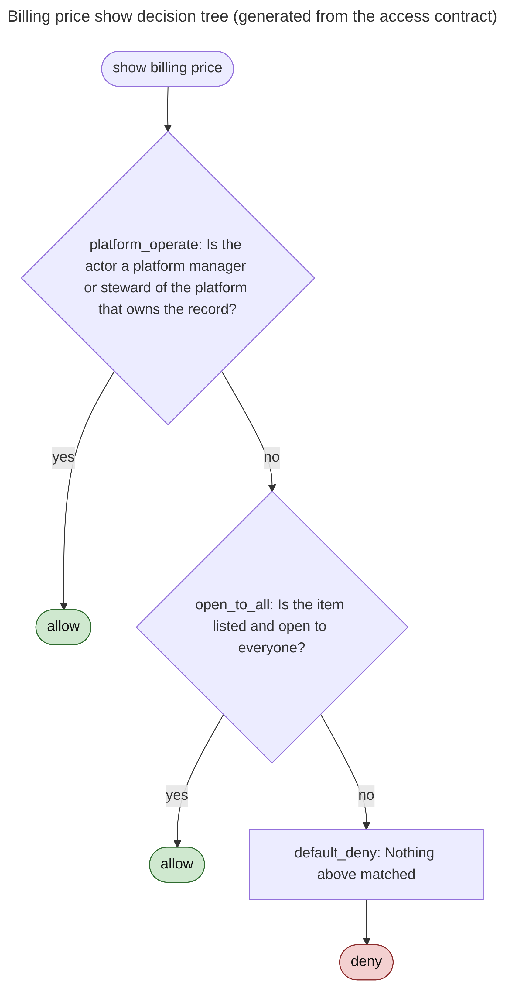

[Open the SVG](../../diagrams/exports/svg/access_contract_billing_price_decision_tree.svg) · [Mermaid source](../../diagrams/source/access_contract_billing_price_decision_tree.mmd)

### Rules in order

| # | Rule | Question | Decides | Note |
| --- | --- | --- | --- | --- |
| 1 | `platform_operate` | Is the actor a platform manager or steward of the platform that owns the record? | allow |  |
| 2 | `open_to_all` | Is the item listed and open to everyone? | allow |  |
| 3 | `default_deny` | Nothing above matched | deny |  |

### index

| Persona | any |
| --- | --- |
| `anonymous` | deny default_deny |
| `signed_in_non_member` | deny default_deny |
| `community_member` | deny default_deny |
| `community_contributor` | deny default_deny |
| `community_organizer` | deny default_deny |
| `platform_manager` | allow platform_operate |
| `platform_steward` | allow platform_operate |
| `safety_reviewer` (pending) | pending |
| `remote_operator` (pending) | pending |
| `support_grantee` (pending) | pending |
| `record_owner` | n/a |
| `blocked_user` | n/a |

Reasons

- allow via `platform_operate`: Managers and stewards operate the price of their own platform. (platform_manager, platform_steward)
- deny via `default_deny`: Needs platform billing authority, an account or ownership this person does not hold. (anonymous, community_contributor, community_member, community_organizer, signed_in_non_member)

### show

| Persona | public | archived | other_platform |
| --- | --- | --- | --- |
| `anonymous` | deny default_deny | deny default_deny | deny default_deny |
| `signed_in_non_member` | deny default_deny | deny default_deny | deny default_deny |
| `community_member` | deny default_deny | deny default_deny | deny default_deny |
| `community_contributor` | deny default_deny | deny default_deny | deny default_deny |
| `community_organizer` | deny default_deny | deny default_deny | deny default_deny |
| `platform_manager` | allow platform_operate | allow platform_operate | deny default_deny |
| `platform_steward` | allow platform_operate | allow platform_operate | deny default_deny |
| `safety_reviewer` (pending) | pending | pending | pending |
| `remote_operator` (pending) | pending | pending | pending |
| `support_grantee` (pending) | pending | pending | pending |
| `record_owner` | n/a | n/a | n/a |
| `blocked_user` | n/a | n/a | n/a |

Reasons

- allow via `platform_operate`: Managers and stewards operate the price of their own platform. (platform_manager, platform_steward)
- deny via `default_deny`: Needs platform billing authority, an account or ownership this person does not hold. (anonymous, community_contributor, community_member, community_organizer, signed_in_non_member)
- deny via `default_deny`: Records of another platform are out of reach; tenant isolation. (anonymous, community_contributor, community_member, community_organizer, platform_manager, platform_steward, signed_in_non_member)

### new

| Persona | new |
| --- | --- |
| `anonymous` | deny default_deny |
| `signed_in_non_member` | deny default_deny |
| `community_member` | deny default_deny |
| `community_contributor` | deny default_deny |
| `community_organizer` | deny default_deny |
| `platform_manager` | allow platform_operate |
| `platform_steward` | allow platform_operate |
| `safety_reviewer` (pending) | pending |
| `remote_operator` (pending) | pending |
| `support_grantee` (pending) | pending |
| `record_owner` | n/a |
| `blocked_user` | n/a |

Reasons

- allow via `platform_operate`: Managers and stewards operate the price of their own platform. (platform_manager, platform_steward)
- deny via `default_deny`: Needs platform billing authority, an account or ownership this person does not hold. (anonymous, community_contributor, community_member, community_organizer, signed_in_non_member)

### create

| Persona | new |
| --- | --- |
| `anonymous` | deny default_deny |
| `signed_in_non_member` | deny default_deny |
| `community_member` | deny default_deny |
| `community_contributor` | deny default_deny |
| `community_organizer` | deny default_deny |
| `platform_manager` | allow platform_operate |
| `platform_steward` | allow platform_operate |
| `safety_reviewer` (pending) | pending |
| `remote_operator` (pending) | pending |
| `support_grantee` (pending) | pending |
| `record_owner` | n/a |
| `blocked_user` | n/a |

Reasons

- allow via `platform_operate`: Managers and stewards operate the price of their own platform. (platform_manager, platform_steward)
- deny via `default_deny`: Needs platform billing authority, an account or ownership this person does not hold. (anonymous, community_contributor, community_member, community_organizer, signed_in_non_member)

### archive

| Persona | public | archived | other_platform |
| --- | --- | --- | --- |
| `anonymous` | deny default_deny | deny default_deny | deny default_deny |
| `signed_in_non_member` | deny default_deny | deny default_deny | deny default_deny |
| `community_member` | deny default_deny | deny default_deny | deny default_deny |
| `community_contributor` | deny default_deny | deny default_deny | deny default_deny |
| `community_organizer` | deny default_deny | deny default_deny | deny default_deny |
| `platform_manager` | allow platform_operate | allow platform_operate | deny default_deny |
| `platform_steward` | allow platform_operate | allow platform_operate | deny default_deny |
| `safety_reviewer` (pending) | pending | pending | pending |
| `remote_operator` (pending) | pending | pending | pending |
| `support_grantee` (pending) | pending | pending | pending |
| `record_owner` | n/a | n/a | n/a |
| `blocked_user` | n/a | n/a | n/a |

Reasons

- allow via `platform_operate`: Managers and stewards operate the price of their own platform. (platform_manager, platform_steward)
- deny via `default_deny`: Needs platform billing authority, an account or ownership this person does not hold. (anonymous, community_contributor, community_member, community_organizer, signed_in_non_member)
- deny via `default_deny`: Records of another platform are out of reach; tenant isolation. (anonymous, community_contributor, community_member, community_organizer, platform_manager, platform_steward, signed_in_non_member)

### edit

| Persona | public | archived | other_platform |
| --- | --- | --- | --- |
| `anonymous` | deny default_deny | deny default_deny | deny default_deny |
| `signed_in_non_member` | deny default_deny | deny default_deny | deny default_deny |
| `community_member` | deny default_deny | deny default_deny | deny default_deny |
| `community_contributor` | deny default_deny | deny default_deny | deny default_deny |
| `community_organizer` | deny default_deny | deny default_deny | deny default_deny |
| `platform_manager` | deny default_deny | deny default_deny | deny default_deny |
| `platform_steward` | deny default_deny | deny default_deny | deny default_deny |
| `safety_reviewer` (pending) | pending | pending | pending |
| `remote_operator` (pending) | pending | pending | pending |
| `support_grantee` (pending) | pending | pending | pending |
| `record_owner` | n/a | n/a | n/a |
| `blocked_user` | n/a | n/a | n/a |

Reasons

- deny via `default_deny`: Needs platform billing authority, an account or ownership this person does not hold. (anonymous, community_contributor, community_member, community_organizer, platform_manager, platform_steward, signed_in_non_member)

### update

| Persona | public | archived | other_platform |
| --- | --- | --- | --- |
| `anonymous` | deny default_deny | deny default_deny | deny default_deny |
| `signed_in_non_member` | deny default_deny | deny default_deny | deny default_deny |
| `community_member` | deny default_deny | deny default_deny | deny default_deny |
| `community_contributor` | deny default_deny | deny default_deny | deny default_deny |
| `community_organizer` | deny default_deny | deny default_deny | deny default_deny |
| `platform_manager` | deny default_deny | deny default_deny | deny default_deny |
| `platform_steward` | deny default_deny | deny default_deny | deny default_deny |
| `safety_reviewer` (pending) | pending | pending | pending |
| `remote_operator` (pending) | pending | pending | pending |
| `support_grantee` (pending) | pending | pending | pending |
| `record_owner` | n/a | n/a | n/a |
| `blocked_user` | n/a | n/a | n/a |

Reasons

- deny via `default_deny`: Needs platform billing authority, an account or ownership this person does not hold. (anonymous, community_contributor, community_member, community_organizer, platform_manager, platform_steward, signed_in_non_member)

### destroy

| Persona | public | archived | other_platform |
| --- | --- | --- | --- |
| `anonymous` | deny default_deny | deny default_deny | deny default_deny |
| `signed_in_non_member` | deny default_deny | deny default_deny | deny default_deny |
| `community_member` | deny default_deny | deny default_deny | deny default_deny |
| `community_contributor` | deny default_deny | deny default_deny | deny default_deny |
| `community_organizer` | deny default_deny | deny default_deny | deny default_deny |
| `platform_manager` | deny default_deny | deny default_deny | deny default_deny |
| `platform_steward` | deny default_deny | deny default_deny | deny default_deny |
| `safety_reviewer` (pending) | pending | pending | pending |
| `remote_operator` (pending) | pending | pending | pending |
| `support_grantee` (pending) | pending | pending | pending |
| `record_owner` | n/a | n/a | n/a |
| `blocked_user` | n/a | n/a | n/a |

Reasons

- deny via `default_deny`: Needs platform billing authority, an account or ownership this person does not hold. (anonymous, community_contributor, community_member, community_organizer, platform_manager, platform_steward, signed_in_non_member)

### purchase

| Persona | public | archived | other_platform |
| --- | --- | --- | --- |
| `anonymous` | allow open_to_all | deny default_deny | deny default_deny |
| `signed_in_non_member` | allow open_to_all | deny default_deny | deny default_deny |
| `community_member` | allow open_to_all | deny default_deny | deny default_deny |
| `community_contributor` | allow open_to_all | deny default_deny | deny default_deny |
| `community_organizer` | allow open_to_all | deny default_deny | deny default_deny |
| `platform_manager` | allow open_to_all | deny default_deny | deny default_deny |
| `platform_steward` | allow open_to_all | deny default_deny | deny default_deny |
| `safety_reviewer` (pending) | pending | pending | pending |
| `remote_operator` (pending) | pending | pending | pending |
| `support_grantee` (pending) | pending | pending | pending |
| `record_owner` | n/a | n/a | n/a |
| `blocked_user` | n/a | n/a | n/a |

Reasons

- allow via `open_to_all`: Listed price items are open to anyone. (anonymous, community_contributor, community_member, community_organizer, platform_manager, platform_steward, signed_in_non_member)
- deny via `default_deny`: Needs platform billing authority, an account or ownership this person does not hold. (anonymous, community_contributor, community_member, community_organizer, platform_manager, platform_steward, signed_in_non_member)

### buy_alone

| Persona | public | archived | other_platform |
| --- | --- | --- | --- |
| `anonymous` | deny default_deny | deny default_deny | deny default_deny |
| `signed_in_non_member` | deny default_deny | deny default_deny | deny default_deny |
| `community_member` | deny default_deny | deny default_deny | deny default_deny |
| `community_contributor` | deny default_deny | deny default_deny | deny default_deny |
| `community_organizer` | deny default_deny | deny default_deny | deny default_deny |
| `platform_manager` | deny default_deny | deny default_deny | deny default_deny |
| `platform_steward` | deny default_deny | deny default_deny | deny default_deny |
| `safety_reviewer` (pending) | pending | pending | pending |
| `remote_operator` (pending) | pending | pending | pending |
| `support_grantee` (pending) | pending | pending | pending |
| `record_owner` | n/a | n/a | n/a |
| `blocked_user` | n/a | n/a | n/a |

Reasons

- deny via `default_deny`: Needs platform billing authority, an account or ownership this person does not hold. (anonymous, community_contributor, community_member, community_organizer, platform_manager, platform_steward, signed_in_non_member)

## Billing order

`BetterTogether::Billing::Order` · policy `BetterTogether::Billing::OrderPolicy` · classification `financial`

### Decision tree

Decision tree for show. Dashed red nodes are rules the app applies that the privacy rule does not intend.

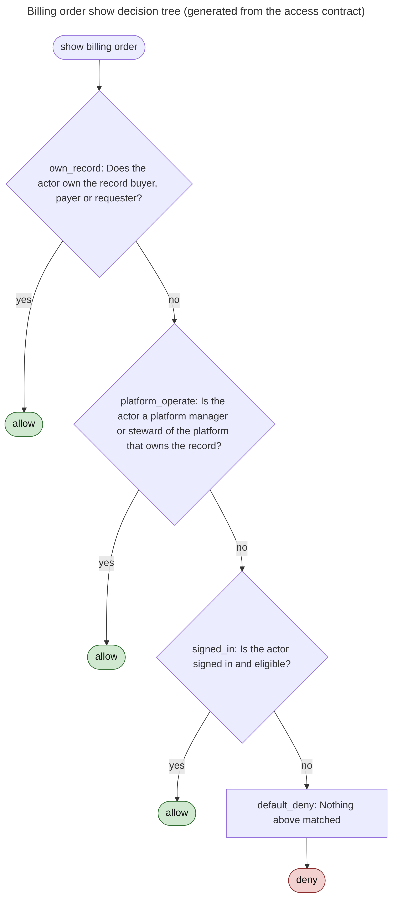

[Open the SVG](../../diagrams/exports/svg/access_contract_billing_order_decision_tree.svg) · [Mermaid source](../../diagrams/source/access_contract_billing_order_decision_tree.mmd)

### Rules in order

| # | Rule | Question | Decides | Note |
| --- | --- | --- | --- | --- |
| 1 | `own_record` | Does the actor own the record (buyer, payer or requester)? | allow |  |
| 2 | `platform_operate` | Is the actor a platform manager or steward of the platform that owns the record? | allow |  |
| 3 | `signed_in` | Is the actor signed in and eligible? | allow |  |
| 4 | `default_deny` | Nothing above matched | deny |  |

### index

| Persona | any |
| --- | --- |
| `anonymous` | deny default_deny |
| `signed_in_non_member` | allow signed_in |
| `community_member` | allow signed_in |
| `community_contributor` | allow signed_in |
| `community_organizer` | allow signed_in |
| `platform_manager` | allow signed_in |
| `platform_steward` | allow signed_in |
| `safety_reviewer` (pending) | pending |
| `remote_operator` (pending) | pending |
| `support_grantee` (pending) | pending |
| `record_owner` | n/a |
| `blocked_user` | n/a |

Reasons

- allow via `signed_in`: Any signed-in person who qualifies may use the order. (community_contributor, community_member, community_organizer, platform_manager, platform_steward, signed_in_non_member)
- deny via `default_deny`: Needs platform billing authority, an account or ownership this person does not hold. (anonymous)

### show

| Persona | own | someone_elses |
| --- | --- | --- |
| `anonymous` | n/a | deny default_deny |
| `signed_in_non_member` | n/a | deny default_deny |
| `community_member` | n/a | deny default_deny |
| `community_contributor` | n/a | deny default_deny |
| `community_organizer` | n/a | deny default_deny |
| `platform_manager` | n/a | deny default_deny |
| `platform_steward` | n/a | deny default_deny |
| `safety_reviewer` (pending) | pending | pending |
| `remote_operator` (pending) | pending | pending |
| `support_grantee` (pending) | pending | pending |
| `record_owner` | allow own_record | n/a |
| `blocked_user` | n/a | n/a |

Reasons

- allow via `own_record`: The buyer reaches their own order. (record_owner)
- deny via `default_deny`: Belongs to another person. (anonymous, community_contributor, community_member, community_organizer, platform_manager, platform_steward, signed_in_non_member)

### checkout

| Persona | any |
| --- | --- |
| `anonymous` | deny default_deny |
| `signed_in_non_member` | allow signed_in |
| `community_member` | allow signed_in |
| `community_contributor` | allow signed_in |
| `community_organizer` | allow signed_in |
| `platform_manager` | allow signed_in |
| `platform_steward` | allow signed_in |
| `safety_reviewer` (pending) | pending |
| `remote_operator` (pending) | pending |
| `support_grantee` (pending) | pending |
| `record_owner` | n/a |
| `blocked_user` | n/a |

Reasons

- allow via `signed_in`: Any signed-in person who qualifies may use the order. (community_contributor, community_member, community_organizer, platform_manager, platform_steward, signed_in_non_member)
- deny via `default_deny`: Needs platform billing authority, an account or ownership this person does not hold. (anonymous)

### new

| Persona | new |
| --- | --- |
| `anonymous` | deny default_deny |
| `signed_in_non_member` | deny default_deny |
| `community_member` | deny default_deny |
| `community_contributor` | deny default_deny |
| `community_organizer` | deny default_deny |
| `platform_manager` | deny default_deny |
| `platform_steward` | deny default_deny |
| `safety_reviewer` (pending) | pending |
| `remote_operator` (pending) | pending |
| `support_grantee` (pending) | pending |
| `record_owner` | n/a |
| `blocked_user` | n/a |

Reasons

- deny via `default_deny`: Needs platform billing authority, an account or ownership this person does not hold. (anonymous, community_contributor, community_member, community_organizer, platform_manager, platform_steward, signed_in_non_member)

### create

| Persona | new |
| --- | --- |
| `anonymous` | deny default_deny |
| `signed_in_non_member` | deny default_deny |
| `community_member` | deny default_deny |
| `community_contributor` | deny default_deny |
| `community_organizer` | deny default_deny |
| `platform_manager` | deny default_deny |
| `platform_steward` | deny default_deny |
| `safety_reviewer` (pending) | pending |
| `remote_operator` (pending) | pending |
| `support_grantee` (pending) | pending |
| `record_owner` | n/a |
| `blocked_user` | n/a |

Reasons

- deny via `default_deny`: Needs platform billing authority, an account or ownership this person does not hold. (anonymous, community_contributor, community_member, community_organizer, platform_manager, platform_steward, signed_in_non_member)

### update

| Persona | own | someone_elses |
| --- | --- | --- |
| `anonymous` | n/a | deny default_deny |
| `signed_in_non_member` | n/a | deny default_deny |
| `community_member` | n/a | deny default_deny |
| `community_contributor` | n/a | deny default_deny |
| `community_organizer` | n/a | deny default_deny |
| `platform_manager` | n/a | deny default_deny |
| `platform_steward` | n/a | deny default_deny |
| `safety_reviewer` (pending) | pending | pending |
| `remote_operator` (pending) | pending | pending |
| `support_grantee` (pending) | pending | pending |
| `record_owner` | deny default_deny | n/a |
| `blocked_user` | n/a | n/a |

Reasons

- deny via `default_deny`: Belongs to another person. (anonymous, community_contributor, community_member, community_organizer, platform_manager, platform_steward, signed_in_non_member)
- deny via `default_deny`: Needs platform billing authority, an account or ownership this person does not hold. (record_owner)

### destroy

| Persona | own | someone_elses |
| --- | --- | --- |
| `anonymous` | n/a | deny default_deny |
| `signed_in_non_member` | n/a | deny default_deny |
| `community_member` | n/a | deny default_deny |
| `community_contributor` | n/a | deny default_deny |
| `community_organizer` | n/a | deny default_deny |
| `platform_manager` | n/a | deny default_deny |
| `platform_steward` | n/a | deny default_deny |
| `safety_reviewer` (pending) | pending | pending |
| `remote_operator` (pending) | pending | pending |
| `support_grantee` (pending) | pending | pending |
| `record_owner` | deny default_deny | n/a |
| `blocked_user` | n/a | n/a |

Reasons

- deny via `default_deny`: Belongs to another person. (anonymous, community_contributor, community_member, community_organizer, platform_manager, platform_steward, signed_in_non_member)
- deny via `default_deny`: Needs platform billing authority, an account or ownership this person does not hold. (record_owner)

### claim

| Persona | own | someone_elses |
| --- | --- | --- |
| `anonymous` | n/a | deny default_deny |
| `signed_in_non_member` | n/a | deny default_deny |
| `community_member` | n/a | deny default_deny |
| `community_contributor` | n/a | deny default_deny |
| `community_organizer` | n/a | deny default_deny |
| `platform_manager` | n/a | deny default_deny |
| `platform_steward` | n/a | deny default_deny |
| `safety_reviewer` (pending) | pending | pending |
| `remote_operator` (pending) | pending | pending |
| `support_grantee` (pending) | pending | pending |
| `record_owner` | allow own_record | n/a |
| `blocked_user` | n/a | n/a |

Reasons

- allow via `own_record`: The buyer reaches their own order. (record_owner)
- deny via `default_deny`: Belongs to another person. (anonymous, community_contributor, community_member, community_organizer, platform_manager, platform_steward, signed_in_non_member)

### add_payment

| Persona | own | someone_elses |
| --- | --- | --- |
| `anonymous` | n/a | deny default_deny |
| `signed_in_non_member` | n/a | deny default_deny |
| `community_member` | n/a | deny default_deny |
| `community_contributor` | n/a | deny default_deny |
| `community_organizer` | n/a | deny default_deny |
| `platform_manager` | n/a | deny default_deny |
| `platform_steward` | n/a | deny default_deny |
| `safety_reviewer` (pending) | pending | pending |
| `remote_operator` (pending) | pending | pending |
| `support_grantee` (pending) | pending | pending |
| `record_owner` | allow own_record | n/a |
| `blocked_user` | n/a | n/a |

Reasons

- allow via `own_record`: The buyer reaches their own order. (record_owner)
- deny via `default_deny`: Belongs to another person. (anonymous, community_contributor, community_member, community_organizer, platform_manager, platform_steward, signed_in_non_member)

### pay

| Persona | own | someone_elses |
| --- | --- | --- |
| `anonymous` | n/a | deny default_deny |
| `signed_in_non_member` | n/a | deny default_deny |
| `community_member` | n/a | deny default_deny |
| `community_contributor` | n/a | deny default_deny |
| `community_organizer` | n/a | deny default_deny |
| `platform_manager` | n/a | deny default_deny |
| `platform_steward` | n/a | deny default_deny |
| `safety_reviewer` (pending) | pending | pending |
| `remote_operator` (pending) | pending | pending |
| `support_grantee` (pending) | pending | pending |
| `record_owner` | allow own_record | n/a |
| `blocked_user` | n/a | n/a |

Reasons

- allow via `own_record`: The buyer reaches their own order. (record_owner)
- deny via `default_deny`: Belongs to another person. (anonymous, community_contributor, community_member, community_organizer, platform_manager, platform_steward, signed_in_non_member)

### checkout_return

| Persona | own | someone_elses |
| --- | --- | --- |
| `anonymous` | n/a | deny default_deny |
| `signed_in_non_member` | n/a | deny default_deny |
| `community_member` | n/a | deny default_deny |
| `community_contributor` | n/a | deny default_deny |
| `community_organizer` | n/a | deny default_deny |
| `platform_manager` | n/a | deny default_deny |
| `platform_steward` | n/a | deny default_deny |
| `safety_reviewer` (pending) | pending | pending |
| `remote_operator` (pending) | pending | pending |
| `support_grantee` (pending) | pending | pending |
| `record_owner` | allow own_record | n/a |
| `blocked_user` | n/a | n/a |

Reasons

- allow via `own_record`: The buyer reaches their own order. (record_owner)
- deny via `default_deny`: Belongs to another person. (anonymous, community_contributor, community_member, community_organizer, platform_manager, platform_steward, signed_in_non_member)

### sales

| Persona | any |
| --- | --- |
| `anonymous` | deny default_deny |
| `signed_in_non_member` | deny default_deny |
| `community_member` | deny default_deny |
| `community_contributor` | deny default_deny |
| `community_organizer` | deny default_deny |
| `platform_manager` | allow platform_operate |
| `platform_steward` | allow platform_operate |
| `safety_reviewer` (pending) | pending |
| `remote_operator` (pending) | pending |
| `support_grantee` (pending) | pending |
| `record_owner` | n/a |
| `blocked_user` | n/a |

Reasons

- allow via `platform_operate`: Managers and stewards operate the order of their own platform. (platform_manager, platform_steward)
- deny via `default_deny`: Needs platform billing authority, an account or ownership this person does not hold. (anonymous, community_contributor, community_member, community_organizer, signed_in_non_member)

### sale

| Persona | own | someone_elses |
| --- | --- | --- |
| `anonymous` | n/a | deny default_deny |
| `signed_in_non_member` | n/a | deny default_deny |
| `community_member` | n/a | deny default_deny |
| `community_contributor` | n/a | deny default_deny |
| `community_organizer` | n/a | deny default_deny |
| `platform_manager` | n/a | allow platform_operate |
| `platform_steward` | n/a | allow platform_operate |
| `safety_reviewer` (pending) | pending | pending |
| `remote_operator` (pending) | pending | pending |
| `support_grantee` (pending) | pending | pending |
| `record_owner` | deny default_deny | n/a |
| `blocked_user` | n/a | n/a |

Reasons

- allow via `platform_operate`: Managers and stewards operate the order of their own platform. (platform_manager, platform_steward)
- deny via `default_deny`: Belongs to another person. (anonymous, community_contributor, community_member, community_organizer, signed_in_non_member)
- deny via `default_deny`: Needs platform billing authority, an account or ownership this person does not hold. (record_owner)

### refund

| Persona | own | someone_elses |
| --- | --- | --- |
| `anonymous` | n/a | deny default_deny |
| `signed_in_non_member` | n/a | deny default_deny |
| `community_member` | n/a | deny default_deny |
| `community_contributor` | n/a | deny default_deny |
| `community_organizer` | n/a | deny default_deny |
| `platform_manager` | n/a | allow platform_operate |
| `platform_steward` | n/a | allow platform_operate |
| `safety_reviewer` (pending) | pending | pending |
| `remote_operator` (pending) | pending | pending |
| `support_grantee` (pending) | pending | pending |
| `record_owner` | deny default_deny | n/a |
| `blocked_user` | n/a | n/a |

Reasons

- allow via `platform_operate`: Managers and stewards operate the order of their own platform. (platform_manager, platform_steward)
- deny via `default_deny`: Belongs to another person. (anonymous, community_contributor, community_member, community_organizer, signed_in_non_member)
- deny via `default_deny`: Needs platform billing authority, an account or ownership this person does not hold. (record_owner)

### return_payments

| Persona | own | someone_elses |
| --- | --- | --- |
| `anonymous` | n/a | deny default_deny |
| `signed_in_non_member` | n/a | deny default_deny |
| `community_member` | n/a | deny default_deny |
| `community_contributor` | n/a | deny default_deny |
| `community_organizer` | n/a | deny default_deny |
| `platform_manager` | n/a | allow platform_operate |
| `platform_steward` | n/a | allow platform_operate |
| `safety_reviewer` (pending) | pending | pending |
| `remote_operator` (pending) | pending | pending |
| `support_grantee` (pending) | pending | pending |
| `record_owner` | deny default_deny | n/a |
| `blocked_user` | n/a | n/a |

Reasons

- allow via `platform_operate`: Managers and stewards operate the order of their own platform. (platform_manager, platform_steward)
- deny via `default_deny`: Belongs to another person. (anonymous, community_contributor, community_member, community_organizer, signed_in_non_member)
- deny via `default_deny`: Needs platform billing authority, an account or ownership this person does not hold. (record_owner)

### cancel

| Persona | own | someone_elses |
| --- | --- | --- |
| `anonymous` | n/a | deny default_deny |
| `signed_in_non_member` | n/a | deny default_deny |
| `community_member` | n/a | deny default_deny |
| `community_contributor` | n/a | deny default_deny |
| `community_organizer` | n/a | deny default_deny |
| `platform_manager` | n/a | allow platform_operate |
| `platform_steward` | n/a | allow platform_operate |
| `safety_reviewer` (pending) | pending | pending |
| `remote_operator` (pending) | pending | pending |
| `support_grantee` (pending) | pending | pending |
| `record_owner` | deny default_deny | n/a |
| `blocked_user` | n/a | n/a |

Reasons

- allow via `platform_operate`: Managers and stewards operate the order of their own platform. (platform_manager, platform_steward)
- deny via `default_deny`: Belongs to another person. (anonymous, community_contributor, community_member, community_organizer, signed_in_non_member)
- deny via `default_deny`: Needs platform billing authority, an account or ownership this person does not hold. (record_owner)

### walk_up

| Persona | any |
| --- | --- |
| `anonymous` | deny default_deny |
| `signed_in_non_member` | deny default_deny |
| `community_member` | deny default_deny |
| `community_contributor` | deny default_deny |
| `community_organizer` | deny default_deny |
| `platform_manager` | allow platform_operate |
| `platform_steward` | allow platform_operate |
| `safety_reviewer` (pending) | pending |
| `remote_operator` (pending) | pending |
| `support_grantee` (pending) | pending |
| `record_owner` | n/a |
| `blocked_user` | n/a |

Reasons

- allow via `platform_operate`: Managers and stewards operate the order of their own platform. (platform_manager, platform_steward)
- deny via `default_deny`: Needs platform billing authority, an account or ownership this person does not hold. (anonymous, community_contributor, community_member, community_organizer, signed_in_non_member)

### scope

| Persona | own | someone_elses |
| --- | --- | --- |
| `anonymous` | n/a | deny default_deny |
| `signed_in_non_member` | n/a | deny default_deny |
| `community_member` | n/a | deny default_deny |
| `community_contributor` | n/a | deny default_deny |
| `community_organizer` | n/a | deny default_deny |
| `platform_manager` | n/a | deny default_deny |
| `platform_steward` | n/a | deny default_deny |
| `safety_reviewer` (pending) | pending | pending |
| `remote_operator` (pending) | pending | pending |
| `support_grantee` (pending) | pending | pending |
| `record_owner` | allow own_record | n/a |
| `blocked_user` | n/a | n/a |

Reasons

- allow via `own_record`: The buyer reaches their own order. (record_owner)
- deny via `default_deny`: Belongs to another person. (anonymous, community_contributor, community_member, community_organizer, platform_manager, platform_steward, signed_in_non_member)

## Billing refund request

`BetterTogether::Billing::RefundRequest` · policy `BetterTogether::Billing::RefundRequestPolicy` · classification `financial`

### Decision tree

Decision tree for show. Dashed red nodes are rules the app applies that the privacy rule does not intend.

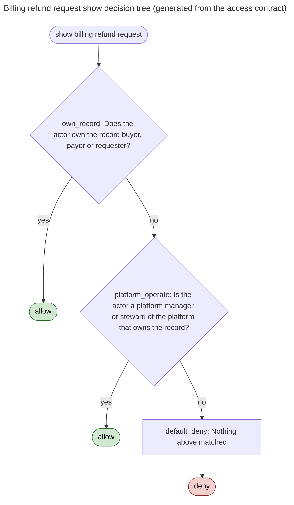

[Open the SVG](../../diagrams/exports/svg/access_contract_billing_refund_request_decision_tree.svg) · [Mermaid source](../../diagrams/source/access_contract_billing_refund_request_decision_tree.mmd)

### Rules in order

| # | Rule | Question | Decides | Note |
| --- | --- | --- | --- | --- |
| 1 | `own_record` | Does the actor own the record (buyer, payer or requester)? | allow |  |
| 2 | `platform_operate` | Is the actor a platform manager or steward of the platform that owns the record? | allow |  |
| 3 | `default_deny` | Nothing above matched | deny |  |

### new

| Persona | own | someone_elses |
| --- | --- | --- |
| `anonymous` | n/a | deny default_deny |
| `signed_in_non_member` | n/a | deny default_deny |
| `community_member` | n/a | deny default_deny |
| `community_contributor` | n/a | deny default_deny |
| `community_organizer` | n/a | deny default_deny |
| `platform_manager` | n/a | deny default_deny |
| `platform_steward` | n/a | deny default_deny |
| `safety_reviewer` (pending) | pending | pending |
| `remote_operator` (pending) | pending | pending |
| `support_grantee` (pending) | pending | pending |
| `record_owner` | deny default_deny | n/a |
| `blocked_user` | n/a | n/a |

Reasons

- deny via `default_deny`: Belongs to another person. (anonymous, community_contributor, community_member, community_organizer, platform_manager, platform_steward, signed_in_non_member)
- deny via `default_deny`: Needs platform billing authority, an account or ownership this person does not hold. (record_owner)

### create

| Persona | own | someone_elses |
| --- | --- | --- |
| `anonymous` | n/a | deny default_deny |
| `signed_in_non_member` | n/a | deny default_deny |
| `community_member` | n/a | deny default_deny |
| `community_contributor` | n/a | deny default_deny |
| `community_organizer` | n/a | deny default_deny |
| `platform_manager` | n/a | deny default_deny |
| `platform_steward` | n/a | deny default_deny |
| `safety_reviewer` (pending) | pending | pending |
| `remote_operator` (pending) | pending | pending |
| `support_grantee` (pending) | pending | pending |
| `record_owner` | deny default_deny | n/a |
| `blocked_user` | n/a | n/a |

Reasons

- deny via `default_deny`: Belongs to another person. (anonymous, community_contributor, community_member, community_organizer, platform_manager, platform_steward, signed_in_non_member)
- deny via `default_deny`: Needs platform billing authority, an account or ownership this person does not hold. (record_owner)

### cancel

| Persona | own | someone_elses |
| --- | --- | --- |
| `anonymous` | n/a | deny default_deny |
| `signed_in_non_member` | n/a | deny default_deny |
| `community_member` | n/a | deny default_deny |
| `community_contributor` | n/a | deny default_deny |
| `community_organizer` | n/a | deny default_deny |
| `platform_manager` | n/a | deny default_deny |
| `platform_steward` | n/a | deny default_deny |
| `safety_reviewer` (pending) | pending | pending |
| `remote_operator` (pending) | pending | pending |
| `support_grantee` (pending) | pending | pending |
| `record_owner` | allow own_record | n/a |
| `blocked_user` | n/a | n/a |

Reasons

- allow via `own_record`: The buyer reaches their own refund request. (record_owner)
- deny via `default_deny`: Belongs to another person. (anonymous, community_contributor, community_member, community_organizer, platform_manager, platform_steward, signed_in_non_member)

### index

| Persona | any |
| --- | --- |
| `anonymous` | deny default_deny |
| `signed_in_non_member` | deny default_deny |
| `community_member` | deny default_deny |
| `community_contributor` | deny default_deny |
| `community_organizer` | deny default_deny |
| `platform_manager` | allow platform_operate |
| `platform_steward` | allow platform_operate |
| `safety_reviewer` (pending) | pending |
| `remote_operator` (pending) | pending |
| `support_grantee` (pending) | pending |
| `record_owner` | n/a |
| `blocked_user` | n/a |

Reasons

- allow via `platform_operate`: Managers and stewards operate the refund request of their own platform. (platform_manager, platform_steward)
- deny via `default_deny`: Needs platform billing authority, an account or ownership this person does not hold. (anonymous, community_contributor, community_member, community_organizer, signed_in_non_member)

### show

| Persona | own | someone_elses |
| --- | --- | --- |
| `anonymous` | n/a | deny default_deny |
| `signed_in_non_member` | n/a | deny default_deny |
| `community_member` | n/a | deny default_deny |
| `community_contributor` | n/a | deny default_deny |
| `community_organizer` | n/a | deny default_deny |
| `platform_manager` | n/a | deny (app: allow) [^1] |
| `platform_steward` | n/a | deny (app: allow) [^1] |
| `safety_reviewer` (pending) | pending | pending |
| `remote_operator` (pending) | pending | pending |
| `support_grantee` (pending) | pending | pending |
| `record_owner` | deny default_deny | n/a |
| `blocked_user` | n/a | n/a |

[^1]: BL-1, known deviation: Platform operators read buyers financial records.

Reasons

- deny via `default_deny`: Belongs to another person. (anonymous, community_contributor, community_member, community_organizer, signed_in_non_member)
- deny via `default_deny`: Needs platform billing authority, an account or ownership this person does not hold. (record_owner)
- deny via `default_deny`: No standing role reads buyers' financial records or platform money figures. (platform_manager, platform_steward)

### decide

| Persona | own | someone_elses |
| --- | --- | --- |
| `anonymous` | n/a | deny default_deny |
| `signed_in_non_member` | n/a | deny default_deny |
| `community_member` | n/a | deny default_deny |
| `community_contributor` | n/a | deny default_deny |
| `community_organizer` | n/a | deny default_deny |
| `platform_manager` | n/a | allow platform_operate |
| `platform_steward` | n/a | allow platform_operate |
| `safety_reviewer` (pending) | pending | pending |
| `remote_operator` (pending) | pending | pending |
| `support_grantee` (pending) | pending | pending |
| `record_owner` | deny default_deny | n/a |
| `blocked_user` | n/a | n/a |

Reasons

- allow via `platform_operate`: Managers and stewards operate the refund request of their own platform. (platform_manager, platform_steward)
- deny via `default_deny`: Belongs to another person. (anonymous, community_contributor, community_member, community_organizer, signed_in_non_member)
- deny via `default_deny`: Needs platform billing authority, an account or ownership this person does not hold. (record_owner)

### scope

| Persona | own | someone_elses |
| --- | --- | --- |
| `anonymous` | n/a | deny default_deny |
| `signed_in_non_member` | n/a | deny default_deny |
| `community_member` | n/a | deny default_deny |
| `community_contributor` | n/a | deny default_deny |
| `community_organizer` | n/a | deny default_deny |
| `platform_manager` | n/a | deny (app: allow) [^1] |
| `platform_steward` | n/a | deny (app: allow) [^1] |
| `safety_reviewer` (pending) | pending | pending |
| `remote_operator` (pending) | pending | pending |
| `support_grantee` (pending) | pending | pending |
| `record_owner` | deny default_deny | n/a |
| `blocked_user` | n/a | n/a |

[^1]: BL-1, known deviation: Platform operators read buyers financial records.

Reasons

- deny via `default_deny`: Belongs to another person. (anonymous, community_contributor, community_member, community_organizer, signed_in_non_member)
- deny via `default_deny`: Needs platform billing authority, an account or ownership this person does not hold. (record_owner)
- deny via `default_deny`: No standing role reads buyers' financial records or platform money figures. (platform_manager, platform_steward)

## Billing subscription term

`BetterTogether::Billing::SubscriptionTerm` · policy `BetterTogether::Billing::SubscriptionTermPolicy` · classification `financial`

### Decision tree

Decision tree for show. Dashed red nodes are rules the app applies that the privacy rule does not intend.

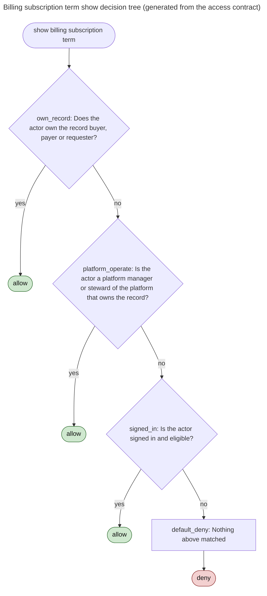

[Open the SVG](../../diagrams/exports/svg/access_contract_billing_subscription_term_decision_tree.svg) · [Mermaid source](../../diagrams/source/access_contract_billing_subscription_term_decision_tree.mmd)

### Rules in order

| # | Rule | Question | Decides | Note |
| --- | --- | --- | --- | --- |
| 1 | `own_record` | Does the actor own the record (buyer, payer or requester)? | allow |  |
| 2 | `platform_operate` | Is the actor a platform manager or steward of the platform that owns the record? | allow |  |
| 3 | `signed_in` | Is the actor signed in and eligible? | allow |  |
| 4 | `default_deny` | Nothing above matched | deny |  |

### own

| Persona | any |
| --- | --- |
| `anonymous` | deny default_deny |
| `signed_in_non_member` | allow signed_in |
| `community_member` | allow signed_in |
| `community_contributor` | allow signed_in |
| `community_organizer` | allow signed_in |
| `platform_manager` | allow signed_in |
| `platform_steward` | allow signed_in |
| `safety_reviewer` (pending) | pending |
| `remote_operator` (pending) | pending |
| `support_grantee` (pending) | pending |
| `record_owner` | n/a |
| `blocked_user` | n/a |

Reasons

- allow via `signed_in`: Any signed-in person who qualifies may use the subscription term. (community_contributor, community_member, community_organizer, platform_manager, platform_steward, signed_in_non_member)
- deny via `default_deny`: Needs platform billing authority, an account or ownership this person does not hold. (anonymous)

### show

| Persona | own | someone_elses |
| --- | --- | --- |
| `anonymous` | n/a | deny default_deny |
| `signed_in_non_member` | n/a | deny default_deny |
| `community_member` | n/a | deny default_deny |
| `community_contributor` | n/a | deny default_deny |
| `community_organizer` | n/a | deny default_deny |
| `platform_manager` | n/a | deny default_deny |
| `platform_steward` | n/a | deny default_deny |
| `safety_reviewer` (pending) | pending | pending |
| `remote_operator` (pending) | pending | pending |
| `support_grantee` (pending) | pending | pending |
| `record_owner` | allow own_record | n/a |
| `blocked_user` | n/a | n/a |

Reasons

- allow via `own_record`: The buyer reaches their own subscription term. (record_owner)
- deny via `default_deny`: Belongs to another person. (anonymous, community_contributor, community_member, community_organizer, platform_manager, platform_steward, signed_in_non_member)

### cancel

| Persona | own | someone_elses |
| --- | --- | --- |
| `anonymous` | n/a | deny default_deny |
| `signed_in_non_member` | n/a | deny default_deny |
| `community_member` | n/a | deny default_deny |
| `community_contributor` | n/a | deny default_deny |
| `community_organizer` | n/a | deny default_deny |
| `platform_manager` | n/a | deny default_deny |
| `platform_steward` | n/a | deny default_deny |
| `safety_reviewer` (pending) | pending | pending |
| `remote_operator` (pending) | pending | pending |
| `support_grantee` (pending) | pending | pending |
| `record_owner` | allow own_record | n/a |
| `blocked_user` | n/a | n/a |

Reasons

- allow via `own_record`: The buyer reaches their own subscription term. (record_owner)
- deny via `default_deny`: Belongs to another person. (anonymous, community_contributor, community_member, community_organizer, platform_manager, platform_steward, signed_in_non_member)

### resume

| Persona | own | someone_elses |
| --- | --- | --- |
| `anonymous` | n/a | deny default_deny |
| `signed_in_non_member` | n/a | deny default_deny |
| `community_member` | n/a | deny default_deny |
| `community_contributor` | n/a | deny default_deny |
| `community_organizer` | n/a | deny default_deny |
| `platform_manager` | n/a | deny default_deny |
| `platform_steward` | n/a | deny default_deny |
| `safety_reviewer` (pending) | pending | pending |
| `remote_operator` (pending) | pending | pending |
| `support_grantee` (pending) | pending | pending |
| `record_owner` | allow own_record | n/a |
| `blocked_user` | n/a | n/a |

Reasons

- allow via `own_record`: The buyer reaches their own subscription term. (record_owner)
- deny via `default_deny`: Belongs to another person. (anonymous, community_contributor, community_member, community_organizer, platform_manager, platform_steward, signed_in_non_member)

### accept_agreements

| Persona | own | someone_elses |
| --- | --- | --- |
| `anonymous` | n/a | deny default_deny |
| `signed_in_non_member` | n/a | deny default_deny |
| `community_member` | n/a | deny default_deny |
| `community_contributor` | n/a | deny default_deny |
| `community_organizer` | n/a | deny default_deny |
| `platform_manager` | n/a | deny default_deny |
| `platform_steward` | n/a | deny default_deny |
| `safety_reviewer` (pending) | pending | pending |
| `remote_operator` (pending) | pending | pending |
| `support_grantee` (pending) | pending | pending |
| `record_owner` | allow own_record | n/a |
| `blocked_user` | n/a | n/a |

Reasons

- allow via `own_record`: The buyer reaches their own subscription term. (record_owner)
- deny via `default_deny`: Belongs to another person. (anonymous, community_contributor, community_member, community_organizer, platform_manager, platform_steward, signed_in_non_member)

### change_plan

| Persona | own | someone_elses |
| --- | --- | --- |
| `anonymous` | n/a | deny default_deny |
| `signed_in_non_member` | n/a | deny default_deny |
| `community_member` | n/a | deny default_deny |
| `community_contributor` | n/a | deny default_deny |
| `community_organizer` | n/a | deny default_deny |
| `platform_manager` | n/a | deny default_deny |
| `platform_steward` | n/a | deny default_deny |
| `safety_reviewer` (pending) | pending | pending |
| `remote_operator` (pending) | pending | pending |
| `support_grantee` (pending) | pending | pending |
| `record_owner` | allow own_record | n/a |
| `blocked_user` | n/a | n/a |

Reasons

- allow via `own_record`: The buyer reaches their own subscription term. (record_owner)
- deny via `default_deny`: Belongs to another person. (anonymous, community_contributor, community_member, community_organizer, platform_manager, platform_steward, signed_in_non_member)

### change_method

| Persona | own | someone_elses |
| --- | --- | --- |
| `anonymous` | n/a | deny default_deny |
| `signed_in_non_member` | n/a | deny default_deny |
| `community_member` | n/a | deny default_deny |
| `community_contributor` | n/a | deny default_deny |
| `community_organizer` | n/a | deny default_deny |
| `platform_manager` | n/a | deny default_deny |
| `platform_steward` | n/a | deny default_deny |
| `safety_reviewer` (pending) | pending | pending |
| `remote_operator` (pending) | pending | pending |
| `support_grantee` (pending) | pending | pending |
| `record_owner` | allow own_record | n/a |
| `blocked_user` | n/a | n/a |

Reasons

- allow via `own_record`: The buyer reaches their own subscription term. (record_owner)
- deny via `default_deny`: Belongs to another person. (anonymous, community_contributor, community_member, community_organizer, platform_manager, platform_steward, signed_in_non_member)

### index

| Persona | any |
| --- | --- |
| `anonymous` | deny default_deny |
| `signed_in_non_member` | deny default_deny |
| `community_member` | deny default_deny |
| `community_contributor` | deny default_deny |
| `community_organizer` | deny default_deny |
| `platform_manager` | allow platform_operate |
| `platform_steward` | allow platform_operate |
| `safety_reviewer` (pending) | pending |
| `remote_operator` (pending) | pending |
| `support_grantee` (pending) | pending |
| `record_owner` | n/a |
| `blocked_user` | n/a |

Reasons

- allow via `platform_operate`: Managers and stewards operate the subscription term of their own platform. (platform_manager, platform_steward)
- deny via `default_deny`: Needs platform billing authority, an account or ownership this person does not hold. (anonymous, community_contributor, community_member, community_organizer, signed_in_non_member)

### subscriber

| Persona | own | someone_elses |
| --- | --- | --- |
| `anonymous` | n/a | deny default_deny |
| `signed_in_non_member` | n/a | deny default_deny |
| `community_member` | n/a | deny default_deny |
| `community_contributor` | n/a | deny default_deny |
| `community_organizer` | n/a | deny default_deny |
| `platform_manager` | n/a | allow platform_operate |
| `platform_steward` | n/a | allow platform_operate |
| `safety_reviewer` (pending) | pending | pending |
| `remote_operator` (pending) | pending | pending |
| `support_grantee` (pending) | pending | pending |
| `record_owner` | deny default_deny | n/a |
| `blocked_user` | n/a | n/a |

Reasons

- allow via `platform_operate`: Managers and stewards operate the subscription term of their own platform. (platform_manager, platform_steward)
- deny via `default_deny`: Belongs to another person. (anonymous, community_contributor, community_member, community_organizer, signed_in_non_member)
- deny via `default_deny`: Needs platform billing authority, an account or ownership this person does not hold. (record_owner)

### waive

| Persona | own | someone_elses |
| --- | --- | --- |
| `anonymous` | n/a | deny default_deny |
| `signed_in_non_member` | n/a | deny default_deny |
| `community_member` | n/a | deny default_deny |
| `community_contributor` | n/a | deny default_deny |
| `community_organizer` | n/a | deny default_deny |
| `platform_manager` | n/a | allow platform_operate |
| `platform_steward` | n/a | allow platform_operate |
| `safety_reviewer` (pending) | pending | pending |
| `remote_operator` (pending) | pending | pending |
| `support_grantee` (pending) | pending | pending |
| `record_owner` | deny default_deny | n/a |
| `blocked_user` | n/a | n/a |

Reasons

- allow via `platform_operate`: Managers and stewards operate the subscription term of their own platform. (platform_manager, platform_steward)
- deny via `default_deny`: Belongs to another person. (anonymous, community_contributor, community_member, community_organizer, signed_in_non_member)
- deny via `default_deny`: Needs platform billing authority, an account or ownership this person does not hold. (record_owner)

### extend_grace

| Persona | own | someone_elses |
| --- | --- | --- |
| `anonymous` | n/a | deny default_deny |
| `signed_in_non_member` | n/a | deny default_deny |
| `community_member` | n/a | deny default_deny |
| `community_contributor` | n/a | deny default_deny |
| `community_organizer` | n/a | deny default_deny |
| `platform_manager` | n/a | allow platform_operate |
| `platform_steward` | n/a | allow platform_operate |
| `safety_reviewer` (pending) | pending | pending |
| `remote_operator` (pending) | pending | pending |
| `support_grantee` (pending) | pending | pending |
| `record_owner` | deny default_deny | n/a |
| `blocked_user` | n/a | n/a |

Reasons

- allow via `platform_operate`: Managers and stewards operate the subscription term of their own platform. (platform_manager, platform_steward)
- deny via `default_deny`: Belongs to another person. (anonymous, community_contributor, community_member, community_organizer, signed_in_non_member)
- deny via `default_deny`: Needs platform billing authority, an account or ownership this person does not hold. (record_owner)

### steward_cancel

| Persona | own | someone_elses |
| --- | --- | --- |
| `anonymous` | n/a | deny default_deny |
| `signed_in_non_member` | n/a | deny default_deny |
| `community_member` | n/a | deny default_deny |
| `community_contributor` | n/a | deny default_deny |
| `community_organizer` | n/a | deny default_deny |
| `platform_manager` | n/a | allow platform_operate |
| `platform_steward` | n/a | allow platform_operate |
| `safety_reviewer` (pending) | pending | pending |
| `remote_operator` (pending) | pending | pending |
| `support_grantee` (pending) | pending | pending |
| `record_owner` | deny default_deny | n/a |
| `blocked_user` | n/a | n/a |

Reasons

- allow via `platform_operate`: Managers and stewards operate the subscription term of their own platform. (platform_manager, platform_steward)
- deny via `default_deny`: Belongs to another person. (anonymous, community_contributor, community_member, community_organizer, signed_in_non_member)
- deny via `default_deny`: Needs platform billing authority, an account or ownership this person does not hold. (record_owner)

### steward_resume

| Persona | own | someone_elses |
| --- | --- | --- |
| `anonymous` | n/a | deny default_deny |
| `signed_in_non_member` | n/a | deny default_deny |
| `community_member` | n/a | deny default_deny |
| `community_contributor` | n/a | deny default_deny |
| `community_organizer` | n/a | deny default_deny |
| `platform_manager` | n/a | allow platform_operate |
| `platform_steward` | n/a | allow platform_operate |
| `safety_reviewer` (pending) | pending | pending |
| `remote_operator` (pending) | pending | pending |
| `support_grantee` (pending) | pending | pending |
| `record_owner` | deny default_deny | n/a |
| `blocked_user` | n/a | n/a |

Reasons

- allow via `platform_operate`: Managers and stewards operate the subscription term of their own platform. (platform_manager, platform_steward)
- deny via `default_deny`: Belongs to another person. (anonymous, community_contributor, community_member, community_organizer, signed_in_non_member)
- deny via `default_deny`: Needs platform billing authority, an account or ownership this person does not hold. (record_owner)

### move_to_current_price

| Persona | own | someone_elses |
| --- | --- | --- |
| `anonymous` | n/a | deny default_deny |
| `signed_in_non_member` | n/a | deny default_deny |
| `community_member` | n/a | deny default_deny |
| `community_contributor` | n/a | deny default_deny |
| `community_organizer` | n/a | deny default_deny |
| `platform_manager` | n/a | allow platform_operate |
| `platform_steward` | n/a | allow platform_operate |
| `safety_reviewer` (pending) | pending | pending |
| `remote_operator` (pending) | pending | pending |
| `support_grantee` (pending) | pending | pending |
| `record_owner` | deny default_deny | n/a |
| `blocked_user` | n/a | n/a |

Reasons

- allow via `platform_operate`: Managers and stewards operate the subscription term of their own platform. (platform_manager, platform_steward)
- deny via `default_deny`: Belongs to another person. (anonymous, community_contributor, community_member, community_organizer, signed_in_non_member)
- deny via `default_deny`: Needs platform billing authority, an account or ownership this person does not hold. (record_owner)

### create

| Persona | new |
| --- | --- |
| `anonymous` | deny default_deny |
| `signed_in_non_member` | deny default_deny |
| `community_member` | deny default_deny |
| `community_contributor` | deny default_deny |
| `community_organizer` | deny default_deny |
| `platform_manager` | deny default_deny |
| `platform_steward` | deny default_deny |
| `safety_reviewer` (pending) | pending |
| `remote_operator` (pending) | pending |
| `support_grantee` (pending) | pending |
| `record_owner` | n/a |
| `blocked_user` | n/a |

Reasons

- deny via `default_deny`: Needs platform billing authority, an account or ownership this person does not hold. (anonymous, community_contributor, community_member, community_organizer, platform_manager, platform_steward, signed_in_non_member)

### update

| Persona | own | someone_elses |
| --- | --- | --- |
| `anonymous` | n/a | deny default_deny |
| `signed_in_non_member` | n/a | deny default_deny |
| `community_member` | n/a | deny default_deny |
| `community_contributor` | n/a | deny default_deny |
| `community_organizer` | n/a | deny default_deny |
| `platform_manager` | n/a | deny default_deny |
| `platform_steward` | n/a | deny default_deny |
| `safety_reviewer` (pending) | pending | pending |
| `remote_operator` (pending) | pending | pending |
| `support_grantee` (pending) | pending | pending |
| `record_owner` | deny default_deny | n/a |
| `blocked_user` | n/a | n/a |

Reasons

- deny via `default_deny`: Belongs to another person. (anonymous, community_contributor, community_member, community_organizer, platform_manager, platform_steward, signed_in_non_member)
- deny via `default_deny`: Needs platform billing authority, an account or ownership this person does not hold. (record_owner)

### destroy

| Persona | own | someone_elses |
| --- | --- | --- |
| `anonymous` | n/a | deny default_deny |
| `signed_in_non_member` | n/a | deny default_deny |
| `community_member` | n/a | deny default_deny |
| `community_contributor` | n/a | deny default_deny |
| `community_organizer` | n/a | deny default_deny |
| `platform_manager` | n/a | deny default_deny |
| `platform_steward` | n/a | deny default_deny |
| `safety_reviewer` (pending) | pending | pending |
| `remote_operator` (pending) | pending | pending |
| `support_grantee` (pending) | pending | pending |
| `record_owner` | deny default_deny | n/a |
| `blocked_user` | n/a | n/a |

Reasons

- deny via `default_deny`: Belongs to another person. (anonymous, community_contributor, community_member, community_organizer, platform_manager, platform_steward, signed_in_non_member)
- deny via `default_deny`: Needs platform billing authority, an account or ownership this person does not hold. (record_owner)

## Billing hosted

`BetterTogether::Billing::HostedAccount` · policy `BetterTogether::Billing::HostedBillingPolicy` · classification `system`

### Decision tree

Decision tree for show. Dashed red nodes are rules the app applies that the privacy rule does not intend.

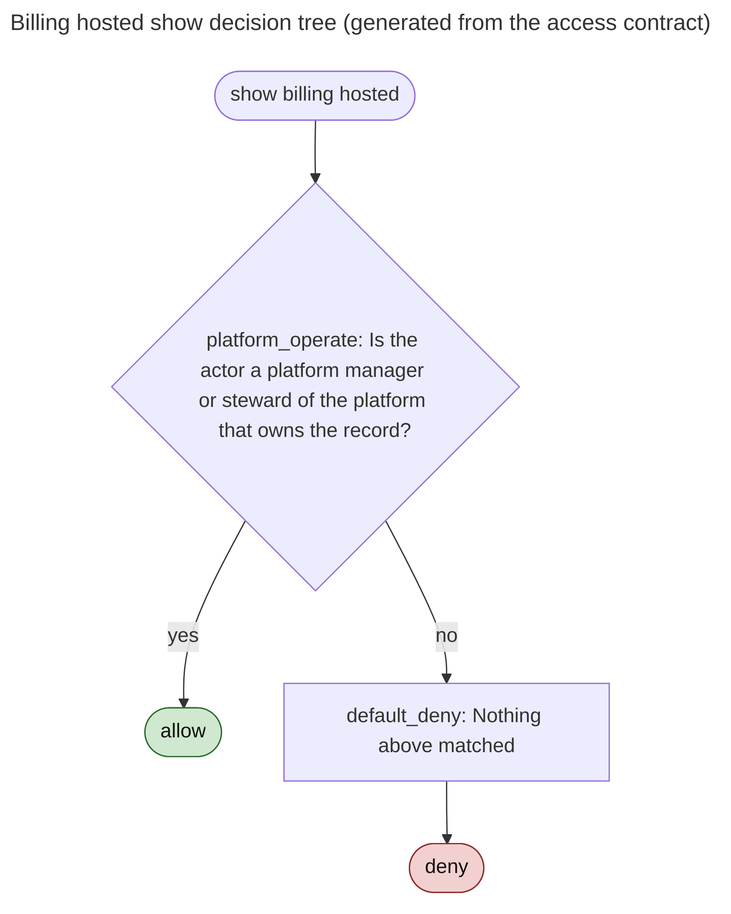

[Open the SVG](../../diagrams/exports/svg/access_contract_billing_hosted_decision_tree.svg) · [Mermaid source](../../diagrams/source/access_contract_billing_hosted_decision_tree.mmd)

### Rules in order

| # | Rule | Question | Decides | Note |
| --- | --- | --- | --- | --- |
| 1 | `platform_operate` | Is the actor a platform manager or steward of the platform that owns the record? | allow |  |
| 2 | `default_deny` | Nothing above matched | deny |  |

### show

| Persona | host_platform | hosted_platform |
| --- | --- | --- |
| `anonymous` | deny default_deny | deny default_deny |
| `signed_in_non_member` | deny default_deny | deny default_deny |
| `community_member` | deny default_deny | deny default_deny |
| `community_contributor` | deny default_deny | deny default_deny |
| `community_organizer` | deny default_deny | deny default_deny |
| `platform_manager` | deny default_deny | allow platform_operate |
| `platform_steward` | deny default_deny | allow platform_operate |
| `safety_reviewer` (pending) | pending | pending |
| `remote_operator` (pending) | pending | pending |
| `support_grantee` (pending) | pending | pending |
| `record_owner` | n/a | n/a |
| `blocked_user` | n/a | n/a |

Reasons

- allow via `platform_operate`: Managers and stewards operate the hosted of their own platform. (platform_manager, platform_steward)
- deny via `default_deny`: Needs platform billing authority, an account or ownership this person does not hold. (anonymous, community_contributor, community_member, community_organizer, platform_manager, platform_steward, signed_in_non_member)

### accept

| Persona | host_platform | hosted_platform |
| --- | --- | --- |
| `anonymous` | deny default_deny | deny default_deny |
| `signed_in_non_member` | deny default_deny | deny default_deny |
| `community_member` | deny default_deny | deny default_deny |
| `community_contributor` | deny default_deny | deny default_deny |
| `community_organizer` | deny default_deny | deny default_deny |
| `platform_manager` | deny default_deny | allow platform_operate |
| `platform_steward` | deny default_deny | allow platform_operate |
| `safety_reviewer` (pending) | pending | pending |
| `remote_operator` (pending) | pending | pending |
| `support_grantee` (pending) | pending | pending |
| `record_owner` | n/a | n/a |
| `blocked_user` | n/a | n/a |

Reasons

- allow via `platform_operate`: Managers and stewards operate the hosted of their own platform. (platform_manager, platform_steward)
- deny via `default_deny`: Needs platform billing authority, an account or ownership this person does not hold. (anonymous, community_contributor, community_member, community_organizer, platform_manager, platform_steward, signed_in_non_member)

### plan

| Persona | host_platform | hosted_platform |
| --- | --- | --- |
| `anonymous` | deny default_deny | deny default_deny |
| `signed_in_non_member` | deny default_deny | deny default_deny |
| `community_member` | deny default_deny | deny default_deny |
| `community_contributor` | deny default_deny | deny default_deny |
| `community_organizer` | deny default_deny | deny default_deny |
| `platform_manager` | deny default_deny | allow platform_operate |
| `platform_steward` | deny default_deny | allow platform_operate |
| `safety_reviewer` (pending) | pending | pending |
| `remote_operator` (pending) | pending | pending |
| `support_grantee` (pending) | pending | pending |
| `record_owner` | n/a | n/a |
| `blocked_user` | n/a | n/a |

Reasons

- allow via `platform_operate`: Managers and stewards operate the hosted of their own platform. (platform_manager, platform_steward)
- deny via `default_deny`: Needs platform billing authority, an account or ownership this person does not hold. (anonymous, community_contributor, community_member, community_organizer, platform_manager, platform_steward, signed_in_non_member)

### index

| Persona | host_platform | hosted_platform |
| --- | --- | --- |
| `anonymous` | deny default_deny | deny default_deny |
| `signed_in_non_member` | deny default_deny | deny default_deny |
| `community_member` | deny default_deny | deny default_deny |
| `community_contributor` | deny default_deny | deny default_deny |
| `community_organizer` | deny default_deny | deny default_deny |
| `platform_manager` | allow platform_operate | deny default_deny |
| `platform_steward` | allow platform_operate | deny default_deny |
| `safety_reviewer` (pending) | pending | pending |
| `remote_operator` (pending) | pending | pending |
| `support_grantee` (pending) | pending | pending |
| `record_owner` | n/a | n/a |
| `blocked_user` | n/a | n/a |

Reasons

- allow via `platform_operate`: Managers and stewards operate the hosted of their own platform. (platform_manager, platform_steward)
- deny via `default_deny`: Needs platform billing authority, an account or ownership this person does not hold. (anonymous, community_contributor, community_member, community_organizer, platform_manager, platform_steward, signed_in_non_member)

### suspend

| Persona | host_platform | hosted_platform |
| --- | --- | --- |
| `anonymous` | deny default_deny | deny default_deny |
| `signed_in_non_member` | deny default_deny | deny default_deny |
| `community_member` | deny default_deny | deny default_deny |
| `community_contributor` | deny default_deny | deny default_deny |
| `community_organizer` | deny default_deny | deny default_deny |
| `platform_manager` | allow platform_operate | deny default_deny |
| `platform_steward` | allow platform_operate | deny default_deny |
| `safety_reviewer` (pending) | pending | pending |
| `remote_operator` (pending) | pending | pending |
| `support_grantee` (pending) | pending | pending |
| `record_owner` | n/a | n/a |
| `blocked_user` | n/a | n/a |

Reasons

- allow via `platform_operate`: Managers and stewards operate the hosted of their own platform. (platform_manager, platform_steward)
- deny via `default_deny`: Needs platform billing authority, an account or ownership this person does not hold. (anonymous, community_contributor, community_member, community_organizer, platform_manager, platform_steward, signed_in_non_member)

### resume

| Persona | host_platform | hosted_platform |
| --- | --- | --- |
| `anonymous` | deny default_deny | deny default_deny |
| `signed_in_non_member` | deny default_deny | deny default_deny |
| `community_member` | deny default_deny | deny default_deny |
| `community_contributor` | deny default_deny | deny default_deny |
| `community_organizer` | deny default_deny | deny default_deny |
| `platform_manager` | allow platform_operate | deny default_deny |
| `platform_steward` | allow platform_operate | deny default_deny |
| `safety_reviewer` (pending) | pending | pending |
| `remote_operator` (pending) | pending | pending |
| `support_grantee` (pending) | pending | pending |
| `record_owner` | n/a | n/a |
| `blocked_user` | n/a | n/a |

Reasons

- allow via `platform_operate`: Managers and stewards operate the hosted of their own platform. (platform_manager, platform_steward)
- deny via `default_deny`: Needs platform billing authority, an account or ownership this person does not hold. (anonymous, community_contributor, community_member, community_organizer, platform_manager, platform_steward, signed_in_non_member)

