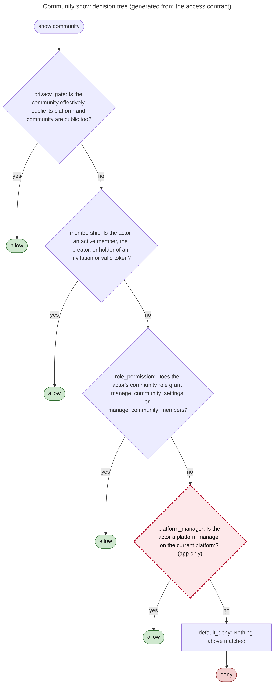
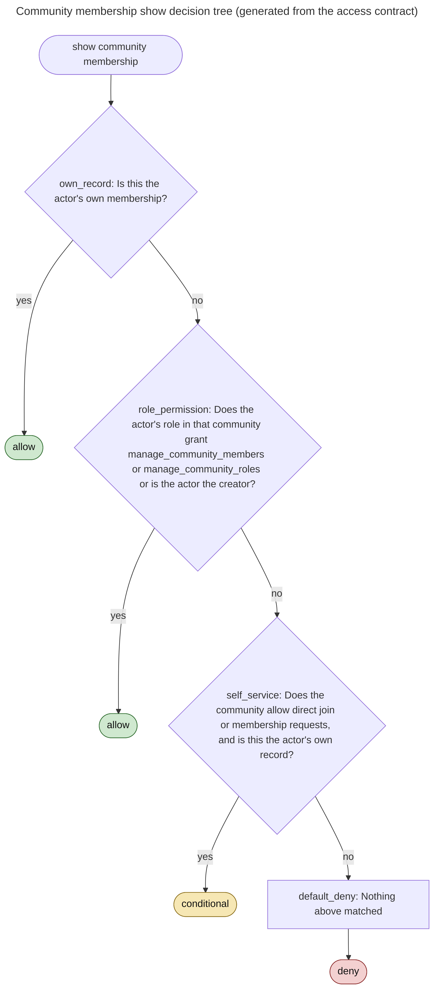
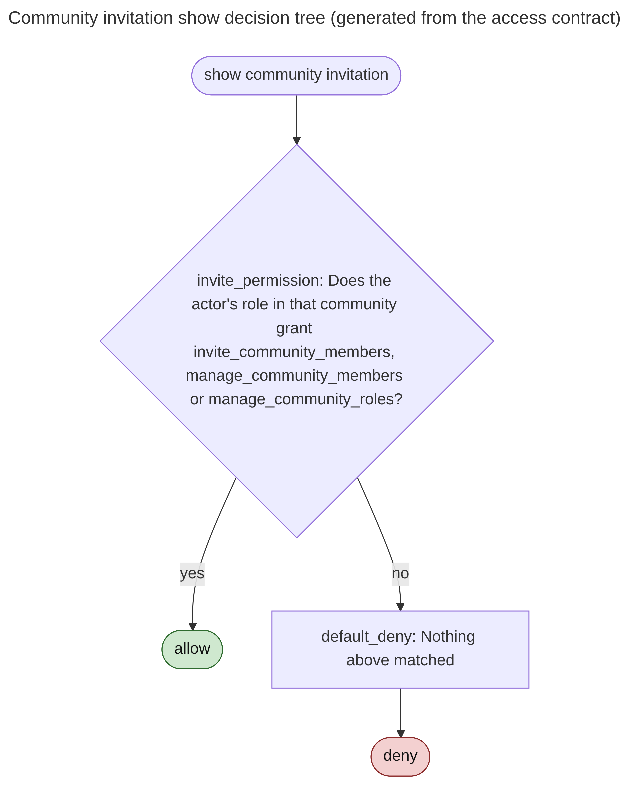

# Communities access contract

Community records, the memberships that join people to them, and the invitations that bring people in.

Generated by `rake better_together:access:docs`.

## Inventory

| Resource | Model | Policy | Classification | Views | MCP tools | Jobs |
| --- | --- | --- | --- | --- | --- | --- |
| [Community](#community) (`community`) | `BetterTogether::Community` | `BetterTogether::CommunityPolicy` | `member_private` | 18 files | `application_tool`, `list_communities_tool` | `apply_platform_defaults_job` |
| [Community membership](#community-membership) (`person_community_membership`) | `BetterTogether::PersonCommunityMembership` | `BetterTogether::PersonCommunityMembershipPolicy` | `member_private` | 8 files | none | none |
| [Community invitation](#community-invitation) (`community_invitation`) | `BetterTogether::CommunityInvitation` | `BetterTogether::CommunityInvitationPolicy` | `member_private` | 1 files | none | none |

### Routed actions

| Controller action | Verb | Example path | Authorization check |
| --- | --- | --- | --- |
| `api/v1/communities#create` | POST | `/api/v1/communities` | api (Pundit::ResourceController) |
| `api/v1/communities#create_relationship` | POST | `/api/v1/communities/:community_id/relationships/members` | api (Pundit::ResourceController) |
| `api/v1/communities#destroy` | DELETE | `/api/v1/communities/:id` | api (Pundit::ResourceController) |
| `api/v1/communities#destroy_relationship` | DELETE | `/api/v1/communities/:community_id/relationships/creator` | api (Pundit::ResourceController) |
| `api/v1/communities#index` | GET | `/api/v1/communities` | api (Pundit::ResourceController) |
| `api/v1/communities#index_related_resources` | GET | `/api/v1/people/:person_id/communities` | api (Pundit::ResourceController) |
| `api/v1/communities#show` | GET | `/api/v1/communities/:id` | api (Pundit::ResourceController) |
| `api/v1/communities#show_related_resource` | GET | `/api/v1/pages/:page_id/community` | api (Pundit::ResourceController) |
| `api/v1/communities#show_relationship` | GET | `/api/v1/communities/:community_id/relationships/creator` | api (Pundit::ResourceController) |
| `api/v1/communities#update` | PATCH | `/api/v1/communities/:id` | api (Pundit::ResourceController) |
| `api/v1/communities#update_relationship` | PUT|PATCH | `/api/v1/communities/:community_id/relationships/creator` | api (Pundit::ResourceController) |
| `api/v1/person_community_memberships#create` | POST | `/api/v1/person_community_memberships` | api (Pundit::ResourceController) |
| `api/v1/person_community_memberships#destroy_relationship` | DELETE | `/api/v1/person_community_memberships/:person_community_membership_id/relationships/joinable` | api (Pundit::ResourceController) |
| `api/v1/person_community_memberships#index` | GET | `/api/v1/person_community_memberships` | api (Pundit::ResourceController) |
| `api/v1/person_community_memberships#index_related_resources` | GET | `/api/v1/communities/:community_id/person_community_memberships` | api (Pundit::ResourceController) |
| `api/v1/person_community_memberships#show` | GET | `/api/v1/person_community_memberships/:id` | api (Pundit::ResourceController) |
| `api/v1/person_community_memberships#show_relationship` | GET | `/api/v1/person_community_memberships/:person_community_membership_id/relationships/joinable` | api (Pundit::ResourceController) |
| `api/v1/person_community_memberships#update` | PATCH | `/api/v1/person_community_memberships/:id` | api (Pundit::ResourceController) |
| `api/v1/person_community_memberships#update_relationship` | PUT|PATCH | `/api/v1/person_community_memberships/:person_community_membership_id/relationships/joinable` | api (Pundit::ResourceController) |
| `communities#create` | POST | `/:locale/communities` | action (authorize or policy_scope in the action) |
| `communities#destroy` | DELETE | `/:locale/c/:id` | callback (authorization callback) |
| `communities#edit` | GET | `/:locale/c/:id/edit` | action (authorize or policy_scope in the action) |
| `communities#index` | GET | `/:locale/communities` | action (authorize or policy_scope in the action) |
| `communities#new` | GET | `/:locale/communities/new` | action (authorize or policy_scope in the action) |
| `communities#show` | GET | `/:locale/c/:id` | action (authorize or policy_scope in the action) |
| `communities#update` | PATCH | `/:locale/c/:id` | callback (authorization callback) |
| `invitations#accept` | POST | `/:locale/invitations/:token/accept` | allowlisted (Token-bearing invitee flow; the action checks the invitee against the signed-in person.) |
| `invitations#available_people` | GET | `/:locale/c/:community_id/invitations/available_people` | allowlisted (Scoped through policy_scope or a platform-people permission, enforced by verify_policy_scoped.) |
| `invitations#create` | POST | `/:locale/c/:community_id/invitations` | action (authorize or policy_scope in the action) |
| `invitations#decline` | POST | `/:locale/invitations/:token/decline` | allowlisted (Token-bearing invitee flow; the action checks the invitee against the signed-in person.) |
| `invitations#destroy` | DELETE | `/:locale/c/:community_id/invitations/:id` | action (authorize or policy_scope in the action) |
| `invitations#resend` | PUT | `/:locale/c/:community_id/invitations/:id/resend` | action (authorize or policy_scope in the action) |
| `invitations#show` | GET | `/:locale/invitations/:token` | allowlisted (Token-bearing invitee flow; access is the unguessable invitation token, checked in find_invitation_by_token.) |
| `person_community_memberships#create` | POST | `/:locale/c/:community_id/person_community_memberships` | action (authorize or policy_scope in the action) |
| `person_community_memberships#destroy` | DELETE | `/:locale/c/:community_id/person_community_memberships/:id` | action (authorize or policy_scope in the action) |
| `person_community_memberships#edit` | GET | `/:locale/host/person_community_memberships/:id/edit` | not implemented (routed but the controller defines no such action) |
| `person_community_memberships#index` | GET | `/:locale/host/person_community_memberships` | not implemented (routed but the controller defines no such action) |
| `person_community_memberships#new` | GET | `/:locale/host/person_community_memberships/new` | not implemented (routed but the controller defines no such action) |
| `person_community_memberships#show` | GET | `/:locale/host/person_community_memberships/:id` | not implemented (routed but the controller defines no such action) |
| `person_community_memberships#update` | PATCH | `/:locale/host/person_community_memberships/:id` | not implemented (routed but the controller defines no such action) |

### Policies not contracted yet

None.

## Community

`BetterTogether::Community` · policy `BetterTogether::CommunityPolicy` · classification `member_private`

### Decision tree

Decision tree for show. Dashed red nodes are rules the app applies that the privacy rule does not intend.

[Open the SVG](../../diagrams/exports/svg/access_contract_community_decision_tree.svg) · [Mermaid source](../../diagrams/source/access_contract_community_decision_tree.mmd)

### Rules in order

| # | Rule | Question | Decides | Note |
| --- | --- | --- | --- | --- |
| 1 | `privacy_gate` | Is the community effectively public (its platform and community are public too)? | allow |  |
| 2 | `membership` | Is the actor an active member, the creator, or holder of an invitation or valid token? | allow |  |
| 3 | `role_permission` | Does the actor's community role grant manage_community_settings or manage_community_members? | allow |  |
| 4 | `platform_operate` | Is the actor a platform manager acting on a public community or creating one? | allow |  |
| 5 | `platform_manager` | Is the actor a platform manager on the current platform? | not intended | Opens private communities to a standing role; see CD-1 and CD-2. |
| 6 | `default_deny` | Nothing above matched | deny |  |

### index

| Persona | any |
| --- | --- |
| `anonymous` | allow privacy_gate |
| `signed_in_non_member` | allow privacy_gate |
| `community_member` | allow privacy_gate |
| `community_contributor` | allow privacy_gate |
| `community_organizer` | allow privacy_gate |
| `platform_manager` | allow privacy_gate |
| `platform_steward` | allow privacy_gate |
| `safety_reviewer` (pending) | pending |
| `remote_operator` (pending) | pending |
| `support_grantee` (pending) | pending |
| `record_owner` | n/a |
| `blocked_user` | n/a |

Reasons

- allow via `privacy_gate`: Everyone may open the index; the scope filters the rows. (anonymous, community_contributor, community_member, community_organizer, platform_manager, platform_steward, signed_in_non_member)

### show

| Persona | public | community | private |
| --- | --- | --- | --- |
| `anonymous` | allow privacy_gate | deny default_deny | deny default_deny |
| `signed_in_non_member` | allow privacy_gate | deny default_deny | deny default_deny |
| `community_member` | allow privacy_gate | allow membership | allow membership |
| `community_contributor` | allow privacy_gate | allow membership | allow membership |
| `community_organizer` | allow privacy_gate | allow membership | allow membership |
| `platform_manager` | allow privacy_gate | deny (app: allow) [^1] | deny (app: allow) [^1] |
| `platform_steward` | allow privacy_gate | deny (app: allow) [^1] | deny (app: allow) [^1] |
| `safety_reviewer` (pending) | pending | pending | pending |
| `remote_operator` (pending) | pending | pending | pending |
| `support_grantee` (pending) | pending | pending | pending |
| `record_owner` | allow privacy_gate | allow membership | allow membership |
| `blocked_user` | allow privacy_gate | deny default_deny | deny default_deny |

[^1]: CD-1, known deviation: Platform managers can read private and community-only community records.

Reasons

- allow via `membership`: Active members read their own community. (community_contributor, community_member, community_organizer)
- allow via `membership`: The creator can always read the community. (record_owner)
- allow via `privacy_gate`: Public communities are readable by anyone. (anonymous, blocked_user, community_contributor, community_member, community_organizer, platform_manager, platform_steward, record_owner, signed_in_non_member)
- deny via `default_deny`: Community-only and private communities are for members. (anonymous, blocked_user, signed_in_non_member)
- deny via `default_deny`: No standing role discloses a non-public community record. (platform_manager, platform_steward)

### download

| Persona | public | community | private |
| --- | --- | --- | --- |
| `anonymous` | allow privacy_gate | deny default_deny | deny default_deny |
| `signed_in_non_member` | allow privacy_gate | deny default_deny | deny default_deny |
| `community_member` | allow privacy_gate | allow membership | allow membership |
| `community_contributor` | allow privacy_gate | allow membership | allow membership |
| `community_organizer` | allow privacy_gate | allow membership | allow membership |
| `platform_manager` | allow privacy_gate | deny (app: allow) [^1] | deny (app: allow) [^1] |
| `platform_steward` | allow privacy_gate | deny (app: allow) [^1] | deny (app: allow) [^1] |
| `safety_reviewer` (pending) | pending | pending | pending |
| `remote_operator` (pending) | pending | pending | pending |
| `support_grantee` (pending) | pending | pending | pending |
| `record_owner` | allow privacy_gate | allow membership | allow membership |
| `blocked_user` | allow privacy_gate | deny default_deny | deny default_deny |

[^1]: CD-1, known deviation: Platform managers can read private and community-only community records.

Reasons

- allow via `membership`: Download follows show. (community_contributor, community_member, community_organizer, record_owner)
- allow via `privacy_gate`: Media of a public community is public. (anonymous, blocked_user, community_contributor, community_member, community_organizer, platform_manager, platform_steward, record_owner, signed_in_non_member)
- deny via `default_deny`: Download follows show; no standing role discloses a non-public community. (platform_manager, platform_steward)
- deny via `default_deny`: Media follows the record: members only. (anonymous, blocked_user, signed_in_non_member)

### create

| Persona | new |
| --- | --- |
| `anonymous` | deny default_deny |
| `signed_in_non_member` | conditional [^1] role_permission |
| `community_member` | conditional [^1] role_permission |
| `community_contributor` | conditional [^1] role_permission |
| `community_organizer` | conditional [^1] role_permission |
| `platform_manager` | allow platform_operate |
| `platform_steward` | allow platform_operate |
| `safety_reviewer` (pending) | pending |
| `remote_operator` (pending) | pending |
| `support_grantee` (pending) | pending |
| `record_owner` | n/a |
| `blocked_user` | n/a |

[^1]: The actor has accepted the community creation agreement. Probe fixture: deny.

Reasons

- allow via `platform_operate`: Platform managers always create communities. (platform_manager, platform_steward)
- conditional via `role_permission`: Everyone else must accept the creation agreement first; fixtures have not. (community_contributor, community_member, community_organizer, signed_in_non_member)
- deny via `default_deny`: Signing in is required to create a community. (anonymous)

### update

| Persona | public | community | private |
| --- | --- | --- | --- |
| `anonymous` | deny default_deny | deny default_deny | deny default_deny |
| `signed_in_non_member` | deny default_deny | deny default_deny | deny default_deny |
| `community_member` | deny default_deny | deny default_deny | deny default_deny |
| `community_contributor` | deny default_deny | deny default_deny | deny default_deny |
| `community_organizer` | allow role_permission | allow role_permission | allow role_permission |
| `platform_manager` | allow platform_operate | undecided (app: allow) [^1] | undecided (app: allow) [^1] |
| `platform_steward` | allow platform_operate | undecided (app: allow) [^1] | undecided (app: allow) [^1] |
| `safety_reviewer` (pending) | pending | pending | pending |
| `remote_operator` (pending) | pending | pending | pending |
| `support_grantee` (pending) | pending | pending | pending |
| `record_owner` | deny default_deny | deny default_deny | deny default_deny |
| `blocked_user` | deny default_deny | deny default_deny | deny default_deny |

[^1]: CD-2, undecided: Platform manager operate power over private communities.

Reasons

- allow via `platform_operate`: Managers operate the platform's public communities. (platform_manager, platform_steward)
- allow via `role_permission`: Organizers hold update_community and manage_community_settings. (community_organizer)
- deny via `default_deny`: Creating a community grants no role permission; the creator normally also holds an organizer membership. (record_owner)
- deny via `default_deny`: Members and contributors read and contribute; they do not edit community settings. (anonymous, blocked_user, community_contributor, community_member, signed_in_non_member)

### manage_integrations

| Persona | public | community | private |
| --- | --- | --- | --- |
| `anonymous` | deny default_deny | deny default_deny | deny default_deny |
| `signed_in_non_member` | deny default_deny | deny default_deny | deny default_deny |
| `community_member` | deny default_deny | deny default_deny | deny default_deny |
| `community_contributor` | deny default_deny | deny default_deny | deny default_deny |
| `community_organizer` | allow role_permission | allow role_permission | allow role_permission |
| `platform_manager` | allow platform_operate | undecided (app: allow) [^1] | undecided (app: allow) [^1] |
| `platform_steward` | allow platform_operate | undecided (app: allow) [^1] | undecided (app: allow) [^1] |
| `safety_reviewer` (pending) | pending | pending | pending |
| `remote_operator` (pending) | pending | pending | pending |
| `support_grantee` (pending) | pending | pending | pending |
| `record_owner` | deny default_deny | deny default_deny | deny default_deny |
| `blocked_user` | deny default_deny | deny default_deny | deny default_deny |

[^1]: CD-2, undecided: Platform manager operate power over private communities.

Reasons

- allow via `platform_operate`: Managers operate public communities. (platform_manager, platform_steward)
- allow via `role_permission`: Same gate as update. (community_organizer)
- deny via `default_deny`: Integrations are configured by organizers only. (anonymous, blocked_user, community_contributor, community_member, record_owner, signed_in_non_member)

### create_events

| Persona | public | community | private |
| --- | --- | --- | --- |
| `anonymous` | deny default_deny | deny default_deny | deny default_deny |
| `signed_in_non_member` | deny default_deny | deny default_deny | deny default_deny |
| `community_member` | allow membership | allow membership | allow membership |
| `community_contributor` | allow membership | allow membership | allow membership |
| `community_organizer` | allow membership | allow membership | allow membership |
| `platform_manager` | allow platform_operate | undecided (app: allow) [^1] | undecided (app: allow) [^1] |
| `platform_steward` | allow platform_operate | undecided (app: allow) [^1] | undecided (app: allow) [^1] |
| `safety_reviewer` (pending) | pending | pending | pending |
| `remote_operator` (pending) | pending | pending | pending |
| `support_grantee` (pending) | pending | pending | pending |
| `record_owner` | deny default_deny | deny default_deny | deny default_deny |
| `blocked_user` | deny default_deny | deny default_deny | deny default_deny |

[^1]: CD-2, undecided: Platform manager operate power over private communities.

Reasons

- allow via `membership`: Any active member may host events on the community's behalf. (community_contributor, community_member, community_organizer)
- allow via `platform_operate`: Managers operate public communities. (platform_manager, platform_steward)
- deny via `default_deny`: Hosting needs membership or manage_community_events. (anonymous, blocked_user, record_owner, signed_in_non_member)

### view_members

| Persona | public | community | private |
| --- | --- | --- | --- |
| `anonymous` | deny default_deny | deny default_deny | deny default_deny |
| `signed_in_non_member` | deny default_deny | deny default_deny | deny default_deny |
| `community_member` | allow membership | allow membership | allow membership |
| `community_contributor` | allow membership | allow membership | allow membership |
| `community_organizer` | allow membership | allow membership | allow membership |
| `platform_manager` | deny (app: allow) [^1] | deny (app: allow) [^1] | deny (app: allow) [^1] |
| `platform_steward` | deny (app: allow) [^1] | deny (app: allow) [^1] | deny (app: allow) [^1] |
| `safety_reviewer` (pending) | pending | pending | pending |
| `remote_operator` (pending) | pending | pending | pending |
| `support_grantee` (pending) | pending | pending | pending |
| `record_owner` | allow membership | allow membership | allow membership |
| `blocked_user` | deny default_deny | deny default_deny | deny default_deny |

[^1]: CD-1, known deviation: Platform managers can read private and community-only community records.

Reasons

- allow via `membership`: Members and the creator see who else is in the community. (community_contributor, community_member, community_organizer, record_owner)
- deny via `default_deny`: Member lists are member private; standing roles do not disclose them. (platform_manager, platform_steward)
- deny via `default_deny`: The member list is member private, even for a public community. (anonymous, blocked_user, signed_in_non_member)

### manage_roles

| Persona | public | community | private |
| --- | --- | --- | --- |
| `anonymous` | deny default_deny | deny default_deny | deny default_deny |
| `signed_in_non_member` | deny default_deny | deny default_deny | deny default_deny |
| `community_member` | deny default_deny | deny default_deny | deny default_deny |
| `community_contributor` | deny default_deny | deny default_deny | deny default_deny |
| `community_organizer` | allow role_permission | allow role_permission | allow role_permission |
| `platform_manager` | allow platform_operate | undecided (app: allow) [^1] | undecided (app: allow) [^1] |
| `platform_steward` | allow platform_operate | undecided (app: allow) [^1] | undecided (app: allow) [^1] |
| `safety_reviewer` (pending) | pending | pending | pending |
| `remote_operator` (pending) | pending | pending | pending |
| `support_grantee` (pending) | pending | pending | pending |
| `record_owner` | deny default_deny | deny default_deny | deny default_deny |
| `blocked_user` | deny default_deny | deny default_deny | deny default_deny |

[^1]: CD-2, undecided: Platform manager operate power over private communities.

Reasons

- allow via `platform_operate`: Managers operate public communities. (platform_manager, platform_steward)
- allow via `role_permission`: Organizers hold manage_community_roles. (community_organizer)
- deny via `default_deny`: Only organizers assign roles. (anonymous, blocked_user, community_contributor, community_member, record_owner, signed_in_non_member)

### view_quota_usage

| Persona | public | community | private |
| --- | --- | --- | --- |
| `anonymous` | deny default_deny | deny default_deny | deny default_deny |
| `signed_in_non_member` | deny default_deny | deny default_deny | deny default_deny |
| `community_member` | deny default_deny | deny default_deny | deny default_deny |
| `community_contributor` | deny default_deny | deny default_deny | deny default_deny |
| `community_organizer` | allow role_permission | allow role_permission | allow role_permission |
| `platform_manager` | allow platform_operate | undecided (app: allow) [^1] | undecided (app: allow) [^1] |
| `platform_steward` | allow platform_operate | undecided (app: allow) [^1] | undecided (app: allow) [^1] |
| `safety_reviewer` (pending) | pending | pending | pending |
| `remote_operator` (pending) | pending | pending | pending |
| `support_grantee` (pending) | pending | pending | pending |
| `record_owner` | deny default_deny | deny default_deny | deny default_deny |
| `blocked_user` | deny default_deny | deny default_deny | deny default_deny |

[^1]: CD-2, undecided: Platform manager operate power over private communities.

Reasons

- allow via `platform_operate`: Managers operate public communities. (platform_manager, platform_steward)
- allow via `role_permission`: Anyone who can manage the community sees its usage. (community_organizer)
- deny via `default_deny`: Usage is shown to managers of the community only. (anonymous, blocked_user, community_contributor, community_member, record_owner, signed_in_non_member)

### destroy

| Persona | public | community | private |
| --- | --- | --- | --- |
| `anonymous` | deny default_deny | deny default_deny | deny default_deny |
| `signed_in_non_member` | deny default_deny | deny default_deny | deny default_deny |
| `community_member` | deny default_deny | deny default_deny | deny default_deny |
| `community_contributor` | deny default_deny | deny default_deny | deny default_deny |
| `community_organizer` | allow role_permission | allow role_permission | allow role_permission |
| `platform_manager` | allow platform_operate | undecided (app: allow) [^1] | undecided (app: allow) [^1] |
| `platform_steward` | allow platform_operate | undecided (app: allow) [^1] | undecided (app: allow) [^1] |
| `safety_reviewer` (pending) | pending | pending | pending |
| `remote_operator` (pending) | pending | pending | pending |
| `support_grantee` (pending) | pending | pending | pending |
| `record_owner` | deny default_deny | deny default_deny | deny default_deny |
| `blocked_user` | deny default_deny | deny default_deny | deny default_deny |

[^1]: CD-2, undecided: Platform manager operate power over private communities.

Reasons

- allow via `platform_operate`: Managers operate public communities. (platform_manager, platform_steward)
- allow via `role_permission`: Organizers hold delete_community. (community_organizer)
- deny via `default_deny`: Only organizers or platform managers delete a community. (anonymous, blocked_user, community_contributor, community_member, record_owner, signed_in_non_member)

### scope

| Persona | public | community | private |
| --- | --- | --- | --- |
| `anonymous` | allow privacy_gate | deny default_deny | deny default_deny |
| `signed_in_non_member` | allow privacy_gate | deny default_deny | deny default_deny |
| `community_member` | allow privacy_gate | allow membership | allow membership |
| `community_contributor` | allow privacy_gate | allow membership | allow membership |
| `community_organizer` | allow privacy_gate | allow membership | allow membership |
| `platform_manager` | allow privacy_gate | deny default_deny | deny (app: allow) [^1] |
| `platform_steward` | allow privacy_gate | deny default_deny | deny (app: allow) [^1] |
| `safety_reviewer` (pending) | pending | pending | pending |
| `remote_operator` (pending) | pending | pending | pending |
| `support_grantee` (pending) | pending | pending | pending |
| `record_owner` | allow privacy_gate | allow membership | allow membership |
| `blocked_user` | allow privacy_gate | deny default_deny | deny default_deny |

[^1]: CD-1, known deviation: Platform managers can read private and community-only community records.

Reasons

- allow via `membership`: Members and the creator list their communities. (community_contributor, community_member, community_organizer, record_owner)
- allow via `privacy_gate`: Public communities are listed for everyone. (anonymous, blocked_user, community_contributor, community_member, community_organizer, platform_manager, platform_steward, record_owner, signed_in_non_member)
- deny via `default_deny`: A community-only community is not listed for a non-member manager. (platform_manager, platform_steward)
- deny via `default_deny`: No standing role lists private communities. (platform_manager, platform_steward)
- deny via `default_deny`: Non-public communities are not listed for non-members. (anonymous, blocked_user, signed_in_non_member)

## Community membership

`BetterTogether::PersonCommunityMembership` · policy `BetterTogether::PersonCommunityMembershipPolicy` · classification `member_private`

### Decision tree

Decision tree for show. Dashed red nodes are rules the app applies that the privacy rule does not intend.

[Open the SVG](../../diagrams/exports/svg/access_contract_person_community_membership_decision_tree.svg) · [Mermaid source](../../diagrams/source/access_contract_person_community_membership_decision_tree.mmd)

### Rules in order

| # | Rule | Question | Decides | Note |
| --- | --- | --- | --- | --- |
| 1 | `own_record` | Is this the actor's own membership? | allow |  |
| 2 | `role_permission` | Does the actor's role in that community grant manage_community_members or manage_community_roles (or is the actor the creator)? | allow |  |
| 3 | `self_service` | Does the community allow direct join or membership requests, and is this the actor's own record? | conditional |  |
| 4 | `default_deny` | Nothing above matched | deny |  |

### index

| Persona | any |
| --- | --- |
| `anonymous` | deny default_deny |
| `signed_in_non_member` | deny default_deny |
| `community_member` | deny default_deny |
| `community_contributor` | deny default_deny |
| `community_organizer` | allow role_permission |
| `platform_manager` | deny default_deny |
| `platform_steward` | deny default_deny |
| `safety_reviewer` (pending) | pending |
| `remote_operator` (pending) | pending |
| `support_grantee` (pending) | pending |
| `record_owner` | n/a |
| `blocked_user` | n/a |

Reasons

- allow via `role_permission`: Organizers list memberships they can manage. (community_organizer)
- deny via `default_deny`: Listing needs a manage permission in at least one community. (anonymous, community_contributor, community_member, platform_manager, platform_steward, signed_in_non_member)

### show

| Persona | own | someone_elses |
| --- | --- | --- |
| `anonymous` | n/a | deny default_deny |
| `signed_in_non_member` | n/a | deny default_deny |
| `community_member` | n/a | deny default_deny |
| `community_contributor` | n/a | deny default_deny |
| `community_organizer` | n/a | allow role_permission |
| `platform_manager` | n/a | deny default_deny |
| `platform_steward` | n/a | deny default_deny |
| `safety_reviewer` (pending) | pending | pending |
| `remote_operator` (pending) | pending | pending |
| `support_grantee` (pending) | pending | pending |
| `record_owner` | allow own_record | n/a |
| `blocked_user` | n/a | n/a |

Reasons

- allow via `own_record`: People read their own membership. (record_owner)
- allow via `role_permission`: Organizers read their members' memberships. (community_organizer)
- deny via `default_deny`: A membership is member private; standing roles do not read it. (anonymous, community_contributor, community_member, platform_manager, platform_steward, signed_in_non_member)

### create

| Persona | own | someone_elses |
| --- | --- | --- |
| `anonymous` | n/a | deny default_deny |
| `signed_in_non_member` | n/a | deny default_deny |
| `community_member` | n/a | deny default_deny |
| `community_contributor` | n/a | deny default_deny |
| `community_organizer` | n/a | allow role_permission |
| `platform_manager` | n/a | deny default_deny |
| `platform_steward` | n/a | deny default_deny |
| `safety_reviewer` (pending) | pending | pending |
| `remote_operator` (pending) | pending | pending |
| `support_grantee` (pending) | pending | pending |
| `record_owner` | conditional [^1] self_service | n/a |
| `blocked_user` | n/a | n/a |

[^1]: The community allows direct join or membership requests. Probe fixture: deny.

Reasons

- allow via `role_permission`: Organizers add members. (community_organizer)
- conditional via `self_service`: Joining oneself needs a self-service community; the fixture community requires an invitation. (record_owner)
- deny via `default_deny`: Adding someone else needs a manage permission in that community. (anonymous, community_contributor, community_member, platform_manager, platform_steward, signed_in_non_member)

### edit

| Persona | own | someone_elses |
| --- | --- | --- |
| `anonymous` | n/a | deny default_deny |
| `signed_in_non_member` | n/a | deny default_deny |
| `community_member` | n/a | deny default_deny |
| `community_contributor` | n/a | deny default_deny |
| `community_organizer` | n/a | allow role_permission |
| `platform_manager` | n/a | deny default_deny |
| `platform_steward` | n/a | deny default_deny |
| `safety_reviewer` (pending) | pending | pending |
| `remote_operator` (pending) | pending | pending |
| `support_grantee` (pending) | pending | pending |
| `record_owner` | deny default_deny | n/a |
| `blocked_user` | n/a | n/a |

Reasons

- allow via `role_permission`: Organizers change roles. (community_organizer)
- deny via `default_deny`: Changing a membership needs a manage permission. (anonymous, community_contributor, community_member, platform_manager, platform_steward, signed_in_non_member)
- deny via `default_deny`: People do not change their own role. (record_owner)

### destroy

| Persona | own | someone_elses |
| --- | --- | --- |
| `anonymous` | n/a | deny default_deny |
| `signed_in_non_member` | n/a | deny default_deny |
| `community_member` | n/a | deny default_deny |
| `community_contributor` | n/a | deny default_deny |
| `community_organizer` | n/a | allow role_permission |
| `platform_manager` | n/a | deny default_deny |
| `platform_steward` | n/a | deny default_deny |
| `safety_reviewer` (pending) | pending | pending |
| `remote_operator` (pending) | pending | pending |
| `support_grantee` (pending) | pending | pending |
| `record_owner` | undecided (app: deny) [^1] | n/a |
| `blocked_user` | n/a | n/a |

[^1]: CD-5, undecided: A member removing their own membership.

Reasons

- allow via `role_permission`: Organizers remove members who do not hold role management themselves. (community_organizer)
- deny via `default_deny`: Removing a member needs a manage permission. (anonymous, community_contributor, community_member, platform_manager, platform_steward, signed_in_non_member)

### scope

| Persona | own | someone_elses |
| --- | --- | --- |
| `anonymous` | n/a | deny default_deny |
| `signed_in_non_member` | n/a | deny default_deny |
| `community_member` | n/a | deny default_deny |
| `community_contributor` | n/a | deny default_deny |
| `community_organizer` | n/a | allow role_permission |
| `platform_manager` | n/a | deny default_deny |
| `platform_steward` | n/a | deny default_deny |
| `safety_reviewer` (pending) | pending | pending |
| `remote_operator` (pending) | pending | pending |
| `support_grantee` (pending) | pending | pending |
| `record_owner` | allow own_record | n/a |
| `blocked_user` | n/a | n/a |

Reasons

- allow via `own_record`: People list their own memberships. (record_owner)
- allow via `role_permission`: Organizers list the memberships of communities they manage. (community_organizer)
- deny via `default_deny`: Other memberships are member private. (anonymous, community_contributor, community_member, platform_manager, platform_steward, signed_in_non_member)

## Community invitation

`BetterTogether::CommunityInvitation` · policy `BetterTogether::CommunityInvitationPolicy` · classification `member_private`

### Decision tree

Decision tree for show. Dashed red nodes are rules the app applies that the privacy rule does not intend.

[Open the SVG](../../diagrams/exports/svg/access_contract_community_invitation_decision_tree.svg) · [Mermaid source](../../diagrams/source/access_contract_community_invitation_decision_tree.mmd)

### Rules in order

| # | Rule | Question | Decides | Note |
| --- | --- | --- | --- | --- |
| 1 | `invite_permission` | Does the actor's role in that community grant invite_community_members, manage_community_members or manage_community_roles? | allow |  |
| 2 | `default_deny` | Nothing above matched | deny |  |

### index

| Persona | any |
| --- | --- |
| `anonymous` | deny default_deny |
| `signed_in_non_member` | deny default_deny |
| `community_member` | deny default_deny |
| `community_contributor` | deny default_deny |
| `community_organizer` | deny default_deny |
| `platform_manager` | deny default_deny |
| `platform_steward` | deny default_deny |
| `safety_reviewer` (pending) | pending |
| `remote_operator` (pending) | pending |
| `support_grantee` (pending) | pending |
| `record_owner` | n/a |
| `blocked_user` | n/a |

Reasons

- deny via `default_deny`: There is no index action for invitations; listing goes through the scope. (anonymous, community_contributor, community_member, community_organizer, platform_manager, platform_steward, signed_in_non_member)

### show

| Persona | own | someone_elses |
| --- | --- | --- |
| `anonymous` | n/a | deny default_deny |
| `signed_in_non_member` | n/a | deny default_deny |
| `community_member` | n/a | deny default_deny |
| `community_contributor` | n/a | deny default_deny |
| `community_organizer` | n/a | deny default_deny |
| `platform_manager` | n/a | deny default_deny |
| `platform_steward` | n/a | deny default_deny |
| `safety_reviewer` (pending) | pending | pending |
| `remote_operator` (pending) | pending | pending |
| `support_grantee` (pending) | pending | pending |
| `record_owner` | deny default_deny | n/a |
| `blocked_user` | n/a | n/a |

Reasons

- deny via `default_deny`: Invitations are read through the community's invitation list, not individually. (anonymous, community_contributor, community_member, community_organizer, platform_manager, platform_steward, record_owner, signed_in_non_member)

### create

| Persona | own | someone_elses |
| --- | --- | --- |
| `anonymous` | n/a | deny default_deny |
| `signed_in_non_member` | n/a | deny default_deny |
| `community_member` | n/a | deny default_deny |
| `community_contributor` | n/a | allow invite_permission |
| `community_organizer` | n/a | allow invite_permission |
| `platform_manager` | n/a | deny default_deny |
| `platform_steward` | n/a | deny default_deny |
| `safety_reviewer` (pending) | pending | pending |
| `remote_operator` (pending) | pending | pending |
| `support_grantee` (pending) | pending | pending |
| `record_owner` | deny default_deny | n/a |
| `blocked_user` | n/a | n/a |

Reasons

- allow via `invite_permission`: Contributors hold invite_community_members; organizers hold the manage permissions. (community_contributor, community_organizer)
- deny via `default_deny`: Inviting needs an invite or manage permission in that community. Platform roles hold none. (anonymous, community_member, platform_manager, platform_steward, signed_in_non_member)
- deny via `default_deny`: Sending an invitation needs the permission now, whoever sent an earlier one. (record_owner)

### destroy

| Persona | own | someone_elses |
| --- | --- | --- |
| `anonymous` | n/a | deny default_deny |
| `signed_in_non_member` | n/a | deny default_deny |
| `community_member` | n/a | deny default_deny |
| `community_contributor` | n/a | allow invite_permission |
| `community_organizer` | n/a | allow invite_permission |
| `platform_manager` | n/a | deny default_deny |
| `platform_steward` | n/a | deny default_deny |
| `safety_reviewer` (pending) | pending | pending |
| `remote_operator` (pending) | pending | pending |
| `support_grantee` (pending) | pending | pending |
| `record_owner` | undecided (app: deny) [^1] | n/a |
| `blocked_user` | n/a | n/a |

[^1]: CD-4, undecided: What an inviter keeps over an invitation they sent.

Reasons

- allow via `invite_permission`: Withdrawing a pending invitation needs the same permission as sending it. (community_contributor, community_organizer)
- deny via `default_deny`: Withdrawing needs an invite or manage permission in that community. (anonymous, community_member, platform_manager, platform_steward, signed_in_non_member)

### resend

| Persona | own | someone_elses |
| --- | --- | --- |
| `anonymous` | n/a | deny default_deny |
| `signed_in_non_member` | n/a | deny default_deny |
| `community_member` | n/a | deny default_deny |
| `community_contributor` | n/a | allow invite_permission |
| `community_organizer` | n/a | allow invite_permission |
| `platform_manager` | n/a | deny default_deny |
| `platform_steward` | n/a | deny default_deny |
| `safety_reviewer` (pending) | pending | pending |
| `remote_operator` (pending) | pending | pending |
| `support_grantee` (pending) | pending | pending |
| `record_owner` | undecided (app: deny) [^1] | n/a |
| `blocked_user` | n/a | n/a |

[^1]: CD-4, undecided: What an inviter keeps over an invitation they sent.

Reasons

- allow via `invite_permission`: Resending needs the same permission as sending. (community_contributor, community_organizer)
- deny via `default_deny`: Resending needs an invite or manage permission in that community. (anonymous, community_member, platform_manager, platform_steward, signed_in_non_member)

### scope

| Persona | own | someone_elses |
| --- | --- | --- |
| `anonymous` | n/a | deny default_deny |
| `signed_in_non_member` | n/a | deny default_deny |
| `community_member` | n/a | deny (app: allow) [^1] |
| `community_contributor` | n/a | allow invite_permission |
| `community_organizer` | n/a | allow invite_permission |
| `platform_manager` | n/a | deny default_deny |
| `platform_steward` | n/a | deny default_deny |
| `safety_reviewer` (pending) | pending | pending |
| `remote_operator` (pending) | pending | pending |
| `support_grantee` (pending) | pending | pending |
| `record_owner` | undecided (app: deny) [^2] | n/a |
| `blocked_user` | n/a | n/a |

[^1]: CD-3, known deviation: Every community member can list the community's invitations.
[^2]: CD-4, undecided: What an inviter keeps over an invitation they sent.

Reasons

- allow via `invite_permission`: People who can invite see the community's invitations. (community_contributor, community_organizer)
- deny via `default_deny`: Invitations are visible to people who can invite or manage members only. (anonymous, platform_manager, platform_steward, signed_in_non_member)
- deny via `default_deny`: Plain members may not see invitations, which carry invitee emails. (community_member)

