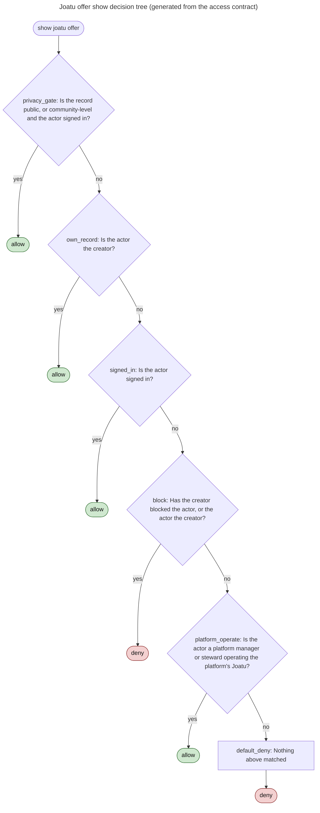
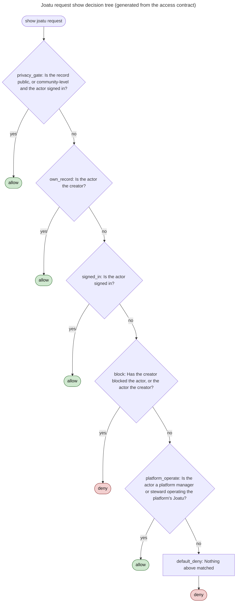

# Joatu access contract

Offers and requests members post to match what the community can give with what it needs.

Generated by `rake better_together:access:docs`.

## Inventory

| Resource | Model | Policy | Classification | Views | MCP tools | Jobs |
| --- | --- | --- | --- | --- | --- | --- |
| [Joatu offer](#joatu-offer) (`joatu_offer`) | `BetterTogether::Joatu::Offer` | `BetterTogether::Joatu::OfferPolicy` | `platform_shared` | 6 files | `list_offers_tool` | none |
| [Joatu request](#joatu-request) (`joatu_request`) | `BetterTogether::Joatu::Request` | `BetterTogether::Joatu::RequestPolicy` | `platform_shared` | 7 files | `list_requests_tool` | none |

### Routed actions

| Controller action | Verb | Example path | Authorization check |
| --- | --- | --- | --- |
| `joatu/offers#create` | POST | `/:locale/exchange/offers` | action (authorize or policy_scope in the action) |
| `joatu/offers#destroy` | DELETE | `/:locale/exchange/offers/:id` | action (authorize or policy_scope in the action) |
| `joatu/offers#edit` | GET | `/:locale/exchange/offers/:id/edit` | action (authorize or policy_scope in the action) |
| `joatu/offers#index` | GET | `/:locale/exchange/offers` | action (authorize or policy_scope in the action) |
| `joatu/offers#new` | GET | `/:locale/exchange/offers/new` | action (authorize or policy_scope in the action) |
| `joatu/offers#respond_with_request` | GET | `/:locale/exchange/offers/:id/respond_with_request` | action (authorize or policy_scope in the action) |
| `joatu/offers#show` | GET | `/:locale/exchange/offers/:id` | callback (authorization callback) |
| `joatu/offers#update` | PATCH | `/:locale/exchange/offers/:id` | action (authorize or policy_scope in the action) |
| `joatu/requests#create` | POST | `/:locale/exchange/requests` | action (authorize or policy_scope in the action) |
| `joatu/requests#destroy` | DELETE | `/:locale/exchange/requests/:id` | action (authorize or policy_scope in the action) |
| `joatu/requests#edit` | GET | `/:locale/exchange/requests/:id/edit` | action (authorize or policy_scope in the action) |
| `joatu/requests#index` | GET | `/:locale/exchange/requests` | action (authorize or policy_scope in the action) |
| `joatu/requests#matches` | GET | `/:locale/exchange/requests/:id/matches` | action (authorize or policy_scope in the action) |
| `joatu/requests#new` | GET | `/:locale/exchange/requests/new` | action (authorize or policy_scope in the action) |
| `joatu/requests#respond_with_offer` | GET | `/:locale/exchange/requests/:id/respond_with_offer` | action (authorize or policy_scope in the action) |
| `joatu/requests#show` | GET | `/:locale/exchange/requests/:id` | callback (authorization callback) |
| `joatu/requests#update` | PATCH | `/:locale/exchange/requests/:id` | action (authorize or policy_scope in the action) |

### Policies not contracted yet

| Policy | Reason |
| --- | --- |
| `Joatu::AgreementPolicy` | Agreements between an offer and a request; next stage. |
| `Joatu::CategoryPolicy` | Platform structure; next stage. |
| `Joatu::ConnectionRequestPolicy` | Network connection requests; contract with the platform subsystem. |
| `Joatu::MembershipRequestPolicy` | Membership requests; contract with the membership stack (MBR PRs). |
| `Joatu::ResponseLinkPolicy` | Links between an offer and a request; next stage. |

## Joatu offer

`BetterTogether::Joatu::Offer` · policy `BetterTogether::Joatu::OfferPolicy` · classification `platform_shared`

### Decision tree

Decision tree for show. Dashed red nodes are rules the app applies that the privacy rule does not intend.

[Open the SVG](../../diagrams/exports/svg/access_contract_joatu_offer_decision_tree.svg) · [Mermaid source](../../diagrams/source/access_contract_joatu_offer_decision_tree.mmd)

### Rules in order

| # | Rule | Question | Decides | Note |
| --- | --- | --- | --- | --- |
| 1 | `privacy_gate` | Is the record public, or community-level and the actor signed in? | allow |  |
| 2 | `own_record` | Is the actor the creator? | allow |  |
| 3 | `signed_in` | Is the actor signed in? | allow |  |
| 4 | `block` | Has the creator blocked the actor, or the actor the creator? | deny |  |
| 5 | `platform_operate` | Is the actor a platform manager or steward operating the platform's Joatu? | allow |  |
| 6 | `default_deny` | Nothing above matched | deny |  |

### index

| Persona | any |
| --- | --- |
| `anonymous` | allow privacy_gate |
| `signed_in_non_member` | allow privacy_gate |
| `community_member` | allow privacy_gate |
| `community_contributor` | allow privacy_gate |
| `community_organizer` | allow privacy_gate |
| `platform_manager` | allow privacy_gate |
| `platform_steward` | allow privacy_gate |
| `safety_reviewer` (pending) | pending |
| `remote_operator` (pending) | pending |
| `support_grantee` (pending) | pending |
| `record_owner` | n/a |
| `blocked_user` | n/a |

Reasons

- allow via `privacy_gate`: Everyone may open the index; the scope filters the rows. (anonymous, community_contributor, community_member, community_organizer, platform_manager, platform_steward, signed_in_non_member)

### show

| Persona | public | community | private |
| --- | --- | --- | --- |
| `anonymous` | allow privacy_gate | deny default_deny | deny default_deny |
| `signed_in_non_member` | allow privacy_gate | allow privacy_gate | deny default_deny |
| `community_member` | allow privacy_gate | allow privacy_gate | deny default_deny |
| `community_contributor` | allow privacy_gate | allow privacy_gate | deny default_deny |
| `community_organizer` | allow privacy_gate | allow privacy_gate | deny default_deny |
| `platform_manager` | allow privacy_gate | allow privacy_gate | deny default_deny |
| `platform_steward` | allow privacy_gate | allow privacy_gate | deny default_deny |
| `safety_reviewer` (pending) | pending | pending | pending |
| `remote_operator` (pending) | pending | pending | pending |
| `support_grantee` (pending) | pending | pending | pending |
| `record_owner` | allow privacy_gate | allow privacy_gate | allow own_record |
| `blocked_user` | deny block | deny block | deny block |

Reasons

- allow via `own_record`: Creators read their own offers. (record_owner)
- allow via `privacy_gate`: Any signed-in member reads community-level offers. (community_contributor, community_member, community_organizer, platform_manager, platform_steward, record_owner, signed_in_non_member)
- allow via `privacy_gate`: Public offers are readable by anyone. (anonymous, community_contributor, community_member, community_organizer, platform_manager, platform_steward, record_owner, signed_in_non_member)
- deny via `block`: The creator blocked this person. (blocked_user)
- deny via `default_deny`: Community-level offers are for signed-in members of the platform. (anonymous)
- deny via `default_deny`: No standing role reads private offers. (platform_manager, platform_steward)
- deny via `default_deny`: Private offers are for their creator. (anonymous, community_contributor, community_member, community_organizer, signed_in_non_member)

### create

| Persona | new |
| --- | --- |
| `anonymous` | deny default_deny |
| `signed_in_non_member` | allow signed_in |
| `community_member` | allow signed_in |
| `community_contributor` | allow signed_in |
| `community_organizer` | allow signed_in |
| `platform_manager` | allow signed_in |
| `platform_steward` | allow signed_in |
| `safety_reviewer` (pending) | pending |
| `remote_operator` (pending) | pending |
| `support_grantee` (pending) | pending |
| `record_owner` | n/a |
| `blocked_user` | n/a |

Reasons

- allow via `signed_in`: Any signed-in member may post. (community_contributor, community_member, community_organizer, platform_manager, platform_steward, signed_in_non_member)
- deny via `default_deny`: Posting needs an account. (anonymous)

### update

| Persona | public | community | private |
| --- | --- | --- | --- |
| `anonymous` | deny default_deny | deny default_deny | deny default_deny |
| `signed_in_non_member` | deny default_deny | deny default_deny | deny default_deny |
| `community_member` | deny default_deny | deny default_deny | deny default_deny |
| `community_contributor` | deny default_deny | deny default_deny | deny default_deny |
| `community_organizer` | deny default_deny | deny default_deny | deny default_deny |
| `platform_manager` | allow platform_operate | allow platform_operate | deny default_deny |
| `platform_steward` | allow platform_operate | allow platform_operate | deny default_deny |
| `safety_reviewer` (pending) | pending | pending | pending |
| `remote_operator` (pending) | pending | pending | pending |
| `support_grantee` (pending) | pending | pending | pending |
| `record_owner` | allow own_record | allow own_record | allow own_record |
| `blocked_user` | deny default_deny | deny default_deny | deny default_deny |

Reasons

- allow via `own_record`: Creators edit their own offers. (record_owner)
- allow via `platform_operate`: Managers moderate public and community-level offers. (platform_manager, platform_steward)
- deny via `default_deny`: Only the creator edits a post. (anonymous, blocked_user, community_contributor, community_member, community_organizer, signed_in_non_member)
- deny via `default_deny`: The edit form shows private content; operating a private post needs the creator. (platform_manager, platform_steward)

### destroy

| Persona | public | community | private |
| --- | --- | --- | --- |
| `anonymous` | deny default_deny | deny default_deny | deny default_deny |
| `signed_in_non_member` | deny default_deny | deny default_deny | deny default_deny |
| `community_member` | deny default_deny | deny default_deny | deny default_deny |
| `community_contributor` | deny default_deny | deny default_deny | deny default_deny |
| `community_organizer` | deny default_deny | deny default_deny | deny default_deny |
| `platform_manager` | allow platform_operate | allow platform_operate | allow platform_operate |
| `platform_steward` | allow platform_operate | allow platform_operate | allow platform_operate |
| `safety_reviewer` (pending) | pending | pending | pending |
| `remote_operator` (pending) | pending | pending | pending |
| `support_grantee` (pending) | pending | pending | pending |
| `record_owner` | allow own_record | allow own_record | allow own_record |
| `blocked_user` | deny default_deny | deny default_deny | deny default_deny |

Reasons

- allow via `own_record`: Creators delete their own offers while no agreement exists. (record_owner)
- allow via `platform_operate`: Managers remove offers of any privacy; deleting discloses nothing. (platform_manager, platform_steward)
- deny via `default_deny`: Only the creator or a platform manager deletes a post. (anonymous, blocked_user, community_contributor, community_member, community_organizer, signed_in_non_member)

### respond_with_request

| Persona | public | community | private |
| --- | --- | --- | --- |
| `anonymous` | deny default_deny | deny default_deny | deny default_deny |
| `signed_in_non_member` | allow signed_in | allow signed_in | deny default_deny |
| `community_member` | allow signed_in | allow signed_in | deny default_deny |
| `community_contributor` | allow signed_in | allow signed_in | deny default_deny |
| `community_organizer` | allow signed_in | allow signed_in | deny default_deny |
| `platform_manager` | allow signed_in | allow signed_in | deny default_deny |
| `platform_steward` | allow signed_in | allow signed_in | deny default_deny |
| `safety_reviewer` (pending) | pending | pending | pending |
| `remote_operator` (pending) | pending | pending | pending |
| `support_grantee` (pending) | pending | pending | pending |
| `record_owner` | allow signed_in | allow signed_in | allow own_record |
| `blocked_user` | deny block | deny block | deny block |

Reasons

- allow via `own_record`: Creators respond from their own posts. (record_owner)
- allow via `signed_in`: Any signed-in member may respond to a post they can read. (community_contributor, community_member, community_organizer, platform_manager, platform_steward, record_owner, signed_in_non_member)
- deny via `block`: A blocked person does not respond to the blocker's post. (blocked_user)
- deny via `default_deny`: Nobody else can read a private post, so nobody else responds to it. (community_contributor, community_member, community_organizer, platform_manager, platform_steward, signed_in_non_member)
- deny via `default_deny`: Responding needs an account. (anonymous)

### scope

| Persona | public | community | private |
| --- | --- | --- | --- |
| `anonymous` | allow privacy_gate | deny default_deny | deny default_deny |
| `signed_in_non_member` | allow privacy_gate | allow privacy_gate | deny default_deny |
| `community_member` | allow privacy_gate | allow privacy_gate | deny default_deny |
| `community_contributor` | allow privacy_gate | allow privacy_gate | deny default_deny |
| `community_organizer` | allow privacy_gate | allow privacy_gate | deny default_deny |
| `platform_manager` | allow privacy_gate | allow privacy_gate | deny default_deny |
| `platform_steward` | allow privacy_gate | allow privacy_gate | deny default_deny |
| `safety_reviewer` (pending) | pending | pending | pending |
| `remote_operator` (pending) | pending | pending | pending |
| `support_grantee` (pending) | pending | pending | pending |
| `record_owner` | allow privacy_gate | allow privacy_gate | allow own_record |
| `blocked_user` | deny block | deny block | deny block |

Reasons

- allow via `own_record`: Creators read their own offers. (record_owner)
- allow via `privacy_gate`: Any signed-in member reads community-level offers. (community_contributor, community_member, community_organizer, platform_manager, platform_steward, record_owner, signed_in_non_member)
- allow via `privacy_gate`: Public offers are readable by anyone. (anonymous, community_contributor, community_member, community_organizer, platform_manager, platform_steward, record_owner, signed_in_non_member)
- deny via `block`: The creator blocked this person. (blocked_user)
- deny via `default_deny`: Community-level offers are for signed-in members of the platform. (anonymous)
- deny via `default_deny`: No standing role reads private offers. (platform_manager, platform_steward)
- deny via `default_deny`: Private offers are for their creator. (anonymous, community_contributor, community_member, community_organizer, signed_in_non_member)

## Joatu request

`BetterTogether::Joatu::Request` · policy `BetterTogether::Joatu::RequestPolicy` · classification `platform_shared`

### Decision tree

Decision tree for show. Dashed red nodes are rules the app applies that the privacy rule does not intend.

[Open the SVG](../../diagrams/exports/svg/access_contract_joatu_request_decision_tree.svg) · [Mermaid source](../../diagrams/source/access_contract_joatu_request_decision_tree.mmd)

### Rules in order

| # | Rule | Question | Decides | Note |
| --- | --- | --- | --- | --- |
| 1 | `privacy_gate` | Is the record public, or community-level and the actor signed in? | allow |  |
| 2 | `own_record` | Is the actor the creator? | allow |  |
| 3 | `signed_in` | Is the actor signed in? | allow |  |
| 4 | `block` | Has the creator blocked the actor, or the actor the creator? | deny |  |
| 5 | `platform_operate` | Is the actor a platform manager or steward operating the platform's Joatu? | allow |  |
| 6 | `default_deny` | Nothing above matched | deny |  |

### index

| Persona | any |
| --- | --- |
| `anonymous` | allow privacy_gate |
| `signed_in_non_member` | allow privacy_gate |
| `community_member` | allow privacy_gate |
| `community_contributor` | allow privacy_gate |
| `community_organizer` | allow privacy_gate |
| `platform_manager` | allow privacy_gate |
| `platform_steward` | allow privacy_gate |
| `safety_reviewer` (pending) | pending |
| `remote_operator` (pending) | pending |
| `support_grantee` (pending) | pending |
| `record_owner` | n/a |
| `blocked_user` | n/a |

Reasons

- allow via `privacy_gate`: Everyone may open the index; the scope filters the rows. (anonymous, community_contributor, community_member, community_organizer, platform_manager, platform_steward, signed_in_non_member)

### show

| Persona | public | community | private |
| --- | --- | --- | --- |
| `anonymous` | allow privacy_gate | deny default_deny | deny default_deny |
| `signed_in_non_member` | allow privacy_gate | allow privacy_gate | deny default_deny |
| `community_member` | allow privacy_gate | allow privacy_gate | deny default_deny |
| `community_contributor` | allow privacy_gate | allow privacy_gate | deny default_deny |
| `community_organizer` | allow privacy_gate | allow privacy_gate | deny default_deny |
| `platform_manager` | allow privacy_gate | allow privacy_gate | deny default_deny |
| `platform_steward` | allow privacy_gate | allow privacy_gate | deny default_deny |
| `safety_reviewer` (pending) | pending | pending | pending |
| `remote_operator` (pending) | pending | pending | pending |
| `support_grantee` (pending) | pending | pending | pending |
| `record_owner` | allow privacy_gate | allow privacy_gate | allow own_record |
| `blocked_user` | deny block | deny block | deny block |

Reasons

- allow via `own_record`: Creators read their own requests. (record_owner)
- allow via `privacy_gate`: Any signed-in member reads community-level requests. (community_contributor, community_member, community_organizer, platform_manager, platform_steward, record_owner, signed_in_non_member)
- allow via `privacy_gate`: Public requests are readable by anyone. (anonymous, community_contributor, community_member, community_organizer, platform_manager, platform_steward, record_owner, signed_in_non_member)
- deny via `block`: The creator blocked this person. (blocked_user)
- deny via `default_deny`: Community-level requests are for signed-in members of the platform. (anonymous)
- deny via `default_deny`: No standing role reads private requests. (platform_manager, platform_steward)
- deny via `default_deny`: Private requests are for their creator. (anonymous, community_contributor, community_member, community_organizer, signed_in_non_member)

### create

| Persona | new |
| --- | --- |
| `anonymous` | deny default_deny |
| `signed_in_non_member` | allow signed_in |
| `community_member` | allow signed_in |
| `community_contributor` | allow signed_in |
| `community_organizer` | allow signed_in |
| `platform_manager` | allow signed_in |
| `platform_steward` | allow signed_in |
| `safety_reviewer` (pending) | pending |
| `remote_operator` (pending) | pending |
| `support_grantee` (pending) | pending |
| `record_owner` | n/a |
| `blocked_user` | n/a |

Reasons

- allow via `signed_in`: Any signed-in member may post. (community_contributor, community_member, community_organizer, platform_manager, platform_steward, signed_in_non_member)
- deny via `default_deny`: Posting needs an account. (anonymous)

### update

| Persona | public | community | private |
| --- | --- | --- | --- |
| `anonymous` | deny default_deny | deny default_deny | deny default_deny |
| `signed_in_non_member` | deny default_deny | deny default_deny | deny default_deny |
| `community_member` | deny default_deny | deny default_deny | deny default_deny |
| `community_contributor` | deny default_deny | deny default_deny | deny default_deny |
| `community_organizer` | deny default_deny | deny default_deny | deny default_deny |
| `platform_manager` | allow platform_operate | allow platform_operate | deny default_deny |
| `platform_steward` | allow platform_operate | allow platform_operate | deny default_deny |
| `safety_reviewer` (pending) | pending | pending | pending |
| `remote_operator` (pending) | pending | pending | pending |
| `support_grantee` (pending) | pending | pending | pending |
| `record_owner` | allow own_record | allow own_record | allow own_record |
| `blocked_user` | deny default_deny | deny default_deny | deny default_deny |

Reasons

- allow via `own_record`: Creators edit their own requests. (record_owner)
- allow via `platform_operate`: Managers moderate public and community-level requests. (platform_manager, platform_steward)
- deny via `default_deny`: Only the creator edits a post. (anonymous, blocked_user, community_contributor, community_member, community_organizer, signed_in_non_member)
- deny via `default_deny`: The edit form shows private content; operating a private post needs the creator. (platform_manager, platform_steward)

### destroy

| Persona | public | community | private |
| --- | --- | --- | --- |
| `anonymous` | deny default_deny | deny default_deny | deny default_deny |
| `signed_in_non_member` | deny default_deny | deny default_deny | deny default_deny |
| `community_member` | deny default_deny | deny default_deny | deny default_deny |
| `community_contributor` | deny default_deny | deny default_deny | deny default_deny |
| `community_organizer` | deny default_deny | deny default_deny | deny default_deny |
| `platform_manager` | allow platform_operate | allow platform_operate | allow platform_operate |
| `platform_steward` | allow platform_operate | allow platform_operate | allow platform_operate |
| `safety_reviewer` (pending) | pending | pending | pending |
| `remote_operator` (pending) | pending | pending | pending |
| `support_grantee` (pending) | pending | pending | pending |
| `record_owner` | allow own_record | allow own_record | allow own_record |
| `blocked_user` | deny default_deny | deny default_deny | deny default_deny |

Reasons

- allow via `own_record`: Creators delete their own requests while no agreement exists. (record_owner)
- allow via `platform_operate`: Managers remove requests of any privacy; deleting discloses nothing. (platform_manager, platform_steward)
- deny via `default_deny`: Only the creator or a platform manager deletes a post. (anonymous, blocked_user, community_contributor, community_member, community_organizer, signed_in_non_member)

### respond_with_offer

| Persona | public | community | private |
| --- | --- | --- | --- |
| `anonymous` | deny default_deny | deny default_deny | deny default_deny |
| `signed_in_non_member` | allow signed_in | allow signed_in | deny default_deny |
| `community_member` | allow signed_in | allow signed_in | deny default_deny |
| `community_contributor` | allow signed_in | allow signed_in | deny default_deny |
| `community_organizer` | allow signed_in | allow signed_in | deny default_deny |
| `platform_manager` | allow signed_in | allow signed_in | deny default_deny |
| `platform_steward` | allow signed_in | allow signed_in | deny default_deny |
| `safety_reviewer` (pending) | pending | pending | pending |
| `remote_operator` (pending) | pending | pending | pending |
| `support_grantee` (pending) | pending | pending | pending |
| `record_owner` | allow signed_in | allow signed_in | allow own_record |
| `blocked_user` | deny block | deny block | deny block |

Reasons

- allow via `own_record`: Creators respond from their own posts. (record_owner)
- allow via `signed_in`: Any signed-in member may respond to a post they can read. (community_contributor, community_member, community_organizer, platform_manager, platform_steward, record_owner, signed_in_non_member)
- deny via `block`: A blocked person does not respond to the blocker's post. (blocked_user)
- deny via `default_deny`: Nobody else can read a private post, so nobody else responds to it. (community_contributor, community_member, community_organizer, platform_manager, platform_steward, signed_in_non_member)
- deny via `default_deny`: Responding needs an account. (anonymous)

### scope

| Persona | public | community | private |
| --- | --- | --- | --- |
| `anonymous` | allow privacy_gate | deny default_deny | deny default_deny |
| `signed_in_non_member` | allow privacy_gate | allow privacy_gate | deny default_deny |
| `community_member` | allow privacy_gate | allow privacy_gate | deny default_deny |
| `community_contributor` | allow privacy_gate | allow privacy_gate | deny default_deny |
| `community_organizer` | allow privacy_gate | allow privacy_gate | deny default_deny |
| `platform_manager` | allow privacy_gate | allow privacy_gate | deny default_deny |
| `platform_steward` | allow privacy_gate | allow privacy_gate | deny default_deny |
| `safety_reviewer` (pending) | pending | pending | pending |
| `remote_operator` (pending) | pending | pending | pending |
| `support_grantee` (pending) | pending | pending | pending |
| `record_owner` | allow privacy_gate | allow privacy_gate | allow own_record |
| `blocked_user` | deny block | deny block | deny block |

Reasons

- allow via `own_record`: Creators read their own requests. (record_owner)
- allow via `privacy_gate`: Any signed-in member reads community-level requests. (community_contributor, community_member, community_organizer, platform_manager, platform_steward, record_owner, signed_in_non_member)
- allow via `privacy_gate`: Public requests are readable by anyone. (anonymous, community_contributor, community_member, community_organizer, platform_manager, platform_steward, record_owner, signed_in_non_member)
- deny via `block`: The creator blocked this person. (blocked_user)
- deny via `default_deny`: Community-level requests are for signed-in members of the platform. (anonymous)
- deny via `default_deny`: No standing role reads private requests. (platform_manager, platform_steward)
- deny via `default_deny`: Private requests are for their creator. (anonymous, community_contributor, community_member, community_organizer, signed_in_non_member)

