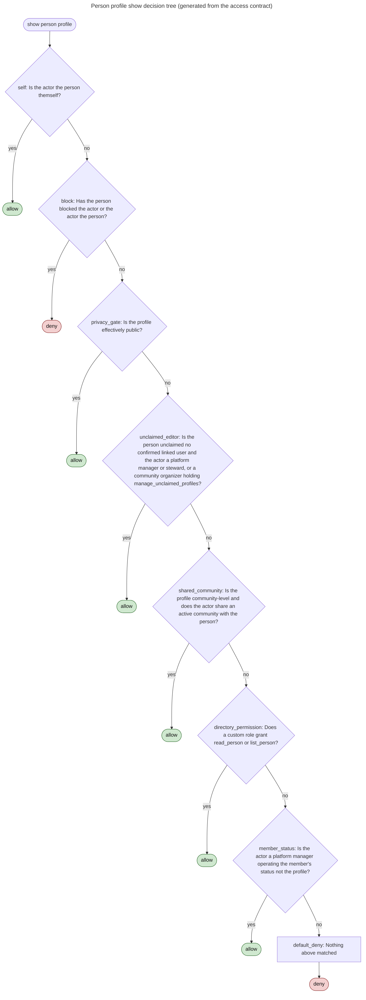
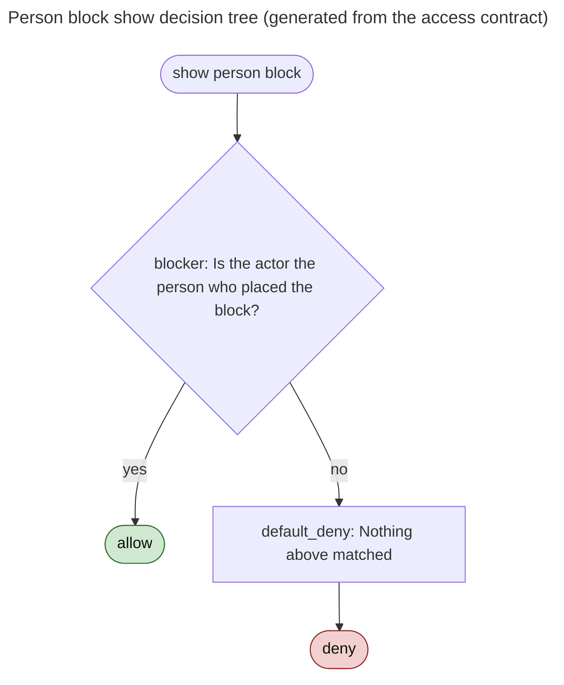
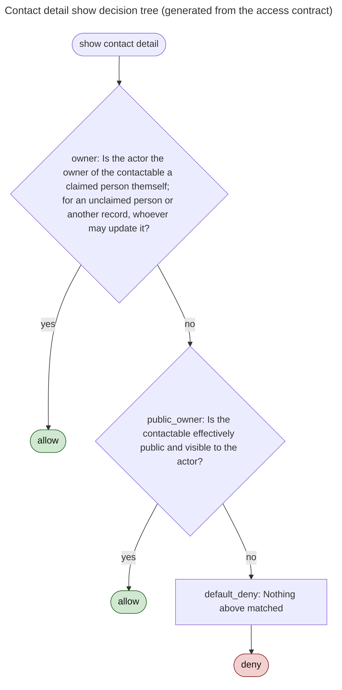

# People access contract

Person profiles, the blocks people place on each other, and the contact details attached to them.

Generated by `rake better_together:access:docs`.

## Inventory

| Resource | Model | Policy | Classification | Views | MCP tools | Jobs |
| --- | --- | --- | --- | --- | --- | --- |
| [Person profile](#person-profile) (`person`) | `BetterTogether::Person` | `BetterTogether::PersonPolicy` | `personal` | 15 files | `application_tool`, `list_notifications_tool`, `search_people_tool` | `event_reminder_job`, `federated_linked_seed_pull_job`, `apply_platform_defaults_job` |
| [Person block](#person-block) (`person_block`) | `BetterTogether::PersonBlock` | `BetterTogether::PersonBlockPolicy` | `personal` | 3 files | none | none |
| [Contact detail](#contact-detail) (`contact_detail`) | `BetterTogether::ContactDetail` | `BetterTogether::ContactDetailPolicy` | `personal` | 0 files | none | none |

### Routed actions

| Controller action | Verb | Example path | Authorization check |
| --- | --- | --- | --- |
| `api/v1/people#create` | POST | `/api/v1/people` | api (Pundit::ResourceController) |
| `api/v1/people#create_relationship` | POST | `/api/v1/people/:person_id/relationships/communities` | api (Pundit::ResourceController) |
| `api/v1/people#destroy` | DELETE | `/api/v1/people/:id` | api (Pundit::ResourceController) |
| `api/v1/people#destroy_relationship` | DELETE | `/api/v1/people/:person_id/relationships/communities` | api (Pundit::ResourceController) |
| `api/v1/people#index` | GET | `/api/v1/people` | api (Pundit::ResourceController) |
| `api/v1/people#index_related_resources` | GET | `/api/v1/communities/:community_id/members` | api (Pundit::ResourceController) |
| `api/v1/people#me` | GET | `/api/v1/people/me` | api (Pundit::ResourceController) |
| `api/v1/people#show` | GET | `/api/v1/people/:id` | api (Pundit::ResourceController) |
| `api/v1/people#show_related_resource` | GET | `/api/v1/authorships/:authorship_id/creator` | api (Pundit::ResourceController) |
| `api/v1/people#show_relationship` | GET | `/api/v1/people/:person_id/relationships/communities` | api (Pundit::ResourceController) |
| `api/v1/people#update` | PATCH | `/api/v1/people/:id` | api (Pundit::ResourceController) |
| `api/v1/people#update_relationship` | PUT|PATCH | `/api/v1/people/:person_id/relationships/communities` | api (Pundit::ResourceController) |
| `api/v1/person_blocks#create` | POST | `/api/v1/person_blocks` | api (Pundit::ResourceController) |
| `api/v1/person_blocks#destroy` | DELETE | `/api/v1/person_blocks/:id` | api (Pundit::ResourceController) |
| `api/v1/person_blocks#destroy_relationship` | DELETE | `/api/v1/person_blocks/:person_block_id/relationships/blocked` | api (Pundit::ResourceController) |
| `api/v1/person_blocks#index` | GET | `/api/v1/person_blocks` | api (Pundit::ResourceController) |
| `api/v1/person_blocks#show` | GET | `/api/v1/person_blocks/:id` | api (Pundit::ResourceController) |
| `api/v1/person_blocks#show_relationship` | GET | `/api/v1/person_blocks/:person_block_id/relationships/blocked` | api (Pundit::ResourceController) |
| `api/v1/person_blocks#update_relationship` | PUT|PATCH | `/api/v1/person_blocks/:person_block_id/relationships/blocked` | api (Pundit::ResourceController) |
| `people#create` | POST | `/:locale/host/people` | action (authorize or policy_scope in the action) |
| `people#destroy` | DELETE | `/:locale/host/people/:id` | callback (authorization callback) |
| `people#edit` | GET | `/:locale/host/people/:id/edit` | callback (authorization callback) |
| `people#index` | GET | `/:locale/host/people` | allowlisted (The index action scopes through resource_collection, which calls policy_scope.) |
| `people#new` | GET | `/:locale/host/people/new` | action (authorize or policy_scope in the action) |
| `people#show` | GET | `/:locale/host/people/:id` | callback (authorization callback) |
| `people#update` | PATCH | `/:locale/host/people/:id` | callback (authorization callback) |
| `person_blocks#create` | POST | `/:locale/blocks` | action (authorize or policy_scope in the action) |
| `person_blocks#destroy` | DELETE | `/:locale/blocks/:id` | action (authorize or policy_scope in the action) |
| `person_blocks#index` | GET | `/:locale/blocks` | action (authorize or policy_scope in the action) |
| `person_blocks#new` | GET | `/:locale/blocks/new` | action (authorize or policy_scope in the action) |
| `person_blocks#search` | GET | `/:locale/blocks/search` | action (authorize or policy_scope in the action) |

### Policies not contracted yet

| Policy | Reason |
| --- | --- |
| `AddressPolicy` | Contact component carrying its own privacy; next pilot stage. |
| `EmailAddressPolicy` | Contact component carrying its own privacy; next pilot stage. |
| `PhoneNumberPolicy` | Contact component carrying its own privacy; next pilot stage. |
| `SocialMediaAccountPolicy` | Contact component carrying its own privacy; next pilot stage. |
| `PersonAccessGrantPolicy` | Feature-flagged grant flow; contract with the break-glass design. |
| `PersonLinkPolicy` | Profile links; next pilot stage. |
| `PersonLinkedSeedPolicy` | Federated seeds; next pilot stage. |
| `PersonPlatformIntegrationPolicy` | Third-party integrations; next pilot stage. |
| `PersonPlatformMembershipPolicy` | Platform membership and role grants; contract with the platform subsystem. |
| `PersonSeedPolicy` | Personal seed exports; next pilot stage. |

## Person profile

`BetterTogether::Person` · policy `BetterTogether::PersonPolicy` · classification `personal`

### Decision tree

Decision tree for show. Dashed red nodes are rules the app applies that the privacy rule does not intend.

[Open the SVG](../../diagrams/exports/svg/access_contract_person_decision_tree.svg) · [Mermaid source](../../diagrams/source/access_contract_person_decision_tree.mmd)

### Rules in order

| # | Rule | Question | Decides | Note |
| --- | --- | --- | --- | --- |
| 1 | `self` | Is the actor the person themself? | allow |  |
| 2 | `block` | Has the person blocked the actor (or the actor the person)? | deny |  |
| 3 | `privacy_gate` | Is the profile effectively public? | allow |  |
| 4 | `unclaimed_editor` | Is the person unclaimed (no confirmed linked user) and the actor a platform manager or steward, or a community organizer holding manage_unclaimed_profiles? | allow |  |
| 5 | `shared_community` | Is the profile community-level and does the actor share an active community with the person? | allow |  |
| 6 | `directory_permission` | Does a custom role grant read_person or list_person? | allow |  |
| 7 | `member_status` | Is the actor a platform manager operating the member's status (not the profile)? | allow |  |
| 8 | `default_deny` | Nothing above matched | deny |  |

### index

| Persona | any |
| --- | --- |
| `anonymous` | deny default_deny |
| `signed_in_non_member` | allow privacy_gate |
| `community_member` | allow privacy_gate |
| `community_contributor` | allow privacy_gate |
| `community_organizer` | allow privacy_gate |
| `platform_manager` | allow privacy_gate |
| `platform_steward` | allow privacy_gate |
| `safety_reviewer` (pending) | pending |
| `remote_operator` (pending) | pending |
| `support_grantee` (pending) | pending |
| `record_owner` | n/a |
| `blocked_user` | n/a |

Reasons

- allow via `privacy_gate`: Signed-in people may open the directory; the scope filters the rows. (community_contributor, community_member, community_organizer, platform_manager, platform_steward, signed_in_non_member)
- deny via `default_deny`: The directory needs a signed-in actor; the scope then filters. (anonymous)

### show

| Persona | public | community | private | unclaimed |
| --- | --- | --- | --- | --- |
| `anonymous` | allow privacy_gate | deny default_deny | deny default_deny | allow privacy_gate |
| `signed_in_non_member` | allow privacy_gate | deny default_deny | deny default_deny | allow privacy_gate |
| `community_member` | allow privacy_gate | allow shared_community | deny default_deny | allow privacy_gate |
| `community_contributor` | allow privacy_gate | allow shared_community | deny default_deny | allow privacy_gate |
| `community_organizer` | allow privacy_gate | allow shared_community | deny default_deny | allow privacy_gate |
| `platform_manager` | allow privacy_gate | deny default_deny | deny default_deny | allow privacy_gate |
| `platform_steward` | allow privacy_gate | deny default_deny | deny default_deny | allow privacy_gate |
| `safety_reviewer` (pending) | pending | pending | pending | pending |
| `remote_operator` (pending) | pending | pending | pending | pending |
| `support_grantee` (pending) | pending | pending | pending | pending |
| `record_owner` | allow self | allow self | allow self | n/a |
| `blocked_user` | deny block | deny block | deny block | allow privacy_gate |

Reasons

- allow via `privacy_gate`: Public profiles are readable by anyone. (anonymous, blocked_user, community_contributor, community_member, community_organizer, platform_manager, platform_steward, signed_in_non_member)
- allow via `self`: People always read their own profile. (record_owner)
- allow via `shared_community`: Community-level profiles are visible to people who share a community. (community_contributor, community_member, community_organizer)
- deny via `block`: A block hides the blocker's profile from the blocked person. (blocked_user)
- deny via `default_deny`: Private profiles and profiles outside one's communities are not readable; standing roles do not read them. (anonymous, community_contributor, community_member, community_organizer, platform_manager, platform_steward, signed_in_non_member)

### download

| Persona | public | community | private | unclaimed |
| --- | --- | --- | --- | --- |
| `anonymous` | allow privacy_gate | deny default_deny | deny default_deny | allow privacy_gate |
| `signed_in_non_member` | allow privacy_gate | deny default_deny | deny default_deny | allow privacy_gate |
| `community_member` | allow privacy_gate | allow shared_community | deny default_deny | allow privacy_gate |
| `community_contributor` | allow privacy_gate | allow shared_community | deny default_deny | allow privacy_gate |
| `community_organizer` | allow privacy_gate | allow shared_community | deny default_deny | allow privacy_gate |
| `platform_manager` | allow privacy_gate | deny default_deny | deny default_deny | allow privacy_gate |
| `platform_steward` | allow privacy_gate | deny default_deny | deny default_deny | allow privacy_gate |
| `safety_reviewer` (pending) | pending | pending | pending | pending |
| `remote_operator` (pending) | pending | pending | pending | pending |
| `support_grantee` (pending) | pending | pending | pending | pending |
| `record_owner` | allow self | allow self | allow self | n/a |
| `blocked_user` | deny block | deny block | deny block | allow privacy_gate |

Reasons

- allow via `privacy_gate`: Download follows show. (anonymous, blocked_user, community_contributor, community_member, community_organizer, platform_manager, platform_steward, signed_in_non_member)
- allow via `self`: Download follows show. (record_owner)
- allow via `shared_community`: Download follows show. (community_contributor, community_member, community_organizer)
- deny via `block`: Download follows show. (blocked_user)
- deny via `default_deny`: Download follows show. (anonymous, community_contributor, community_member, community_organizer, platform_manager, platform_steward, signed_in_non_member)

### create

| Persona | new |
| --- | --- |
| `anonymous` | deny default_deny |
| `signed_in_non_member` | deny default_deny |
| `community_member` | deny default_deny |
| `community_contributor` | deny default_deny |
| `community_organizer` | deny default_deny |
| `platform_manager` | deny default_deny |
| `platform_steward` | deny default_deny |
| `safety_reviewer` (pending) | pending |
| `remote_operator` (pending) | pending |
| `support_grantee` (pending) | pending |
| `record_owner` | n/a |
| `blocked_user` | n/a |

Reasons

- deny via `default_deny`: Creating a profile needs the opt-in create_person grant; no default role holds it. (anonymous, community_contributor, community_member, community_organizer, platform_manager, platform_steward, signed_in_non_member)

### update

| Persona | public | community | private | unclaimed | claimed |
| --- | --- | --- | --- | --- | --- |
| `anonymous` | deny default_deny | deny default_deny | deny default_deny | deny default_deny | deny default_deny |
| `signed_in_non_member` | deny default_deny | deny default_deny | deny default_deny | deny default_deny | deny default_deny |
| `community_member` | deny default_deny | deny default_deny | deny default_deny | deny default_deny | deny default_deny |
| `community_contributor` | deny default_deny | deny default_deny | deny default_deny | deny default_deny | deny default_deny |
| `community_organizer` | deny default_deny | deny default_deny | deny default_deny | deny default_deny | deny default_deny |
| `platform_manager` | deny default_deny | deny default_deny | deny default_deny | allow unclaimed_editor | deny default_deny |
| `platform_steward` | deny default_deny | deny default_deny | deny default_deny | allow unclaimed_editor | deny default_deny |
| `safety_reviewer` (pending) | pending | pending | pending | pending | pending |
| `remote_operator` (pending) | pending | pending | pending | pending | pending |
| `support_grantee` (pending) | pending | pending | pending | pending | pending |
| `record_owner` | allow self | allow self | allow self | n/a | allow self |
| `blocked_user` | deny default_deny | deny default_deny | deny default_deny | deny default_deny | deny default_deny |

Reasons

- allow via `self`: People edit their own profile. (record_owner)
- allow via `unclaimed_editor`: An unclaimed profile has no owner; staff who may update person records maintain it. (platform_manager, platform_steward)
- deny via `default_deny`: Only the person (or an opt-in update_person grant) edits a claimed profile. (anonymous, blocked_user, community_contributor, community_member, community_organizer, signed_in_non_member)
- deny via `default_deny`: Organizers edit an unclaimed profile only with the opt-in manage_unclaimed_profiles grant; no default role holds it. (community_organizer)
- deny via `default_deny`: Profile editing shows private contact details; managers operate member status, not claimed profile content. (platform_manager, platform_steward)

### suspend

| Persona | claimed | unclaimed |
| --- | --- | --- |
| `anonymous` | deny default_deny | deny default_deny |
| `signed_in_non_member` | deny default_deny | deny default_deny |
| `community_member` | deny default_deny | deny default_deny |
| `community_contributor` | deny default_deny | deny default_deny |
| `community_organizer` | deny default_deny | deny default_deny |
| `platform_manager` | allow member_status | allow member_status |
| `platform_steward` | allow member_status | allow member_status |
| `safety_reviewer` (pending) | pending | pending |
| `remote_operator` (pending) | pending | pending |
| `support_grantee` (pending) | pending | pending |
| `record_owner` | deny default_deny | n/a |
| `blocked_user` | deny default_deny | deny default_deny |

Reasons

- allow via `member_status`: Managers suspend members; this opens no profile content. (platform_manager, platform_steward)
- deny via `default_deny`: Only platform managers operate member status, and nobody suspends themself. (anonymous, blocked_user, community_contributor, community_member, community_organizer, record_owner, signed_in_non_member)

### restore

| Persona | claimed | unclaimed |
| --- | --- | --- |
| `anonymous` | deny default_deny | deny default_deny |
| `signed_in_non_member` | deny default_deny | deny default_deny |
| `community_member` | deny default_deny | deny default_deny |
| `community_contributor` | deny default_deny | deny default_deny |
| `community_organizer` | deny default_deny | deny default_deny |
| `platform_manager` | allow member_status | allow member_status |
| `platform_steward` | allow member_status | allow member_status |
| `safety_reviewer` (pending) | pending | pending |
| `remote_operator` (pending) | pending | pending |
| `support_grantee` (pending) | pending | pending |
| `record_owner` | deny default_deny | n/a |
| `blocked_user` | deny default_deny | deny default_deny |

Reasons

- allow via `member_status`: Managers restore suspended members; this opens no profile content. (platform_manager, platform_steward)
- deny via `default_deny`: Only platform managers operate member status, and nobody restores themself. (anonymous, blocked_user, community_contributor, community_member, community_organizer, record_owner, signed_in_non_member)

### destroy

| Persona | public | community | private | unclaimed |
| --- | --- | --- | --- | --- |
| `anonymous` | deny default_deny | deny default_deny | deny default_deny | deny default_deny |
| `signed_in_non_member` | deny default_deny | deny default_deny | deny default_deny | deny default_deny |
| `community_member` | deny default_deny | deny default_deny | deny default_deny | deny default_deny |
| `community_contributor` | deny default_deny | deny default_deny | deny default_deny | deny default_deny |
| `community_organizer` | deny default_deny | deny default_deny | deny default_deny | deny default_deny |
| `platform_manager` | deny default_deny | deny default_deny | deny default_deny | deny default_deny |
| `platform_steward` | deny default_deny | deny default_deny | deny default_deny | deny default_deny |
| `safety_reviewer` (pending) | pending | pending | pending | pending |
| `remote_operator` (pending) | pending | pending | pending | pending |
| `support_grantee` (pending) | pending | pending | pending | pending |
| `record_owner` | deny default_deny | deny default_deny | deny default_deny | n/a |
| `blocked_user` | deny default_deny | deny default_deny | deny default_deny | deny default_deny |

Reasons

- deny via `default_deny`: Deletion is a reviewed deletion request, not a policy action; the opt-in delete_person grant is held by no default role. (anonymous, blocked_user, community_contributor, community_member, community_organizer, platform_manager, platform_steward, record_owner, signed_in_non_member)

### scope

| Persona | public | community | private | unclaimed |
| --- | --- | --- | --- | --- |
| `anonymous` | allow privacy_gate | deny default_deny | deny default_deny | allow privacy_gate |
| `signed_in_non_member` | allow privacy_gate | deny default_deny | deny default_deny | allow privacy_gate |
| `community_member` | allow privacy_gate | allow shared_community | deny default_deny | allow privacy_gate |
| `community_contributor` | allow privacy_gate | allow shared_community | deny default_deny | allow privacy_gate |
| `community_organizer` | allow privacy_gate | allow shared_community | deny default_deny | allow privacy_gate |
| `platform_manager` | allow privacy_gate | deny default_deny | deny default_deny | allow privacy_gate |
| `platform_steward` | allow privacy_gate | deny default_deny | deny default_deny | allow privacy_gate |
| `safety_reviewer` (pending) | pending | pending | pending | pending |
| `remote_operator` (pending) | pending | pending | pending | pending |
| `support_grantee` (pending) | pending | pending | pending | pending |
| `record_owner` | allow self | allow self | allow self | n/a |
| `blocked_user` | deny block | deny block | deny block | allow privacy_gate |

Reasons

- allow via `privacy_gate`: Public profiles are listed for everyone. (anonymous, blocked_user, community_contributor, community_member, community_organizer, platform_manager, platform_steward, signed_in_non_member)
- allow via `self`: People list themselves. (record_owner)
- allow via `shared_community`: Shared-community people are listed. (community_contributor, community_member, community_organizer)
- deny via `block`: Blocks remove the blocker from the blocked person's results. (blocked_user)
- deny via `default_deny`: Other profiles are not listed; standing roles do not list private people. (anonymous, community_contributor, community_member, community_organizer, platform_manager, platform_steward, signed_in_non_member)

## Person block

`BetterTogether::PersonBlock` · policy `BetterTogether::PersonBlockPolicy` · classification `personal`

### Decision tree

Decision tree for show. Dashed red nodes are rules the app applies that the privacy rule does not intend.

[Open the SVG](../../diagrams/exports/svg/access_contract_person_block_decision_tree.svg) · [Mermaid source](../../diagrams/source/access_contract_person_block_decision_tree.mmd)

### Rules in order

| # | Rule | Question | Decides | Note |
| --- | --- | --- | --- | --- |
| 1 | `blocker` | Is the actor the person who placed the block? | allow |  |
| 2 | `default_deny` | Nothing above matched | deny |  |

### index

| Persona | any |
| --- | --- |
| `anonymous` | deny default_deny |
| `signed_in_non_member` | allow blocker |
| `community_member` | allow blocker |
| `community_contributor` | allow blocker |
| `community_organizer` | allow blocker |
| `platform_manager` | allow blocker |
| `platform_steward` | allow blocker |
| `safety_reviewer` (pending) | pending |
| `remote_operator` (pending) | pending |
| `support_grantee` (pending) | pending |
| `record_owner` | n/a |
| `blocked_user` | allow blocker |

Reasons

- allow via `blocker`: Signed-in people open their own block list; the scope filters it. (blocked_user, community_contributor, community_member, community_organizer, platform_manager, platform_steward, signed_in_non_member)
- deny via `default_deny`: Blocking needs a signed-in actor. (anonymous)

### show

| Persona | own | someone_elses |
| --- | --- | --- |
| `anonymous` | n/a | deny default_deny |
| `signed_in_non_member` | n/a | deny default_deny |
| `community_member` | n/a | deny default_deny |
| `community_contributor` | n/a | deny default_deny |
| `community_organizer` | n/a | deny default_deny |
| `platform_manager` | n/a | deny default_deny |
| `platform_steward` | n/a | deny default_deny |
| `safety_reviewer` (pending) | pending | pending |
| `remote_operator` (pending) | pending | pending |
| `support_grantee` (pending) | pending | pending |
| `record_owner` | allow blocker | n/a |
| `blocked_user` | n/a | deny default_deny |

Reasons

- allow via `blocker`: The blocker reads their own block. (record_owner)
- deny via `default_deny`: Blocks are private to the blocker; nobody else reads them, including the blocked person and standing roles. (anonymous, blocked_user, community_contributor, community_member, community_organizer, platform_manager, platform_steward, signed_in_non_member)

### create

| Persona | own | someone_elses |
| --- | --- | --- |
| `anonymous` | n/a | deny default_deny |
| `signed_in_non_member` | n/a | deny default_deny |
| `community_member` | n/a | deny default_deny |
| `community_contributor` | n/a | deny default_deny |
| `community_organizer` | n/a | deny default_deny |
| `platform_manager` | n/a | deny default_deny |
| `platform_steward` | n/a | deny default_deny |
| `safety_reviewer` (pending) | pending | pending |
| `remote_operator` (pending) | pending | pending |
| `support_grantee` (pending) | pending | pending |
| `record_owner` | allow blocker | n/a |
| `blocked_user` | n/a | deny default_deny |

Reasons

- allow via `blocker`: People place their own blocks (except on platform managers). (record_owner)
- deny via `default_deny`: Nobody places a block on someone else's behalf. (anonymous, blocked_user, community_contributor, community_member, community_organizer, platform_manager, platform_steward, signed_in_non_member)

### destroy

| Persona | own | someone_elses |
| --- | --- | --- |
| `anonymous` | n/a | deny default_deny |
| `signed_in_non_member` | n/a | deny default_deny |
| `community_member` | n/a | deny default_deny |
| `community_contributor` | n/a | deny default_deny |
| `community_organizer` | n/a | deny default_deny |
| `platform_manager` | n/a | deny default_deny |
| `platform_steward` | n/a | deny default_deny |
| `safety_reviewer` (pending) | pending | pending |
| `remote_operator` (pending) | pending | pending |
| `support_grantee` (pending) | pending | pending |
| `record_owner` | allow blocker | n/a |
| `blocked_user` | n/a | deny default_deny |

Reasons

- allow via `blocker`: The blocker lifts their own block. (record_owner)
- deny via `default_deny`: Only the blocker lifts a block. (anonymous, blocked_user, community_contributor, community_member, community_organizer, platform_manager, platform_steward, signed_in_non_member)

### scope

| Persona | own | someone_elses |
| --- | --- | --- |
| `anonymous` | n/a | deny default_deny |
| `signed_in_non_member` | n/a | deny default_deny |
| `community_member` | n/a | deny default_deny |
| `community_contributor` | n/a | deny default_deny |
| `community_organizer` | n/a | deny default_deny |
| `platform_manager` | n/a | deny default_deny |
| `platform_steward` | n/a | deny default_deny |
| `safety_reviewer` (pending) | pending | pending |
| `remote_operator` (pending) | pending | pending |
| `support_grantee` (pending) | pending | pending |
| `record_owner` | allow blocker | n/a |
| `blocked_user` | n/a | deny default_deny |

Reasons

- allow via `blocker`: The blocker lists their own blocks. (record_owner)
- deny via `default_deny`: Blocks are visible to the blocker only. (anonymous, blocked_user, community_contributor, community_member, community_organizer, platform_manager, platform_steward, signed_in_non_member)

## Contact detail

`BetterTogether::ContactDetail` · policy `BetterTogether::ContactDetailPolicy` · classification `personal`

### Decision tree

Decision tree for show. Dashed red nodes are rules the app applies that the privacy rule does not intend.

[Open the SVG](../../diagrams/exports/svg/access_contract_contact_detail_decision_tree.svg) · [Mermaid source](../../diagrams/source/access_contract_contact_detail_decision_tree.mmd)

### Rules in order

| # | Rule | Question | Decides | Note |
| --- | --- | --- | --- | --- |
| 1 | `owner` | Is the actor the owner of the contactable (a claimed person themself; for an unclaimed person or another record, whoever may update it)? | allow |  |
| 2 | `public_owner` | Is the contactable effectively public and visible to the actor? | allow |  |
| 3 | `default_deny` | Nothing above matched | deny |  |

### show

| Persona | public | private | unclaimed |
| --- | --- | --- | --- |
| `anonymous` | deny default_deny | deny default_deny | deny default_deny |
| `signed_in_non_member` | deny default_deny | deny default_deny | deny default_deny |
| `community_member` | deny default_deny | deny default_deny | deny default_deny |
| `community_contributor` | deny default_deny | deny default_deny | deny default_deny |
| `community_organizer` | deny default_deny | deny default_deny | deny default_deny |
| `platform_manager` | deny default_deny | deny default_deny | deny default_deny |
| `platform_steward` | deny default_deny | deny default_deny | deny default_deny |
| `safety_reviewer` (pending) | pending | pending | pending |
| `remote_operator` (pending) | pending | pending | pending |
| `support_grantee` (pending) | pending | pending | pending |
| `record_owner` | deny default_deny | deny default_deny | n/a |
| `blocked_user` | deny default_deny | deny default_deny | deny default_deny |

Reasons

- deny via `default_deny`: Contact details render through their owner's profile and are never fetched directly (no show? method). (anonymous, blocked_user, community_contributor, community_member, community_organizer, platform_manager, platform_steward, record_owner, signed_in_non_member)

### create

| Persona | public | private | unclaimed |
| --- | --- | --- | --- |
| `anonymous` | deny default_deny | deny default_deny | deny default_deny |
| `signed_in_non_member` | deny default_deny | deny default_deny | deny default_deny |
| `community_member` | deny default_deny | deny default_deny | deny default_deny |
| `community_contributor` | deny default_deny | deny default_deny | deny default_deny |
| `community_organizer` | deny default_deny | deny default_deny | deny default_deny |
| `platform_manager` | deny default_deny | deny default_deny | allow owner |
| `platform_steward` | deny default_deny | deny default_deny | allow owner |
| `safety_reviewer` (pending) | pending | pending | pending |
| `remote_operator` (pending) | pending | pending | pending |
| `support_grantee` (pending) | pending | pending | pending |
| `record_owner` | allow owner | allow owner | n/a |
| `blocked_user` | deny default_deny | deny default_deny | deny default_deny |

Reasons

- allow via `owner`: An unclaimed person has no owner; staff who may update the person maintain its details. (platform_manager, platform_steward)
- allow via `owner`: The owner adds contact details to their own record. (record_owner)
- deny via `default_deny`: Only the contactable's owner creates its contact details; standing roles do not. (anonymous, blocked_user, community_contributor, community_member, community_organizer, platform_manager, platform_steward, signed_in_non_member)

### update

| Persona | public | private | unclaimed |
| --- | --- | --- | --- |
| `anonymous` | deny default_deny | deny default_deny | deny default_deny |
| `signed_in_non_member` | deny default_deny | deny default_deny | deny default_deny |
| `community_member` | deny default_deny | deny default_deny | deny default_deny |
| `community_contributor` | deny default_deny | deny default_deny | deny default_deny |
| `community_organizer` | deny default_deny | deny default_deny | deny default_deny |
| `platform_manager` | deny default_deny | deny default_deny | allow owner |
| `platform_steward` | deny default_deny | deny default_deny | allow owner |
| `safety_reviewer` (pending) | pending | pending | pending |
| `remote_operator` (pending) | pending | pending | pending |
| `support_grantee` (pending) | pending | pending | pending |
| `record_owner` | allow owner | allow owner | n/a |
| `blocked_user` | deny default_deny | deny default_deny | deny default_deny |

Reasons

- allow via `owner`: An unclaimed person has no owner; staff who may update the person maintain its details. (platform_manager, platform_steward)
- allow via `owner`: The owner edits their own contact details. (record_owner)
- deny via `default_deny`: Only the owner edits contact details; standing roles do not. (anonymous, blocked_user, community_contributor, community_member, community_organizer, platform_manager, platform_steward, signed_in_non_member)

### destroy

| Persona | public | private | unclaimed |
| --- | --- | --- | --- |
| `anonymous` | deny default_deny | deny default_deny | deny default_deny |
| `signed_in_non_member` | deny default_deny | deny default_deny | deny default_deny |
| `community_member` | deny default_deny | deny default_deny | deny default_deny |
| `community_contributor` | deny default_deny | deny default_deny | deny default_deny |
| `community_organizer` | deny default_deny | deny default_deny | deny default_deny |
| `platform_manager` | deny default_deny | deny default_deny | allow owner |
| `platform_steward` | deny default_deny | deny default_deny | allow owner |
| `safety_reviewer` (pending) | pending | pending | pending |
| `remote_operator` (pending) | pending | pending | pending |
| `support_grantee` (pending) | pending | pending | pending |
| `record_owner` | allow owner | allow owner | n/a |
| `blocked_user` | deny default_deny | deny default_deny | deny default_deny |

Reasons

- allow via `owner`: An unclaimed person has no owner; staff who may update the person maintain its details. (platform_manager, platform_steward)
- allow via `owner`: The owner removes their own contact detail. (record_owner)
- deny via `default_deny`: Only the owner removes a contact detail; standing roles do not. (anonymous, blocked_user, community_contributor, community_member, community_organizer, platform_manager, platform_steward, signed_in_non_member)

### scope

| Persona | public | private | unclaimed |
| --- | --- | --- | --- |
| `anonymous` | allow public_owner | deny default_deny | allow public_owner |
| `signed_in_non_member` | allow public_owner | deny default_deny | allow public_owner |
| `community_member` | allow public_owner | deny default_deny | allow public_owner |
| `community_contributor` | allow public_owner | deny default_deny | allow public_owner |
| `community_organizer` | allow public_owner | deny default_deny | allow public_owner |
| `platform_manager` | allow public_owner | deny default_deny | allow public_owner |
| `platform_steward` | allow public_owner | deny default_deny | allow public_owner |
| `safety_reviewer` (pending) | pending | pending | pending |
| `remote_operator` (pending) | pending | pending | pending |
| `support_grantee` (pending) | pending | pending | pending |
| `record_owner` | allow owner | allow owner | n/a |
| `blocked_user` | allow public_owner | deny default_deny | allow public_owner |

Reasons

- allow via `owner`: Owners list their own contact details. (record_owner)
- allow via `public_owner`: A public profile's contact detail container is listed to everyone. (anonymous, blocked_user, community_contributor, community_member, community_organizer, platform_manager, platform_steward, signed_in_non_member)
- deny via `default_deny`: A private person's contact detail is personal data visible to the person only, never to standing roles. (anonymous, blocked_user, community_contributor, community_member, community_organizer, platform_manager, platform_steward, signed_in_non_member)

