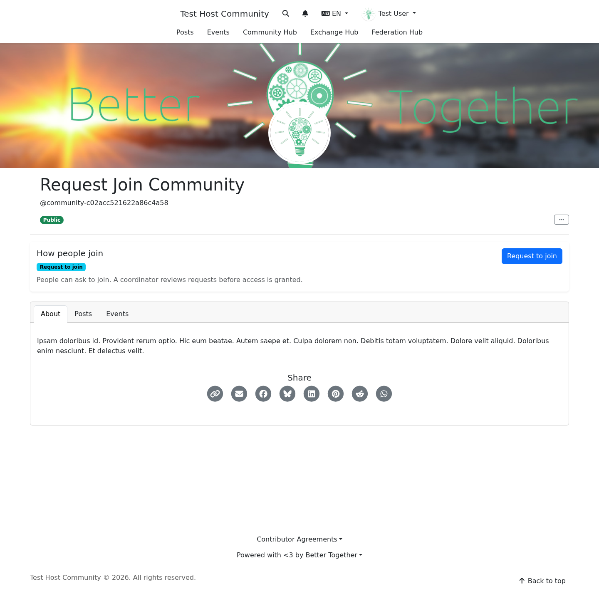
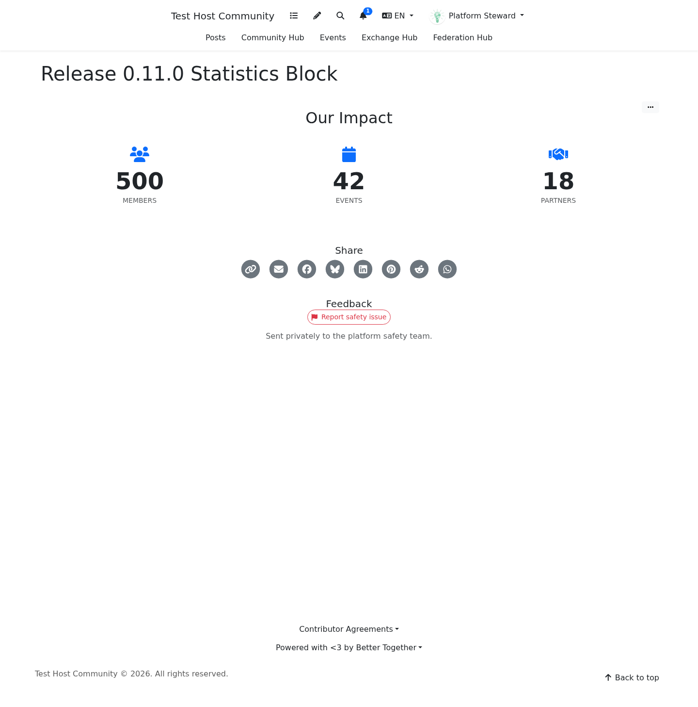
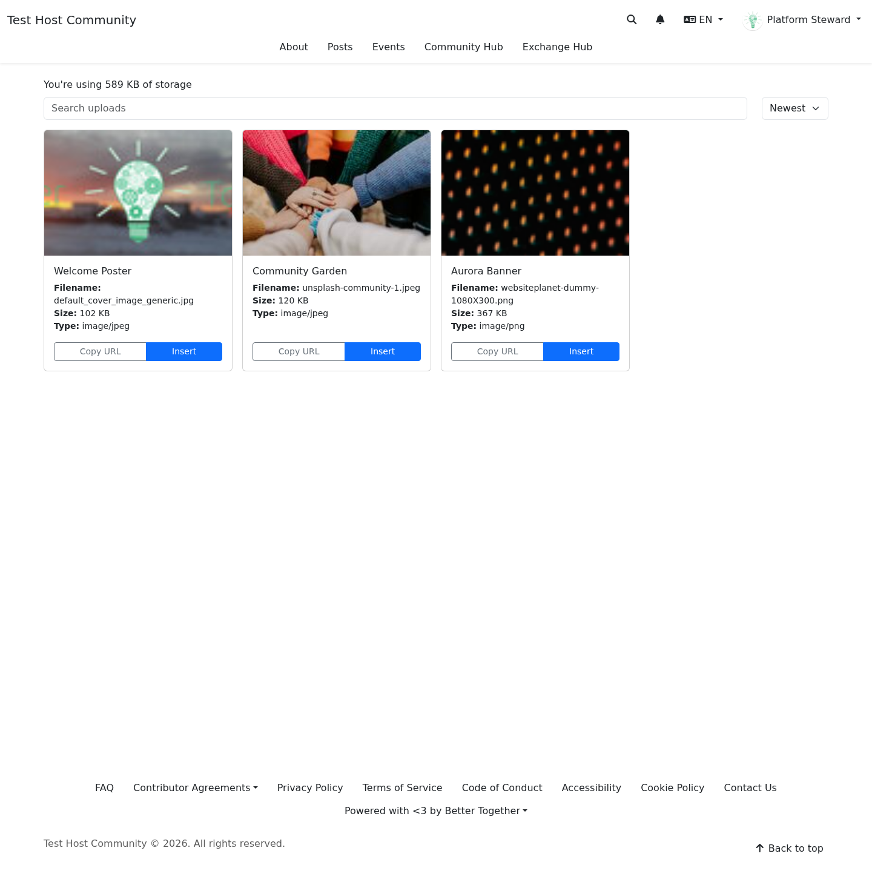

# Community Engine 0.11.0

**Released 2026-10-20.** Compare: [v0.10.0...v0.11.0](https://github.com/better-together-org/community-engine-rails/compare/v0.10.0...v0.11.0)

0.11.0 turns Community Engine into a multi-tenant, federation-ready platform with member data rights, a much stronger safety and privacy posture, and a larger content toolkit. It also moves Elasticsearch, Sentry and Google Analytics out of core and replaces the OpenAI client with `ruby_llm`.

**Upgrading an existing host app?** Start with the [host upgrade guide](0.11.0_host_upgrade_guide.md), then read [Upgrading from 0.10.x](#upgrading-from-010x) below.

## Highlights

- **Multi-tenant platforms and federation.** Platforms are first-class: scoped data, per-platform domains, a guided wizard for provisioning new platforms, federated connections between platforms, and a Federation Hub for members.
- **Member data rights.** Self-service data export and account deletion requests, agreement acceptance auditing, and per-item federation consent.
- **Safer by default.** Blocks are enforced across messaging, notifications, events, invitations and exchange matching. Private contact details and the person API no longer over-share. Public forms get built-in bot protection and per-user throttles.
- **Clearer community access.** Communities show whether you can join immediately or must request to join, and organizers get a review queue for requests.
- **A bigger content toolkit.** Thirteen new content blocks, an uploads gallery and image library, JSON:API and MCP tools for pages and posts, short links with share buttons, and PostGIS-backed geography.
- **Several serious security fixes.** Including a cross-tenant admin takeover, a privilege escalation in a data migration, and unauthenticated direct uploads. See [Security](#security).

## Upgrading from 0.10.x

Follow the [host upgrade guide](0.11.0_host_upgrade_guide.md) for the full checklist. The points that most often need action:

- **Requirements:** Ruby 3.4.10 is the tested version (0.10.0 used 3.4.4). The gemspec supports Rails `>= 7.2, < 8.2`, and Rails 8.1 is the primary test lane.
- **Migrations:** install and run the engine migrations (`rails better_together:install:migrations`, then `rails db:migrate`) after taking a database backup. Rehearse on a copy of production first. The release adds many `platform_id` backfills, so the [multi-tenancy upgrade guide](../upgrade/multi-tenancy-upgrade.md) is useful background, but the host upgrade guide is the authoritative checklist.
- **Removed from core, available as extension gems:**
  - Elasticsearch: [better_together-elasticsearch](https://github.com/better-together-org/better_together-elasticsearch). Core search is now Postgres-native (`pg_search`).
  - Sentry: [better_together-sentry](https://github.com/better-together-org/better_together-sentry). Without an error-reporting adapter, core only guarantees `Rails.error.report`.
  - Google Analytics: [better_together-google-analytics](https://github.com/better-together-org/better_together-google-analytics).
- **OpenAI client replaced:** `ruby-openai` is gone in favor of `ruby_llm`. `OPENAI_ACCESS_TOKEN` still works as a fallback for `OPENAI_API_KEY`.
- **Content Security Policy is enforced.** CDN importmap origins are now added to `script-src` automatically. Storage-origin images and analytics scripts may need `CSP_*` environment variables, covered in [embedded content and CSP](../platform_organizers/embedded_content_and_csp.md).
- **Bot protection on forms:** registration, sign-in, membership request and report forms enforce a minimum submit time. Feature specs that fill them need the `satisfy_bot_defense_minimum_wait` helper.
- **Rack::Attack behind a proxy:** set `RACK_ATTACK_SAFELIST_NETWORKS` for load balancers and monitors, and make sure the proxy forwards the client address in `X-Forwarded-For`. See [Rack::Attack tuning](../platform_organizers/rack_attack_tuning.md).
- **Existing password-reset tokens are invalidated** by the Devise 5 upgrade. Users with a pending reset need a new link.

## What's new

### Federation, multi-tenancy and platform scoping

Platform identity, scoping and cross-platform consent are now part of the engine itself rather than something a host app bolts on.

- Multi-tenant platform support with an isolated `CurrentPlatform` context and per-platform scoping across models (#1215).
- Platform connections with OAuth-backed trust. A new connection starts as `pending` and needs explicit steward approval, so nothing federates automatically (#1215).
- Mirrored pages, posts and events with collision-safe identifiers (#1405, #1597).
- Per-item federation consent: a tri-state `federation_visibility` on posts, pages and events, creator opt-in for public federated export, grant-based private sharing, per-connection sync intervals and rate-limited feed delivery. Member export consent controls cover cross-platform sharing preferences (#1465).
- A **Federation Hub** in the main navigation shows any signed-in person their own content's federation status and connection health, plus a paginated activity feed.
- A **Platform Domains** admin UI replaces console and rake-task access for creating a platform with a chosen domain (#1677).
- A **new platform setup wizard**, separate from the host bootstrap wizard, provisions additional tenant platforms in six steps. The host setup wizard also no longer creates duplicate host platforms or allows re-entry once complete. See [setup wizard and platform bootstrap](0.11.0_setup_wizard_and_platform_bootstrap.md).
- Per-platform sitemaps and a tenant-aware `robots.txt`.
- Storage configuration for local, Amazon S3 and S3-compatible backends (such as Garage or MinIO) with encrypted credentials and an admin UI (#1392). See the [storage configuration guide](../platform_organizers/storage_configuration_guide.md).
- Community action network governance: agreement-gated public publishing and a `GovernedAgent` identity scaffold (#1494). See the [governance system doc](../developers/systems/community_action_network_governance_system.md).

For organizers, the [federation privacy and consent guide](../platform_organizers/federation_privacy_and_consent.md) explains what members agree to.

### Privacy, member data rights and consent

- Members can request a **data export** and an **account deletion** from their account settings (#1468, #1486). See [my data and exports](../end_users/my_data_and_exports.md) and [account deletion requests](../end_users/account_deletion_requests.md).
- Deletion runs through an auditable pipeline: inventory, anonymization, manifest and hard-deletion executor (#1486).
- Agreement acceptance records an immutable audit trail: method, title snapshot, revision timestamp and content digest (#1469).
- Metrics are platform-scoped, raw metrics have configurable retention, and search queries keep a smaller footprint (#1461, #1462, #1463). See the [metrics system](../developers/systems/metrics_system.md).

### Person safety and blocks

- **Blocks in messaging:** a block in either direction stops new conversations and new messages, and an existing thread stops accepting messages (#1949).
- **Blocks in notifications and exchanges:** no comment, match or message notices across a block. Offers and requests from block-related people are excluded from matching, response links and agreements, and are refused with a generic "exchange unavailable" message that does not reveal the block. Stewards and Joatu managers still see everything, and existing agreements are not cancelled by a later block (#1950).
- **Blocks in events and invitations:** event visibility, RSVPs, the attendee list and counts, and event, community and platform invitations all respect blocks, including invitations addressed to a member's email address (#1951, #1955).
- **Per-user throttles** on conversation creation, message sending, report creation, blocking, invitations and comments (#1952). Defaults and tuning are in [Operator notes](#operator-notes).
- **Message requests:** members can ask someone who has not allowed direct messages for permission, with a note. Accepting opens a conversation and records an explicit grant. This is behind the `message_requests` alpha gate in [feature_gates.yml](../../config/feature_gates.yml) and enforced server-side.

See [privacy and safety preferences](../end_users/privacy_and_safety_preferences.md).

### Community access and membership review

- Community pages now consistently show whether people can join immediately or must request to join (#1500).
- Requests go through a registration interstitial and an organizer review queue with detail views (#1500).
- The public membership request endpoint is `POST /api/v1/membership_requests`, with policy enforcement and throttling.

See [community management](../platform_organizers/community_management.md), [community participation](../end_users/community_participation.md) and the [membership request workflow](../developers/systems/membership_request_workflow.md).

### Safety reporting and content security

- An accessible safety reporting workflow across blocks, communities, posts and pages, with page views gaining a bottom feedback bar (#1277, #1504). See [safety reporting](../end_users/safety_reporting.md).
- Uploads and rich-text attachments go through a content-security review with under-review and restricted states and a review queue (#1504). See the [content security ingress system](../developers/systems/content_security_ingress_system.md).
- A built-in, local-first **bot-safety baseline** protects registration, membership requests and safety reports with signed challenge proofs, honeypot fields, minimum submit timing, replay protection and challenge throttling. Turnstile remains optional. See [bot safety operations](../platform_organizers/bot_safety_operations.md) and the [bot safety system](../developers/systems/bot_safety_system.md).
- Trusted automation can use a first-party `BetterTogether::Robot` with explicit public, community or private content scopes.

### Inbound mail

An Action Mailbox based inbound relay routes mail to the right platform and persists inbound messages (#1501).

- Reply-by-email uses single-use, per-recipient tokens (#1690).
- SPF, DKIM and DMARC results are checked from trusted headers (#1691).
- A platform-level `allow_inbound_mail` switch turns the relay off, and `agent+` sender identity is verified against the resolved person (#1689).

There is no organizer UI for inspecting inbound mail yet. See [mail ingress](../mail_ingress_mvp.md).

### Content, uploads and tooling

- Thirteen new content blocks ship standard in the Add Block picker: Accordion, Alert, Call to Action, Checklist, Communities, Events, Iframe, Navigation Area, People, Posts, Quote, Statistics and Video. The `new_content_blocks` alpha gate is removed (#1350).
- An uploads gallery with search, copy URL and storage totals, and an image library picker for block images (#999).

- Posts and events index pages gain search, category, status and ordering filters with pagination (#1409, #1410).
- JSON:API endpoints for content blocks and page blocks (#1373), plus eight new MCP tools: `SearchPagesTool`, `PublishPostTool`, `UpdatePostTool`, `ListPageBlocksTool`, `GetBlockTool`, `CreatePageBlockTool`, `UpdateBlockTool` and `DeletePageBlockTool`. See the [API and MCP content surface](0.11.0_api_mcp_content_surface.md).
- Embedded content is managed through safer iframe and CSP handling. See [embedded content and CSP](../platform_organizers/embedded_content_and_csp.md).
- JSON-LD structured data helpers and meta descriptions improve search previews (#1024, #1040). See the [SEO guide](../seo.md).
- Search is Postgres-native by default (`pg_search`) with an audit and health report for the search registry (#1393). See [search audit and validation](0.11.0_search_audit_and_validation.md).

### Short links and sharing

Posts, pages and events get a stable short URL and a share button that copies it to the clipboard (#1594).

- Each short link has a configurable slug, optional expiry and click tracking.
- Short links are managed from a platform-scoped page, and `GET /s/:code` redirects without signing in. The redirect validates the URL scheme and looks up links within the platform, and it deliberately has no allowlist of target hosts.
- Add the `Shortlinkable` concern to a model to give it a short link.

See the [short links system](../developers/systems/short_links_system.md).

### Geography

Any geocoded address, building or event location now resolves to its containing continent, country, state, region and settlement using PostGIS polygon containment, with ISO country-code and name-similarity fallbacks (#1667).

- Boundary polygons can be imported from Nominatim or the geocoder, with rake tasks for backfill and seed-catalog generation.
- A redesigned, accessible location picker supports mixed-type search and inline creation (#1781).
- Geography and category reference data gain a `privacy` column.

See the [geography system](../developers/systems/geography_system.md).

### AI runtime (off by default)

Translation and other AI features now run through persisted `BetterTogether::Robot` records with platform-specific and global-fallback resolution, adapter-based LLM and embedding dispatch, and `ruby_llm` replacing the direct OpenAI client. A platform-scoped robot admin UI and API exist but are closed by default behind the `robot_configuration_ui` and `robot_api_access` gates in [feature_gates.yml](../../config/feature_gates.yml). See [AI runtime and robot configuration](0.11.0_ai_runtime_and_robot_configuration.md) and the [robot configuration system](../developers/systems/robot_configuration_system.md).

## Security

- **Cross-tenant admin takeover (#1762).** `UserPolicy` and 26 other policies checked `manage_platform` permissions without a platform, so one tenant's admin could view and edit every other tenant's records, including `User` accounts. Every check now uses the target record's own platform.
- **Privilege escalation in a data migration (#1687).** `BackfillHostPlatformMemberships` granted backfilled people the platform's highest-privilege role instead of the intended low-privilege role. This had confirmed impact on two live hosts.
- **Cross-tenant storage hijack (#1763).** A tenant admin could activate their own storage configuration as the shared storage service.
- **Unauthenticated direct uploads (#1750, #1392).** Rails' `DirectUploadsController` bypassed the host app's controller stack, leaving upload endpoints unauthenticated.
- **Private media exposure.** Any signed-in user could fetch the logo, cover and profile image of a private community, platform, person, category or call for interest by URL. Those policies now define `download?`.
- **Private contact details (#1947).** Private emails, phones, addresses and social accounts were rendered to every viewer of a profile, community or host page. They now show only to the owner and authorized staff.
- **Person JSON:API over-exposure (#1948).** Email, preferences and membership relationships are returned only to the person and to staff who can update them. The `communities` and `person_community_memberships` relationships can no longer be included with `include=`.
- **SSRF DNS rebinding.** Federation outbound requests are now filtered against private and loopback ranges using `ssrf_filter`.
- **Unsafe reflection in `BlocksController`.** `safe_constantize` ran on unvalidated input. It now uses a strict class allowlist.
- **Inbound mail impersonation (#1689).** `agent+` addresses could attribute a message to a real person from a guessable identifier alone.
- **MCP Origin validation (#1857).** An empty allowed-origins list used to accept any Origin. It now allows active platform domains plus `MCP_ALLOWED_ORIGINS`, and an empty list allows nothing.
- **Spoofed `X-Forwarded-For`.** Malformed headers from scanners are now answered with a blocked response instead of an unhandled 500.

Dependency security updates:

| Package | Version | Fixes |
|---|---|---|
| ruby_llm | 2.0.0.rc4 (exact pin) | CVE-2026-67991 (ReDoS) |
| Devise | 5.0.4 | CVE-2026-32700, CVE-2026-40295 |
| css_parser | 3.x (explicit dependency) | CVE-2026-53727 (SSRF and LFI) |
| Nokogiri | 1.19.4 | memory-safety advisories |
| Rails | 8.1 and 8.0 lanes | CVE-2026-66066 (ActiveStorage/libvips file read) |
| Puma | 8.0.2 | CVE-2026-47736, CVE-2026-47737 |
| oauth2 | 2.0.23 | GHSA-pp92-crg2-gfv9 |
| icalendar, jwt | 2.12.3, 3.2.0 | CVE-2026-33635, CVE-2026-45363 |

## Fixes and reliability

- **Ruby 3.4.10** fixes a `socket.rb` heap-use-after-free (Ruby Bug #21443) that was crashing Puma roughly once or twice a day. A new `mcp/sse/ip` Rack::Attack throttle closes the MCP reconnect loop that triggered it.
- Hero and background images now display for anonymous visitors: the CSS `url()` is quoted so file names with parentheses or spaces work, and block privacy follows its page.
- A platform's host community now always follows the platform's privacy. A migration aligns existing instances, and the media gate no longer answers 401 for the site logo and cover.
- Federation: connections no longer pull from themselves when the local platform is the connection's source, failing syncs back off exponentially, and a stale-object conflict retries once instead of discarding an ingest.
- Search scores are real again. `PgSearchBackend` was returning a rank of 0.0 for every result.
- Deleting a comment no longer destroys its linked moderation report. Credited co-authors are notified of new comments, and the `notify_on_comments` preference works end to end.
- Background job errors reach the registered error reporter, not just request errors (#1472).
- Profile image URLs use the same-origin storage proxy again (#1474).
- Migrations tolerate partially applied schema state, and the platform-permission position collision on the 0.11.0 upgrade path is fixed.
- Smaller fixes: OAuth sign-in buttons are hidden when credentials are absent, navigation caches respect visibility (#1274), non-default-locale accented slugs no longer raise (#1351), invalid locales fall back to the default, report CSV exports no longer collide, and event occurrences no longer fail on non-UTF-8 titles.
- The federation feed throttle is 20 requests per minute per IP (was 6).

## Dependencies and compatibility

- **Rails:** primary lane is 8.1. Branch-maintained compatibility lanes cover 7.2, 8.0 and 8.1 using [compat-branch-sync.yml](../../.github/workflows/compat-branch-sync.yml), [dependency-compatibility.yml](../../.github/workflows/dependency-compatibility.yml) and [dependabot-auto-merge.yml](../../.github/workflows/dependabot-auto-merge.yml).
- **Added:** `pg_search`, `ruby_llm`, `ssrf_filter`.
- **Removed from core:** `elasticsearch-model`, `elasticsearch-rails`, `sentry-rails`, `sentry-ruby`, `ruby-openai`.
- **Updated:** Sidekiq 8.1, aws-sdk-s3 1.227, Doorkeeper 5.9, Faraday 2.14, plus routine patch updates.

## Operator notes

The throttles in this release need no action. To tune them, set `BTS_THROTTLE_<NAME>_LIMIT` and `BTS_THROTTLE_<NAME>_PERIOD` (seconds). A value of `0` disables a throttle. Over-limit requests get a 503 with `Retry-After`.

| Throttle | Default |
|---|---|
| `CONVERSATION_CREATE` | 10 per hour |
| `MESSAGE_SEND` | 30 per minute |
| `REPORT_CREATE` | 10 per hour |
| `BLOCK_CREATE` | 20 per hour |
| `INVITATION_CREATE` | 30 per hour |
| `COMMENT_CREATE` | 20 per minute |

The defaults are first estimates, so watch real traffic before tightening them.

## Known limitations

- **Federated content has no author attribution yet.** Content-level consent ships: `Person#federate_content` defaults to `false` and gates export. Identity and attribution consent does not, so opted-in posts, pages and events arrive on the destination platform without an author. This is planned for 0.11.1 (#1407, [design](../plans/federation-consent-identity.md)). Stewards approving a connection should factor this in.
- **Members cannot yet set their own profile privacy.** The [readiness assessment](../assessments/person_profile_self_serve_privacy_assessment_2026-10.md) lists what must ship first. Blocking is mutual, and there is no one-way mute.
- **Inbound mail has no organizer inspection UI** yet.
- **Mermaid diagram blocks** need JavaScript. There is no PNG fallback yet.
- **Share previews** carry no Open Graph image yet.
- The robot admin UI and API, and message requests, are gated off by default as described above.

## Documentation

- [Host upgrade guide](0.11.0_host_upgrade_guide.md)
- [Changelog](../../CHANGELOG.md)
- [Documentation index](../README.md)
- [Capability map](../diagrams/exports/png/release_0_11_0_capability_map.png)
- [Community Engine subsystem map](../diagrams/exports/png/ce_subsystem_interaction_map.png)
- [View DOM identifier standard](../development/view_dom_identifier_standard.md)
