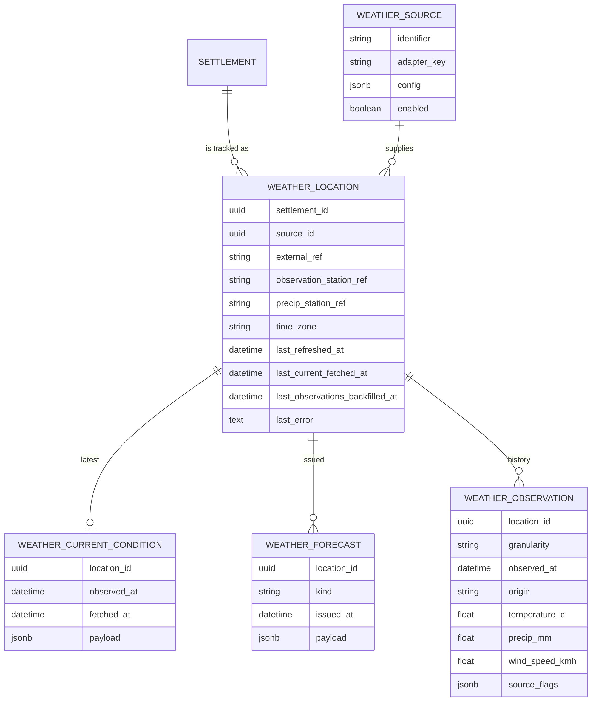
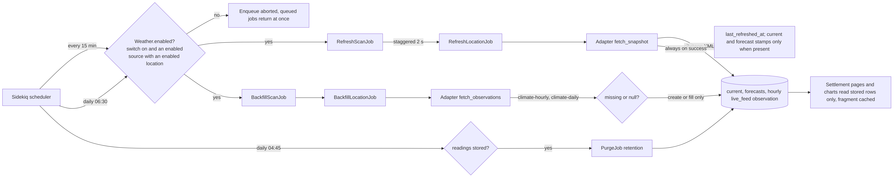
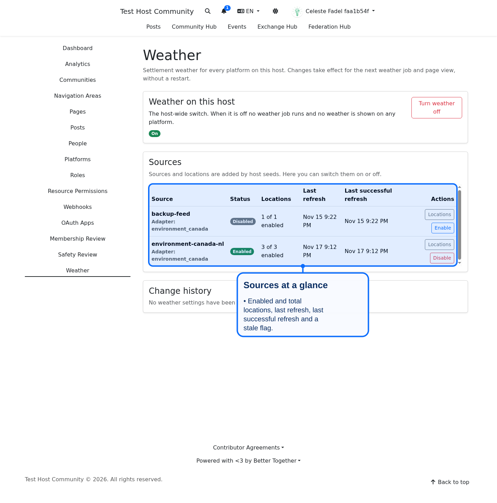
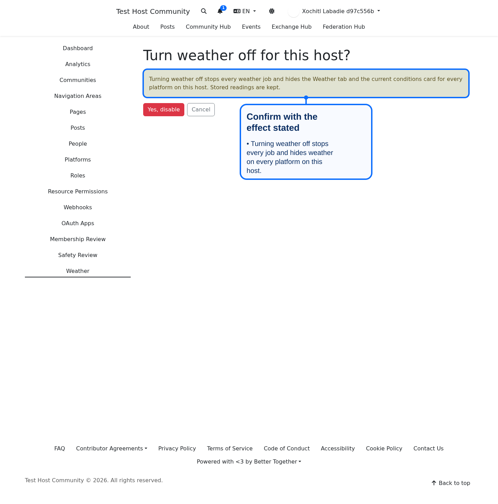

# Settlement Weather

Phase 1 of settlement weather: a source-agnostic data layer that stores current
conditions, forecasts and an observation history per settlement. Pages and charts
(later phases) read only these stored rows. Alerts, the settlement panel and
subscriptions arrive in later phases.

## Data model

Source: [weather_erd.mmd](diagrams/source/weather_erd.mmd).

- `Weather::Source`: one configured adapter (`adapter_key`, `config`, `enabled`).
- `Weather::Location`: a settlement tracked through a source. `external_ref` is the
  source's place code (Environment Canada: `NL/s0000221`). `observation_station_ref`
  is the history station (climate id). `precip_station_ref` optionally supplies
  precipitation when the main station has none. Creating a location enqueues a refresh and a backfill.
- `Weather::CurrentCondition`: latest normalised conditions, one row per location.
- `Weather::Forecast`: one row per issue and kind (`hourly`, `daily`); periods in `payload`.
- `Weather::Observation`: the history. Hourly rows are keyed by the UTC hour bucket,
  daily rows by the local date at 00:00 UTC. Measurements are nullable and nil means
  the station did not report it, never zero. `origin` is `live_feed` or `backfill_api`.

## Ingest

Source: [weather_ingest_flow.mmd](diagrams/source/weather_ingest_flow.mmd).

- `RefreshLocation` (hourly) stores the live feed, including one hourly observation per
  refresh. Source failures keep stored data and set `last_error`.
- `BackfillObservations` (daily and on onboarding) is the only path that asks the
  history API for past data. It creates missing hours, fills measurements the live
  feed lacked, and applies corrections to rows it created. It never overwrites live values
  and the live feed never replaces backfilled rows.
- `Retention` (daily) deletes observations older than 400 days and superseded forecasts
  older than 7 days, always keeping the newest forecast of each kind.

## Adapters

`Weather::Registry` is an allow-list of adapters. Hosts register more:
`BetterTogether::Weather::Registry.register('met_office', 'MyApp::MetOffice')`.
An adapter subclasses `Adapters::Base`, declares `capabilities`, and implements
`fetch_snapshot(location)` and `fetch_observations(location, granularity:, from:, to:, station_ref:)`
returning plain Hashes (see the contract comment in `adapters/base.rb`). Adapters never write to the database.

### Environment Canada

- Live feed: Datamart `citypage_weather` XML (about hourly, 24 hourly and 13 daily periods).
  Documents older than 3 hours are rejected as stale.
- History: MSC GeoMet OGC API `climate-hourly` and `climate-daily`. The API filters on station
  local time, so the request window is padded by 12 hours. Hourly wind direction is in tens of degrees.
- Known gap: the Corner Brook station reports no precipitation or visibility.
- Licence: ECCC Data Services End-use Licence. Show "Data Source: Environment and Climate Change
  Canada" with a link to the licence, and never alter alert text (relevant when alerts ship).
  Set `WEATHER_CONTACT` so the User-Agent identifies the operator.

## Settlement page

A settlement with an enabled `Weather::Location` gets a Weather tab on its show page. The tab holds a lazy
turbo-frame (`#settlement-weather`) that loads `GET /g/settlements/:id/weather` when the tab is opened. The route
is public like the settlement page, and returns 404 when the settlement has no enabled location.

The panel is built by `Weather::SettlementPanel` from stored rows only. It never calls the source, so a slow or
failing source cannot slow or break the page.

- **Current conditions** from `CurrentCondition`, with the observation time.
- **Next 24 hours** from the latest hourly `Forecast`, dropping hours that have finished.
- **7-day forecast** from the latest daily `Forecast`.
- **Past 14 days** from `Weather::HistorySeries`: the previous 14 local days plus today (marked "so far").
  An official daily observation wins; hourly rows fill whatever it lacks. A measurement no row reported stays nil.
  It shows as "Not reported" and is never charted as zero. A chart with no values at all is replaced by a note.

Charts use Chart.js through the `better-together--weather-charts` Stimulus controller. The server renders the series,
dataset names and axis units as JSON values, and each chart has a text alternative plus a data table
(`#weather-history-table`) with the same values.

Stale data (current conditions older than three hours) and a failed last update each show a notice. Attribution and a
licence link are always shown. Condition and forecast text comes from the source in English only, and is not
translated; the surrounding interface is translated into en, es, fr and uk.

## Operations

### When weather is on

Weather is active only when both of these hold (`BetterTogether::Weather.enabled?`):

1. The feature switch is on (`BetterTogether::Weather.feature_enabled?`). Two settings decide it, in this order:
   - The environment kill switch. `BETTER_TOGETHER_WEATHER_ENABLED=false` (also `0`, `off`, `no`) sets
     `BetterTogether.weather_enabled` to false at boot, or a host sets it in an initializer. When it is false,
     weather is off whatever the dashboard says.
   - Otherwise the host platform's `weather_enabled` setting (stored in `Platform#settings`, default on), which
     host stewards change from the host dashboard Weather tab without a restart.
2. A configured, enabled source exists: a `Weather::Source` with `enabled: true` (its `adapter_key` is
   validated against the registry) that has at least one `Weather::Location` with `enabled: true`.
   A disabled source does not count, even when it has locations.

The same predicate gates every enqueue point and every perform:

- All weather jobs inherit `Weather::BaseJob`. Its `before_enqueue` aborts the enqueue, so the scheduler,
  the scan fan-out and the location `after_create_commit` queue nothing, and its `around_perform` returns
  at once (one EXISTS query, a debug log line) so jobs already queued drain instantly.
- Per-location jobs only load `Location.active` (enabled location of an enabled source).
- `Weather::PurgeJob` instead runs while stored readings remain (`Weather.data_stored?`), so retention still
  applies after a source is removed, and is a no-op when nothing is stored.
- The settlement Weather tab, its `/weather` route (404) and the About tab summary card render only for a
  settlement with an active location while the switch is on.

The dashboard setting is read through `Rails.cache` (key `better_together/weather/host_setting_enabled`, one
minute). Saving a new value on the host platform deletes the key after commit, so every web and Sidekiq process
sees the change on its next check. The location check is not cached, so disabling a source or location takes
effect on the next enqueue or perform.

### Host steward management

Host stewards manage weather from the host dashboard Weather tab (`GET /host/weather`, controller
`WeatherManagementController`, host nav item `host-dashboard-weather`).

- **Who.** People with `manage_platform_settings` on the host platform (`WeatherPolicy`,
  `Weather::SourcePolicy`, `Weather::LocationPolicy`). No weather specific permission exists. Ordinary members
  and stewards of other platforms are refused. Creating and deleting sources and locations stays with host seeds.
- **What.** The host-wide switch; each source with its adapter, enabled state, enabled and total locations,
  last refresh (success or error), last successful refresh and a stale flag (an enabled source whose last
  success is more than an hour old); each source's locations with the same fields. The source list costs the
  same number of queries for any number of sources (one grouped Arel query for the location counts and times).
- **How.** Every switch opens a confirm page that states the effect, for example that turning weather off stops
  every weather job and hides the Weather tab for every platform on this host. When
  `BETTER_TOGETHER_WEATHER_ENABLED` is false the page says so and the switch button is disabled; the update
  action refuses the change.
- **Audit.** `Weather::StewardToggle` writes each change and a private `BetterTogether::Activity` in one
  transaction: `owner` is the steward, `trackable` the platform, source or location, `key` is
  `weather.feature.toggled`, `weather.source.toggled` or `weather.location.toggled`, and `parameters` hold
  `attribute`, `before`, `after` and a `label`. The tab lists the last 20. Activities are `private`, so they never
  appear in public activity feeds.

Existing installs get the nav item from `rake better_together:seed:rbac_and_navigation`.

### Refresh cadence and freshness

Jobs run on the `weather` queue (the host must list it in its Sidekiq queues) and `maintenance`.
Schedules are in `config/sidekiq_scheduler.yml` (`better_together:weather:*`). The refresh scan runs every
15 minutes (the Datamart publishes each site about hourly, a few minutes past the hour, plus forecast issues
at about :30) and spreads its per-location jobs 2 seconds apart. Cron minutes are read in the worker's time
zone, which can shift the run times for half-hour zones such as Newfoundland.

Each successful refresh stamps `Location#last_refreshed_at`. `last_current_fetched_at` and
`last_forecast_fetched_at` are stamped only when the document carried that part: the Datamart can publish a
site with an empty `<currentConditions/>` when its station stops reporting, and the stored conditions then
stay as they were. The panel shows the observation time and, when the source was reached after that
observation, says the station has not reported since then rather than implying our refresh failed.

The panel shows the forecast issue fetched most recently, not the one with the latest `issued_at`: overnight
Datamart documents have carried an hourly issue time hours ahead of the real one, which used to pin an old
forecast in place.

### Caching

The panel and the summary card are fragment cached. `SettlementPanel#cache_key` follows the data: location
`updated_at` (every refresh), current conditions `updated_at`, the count and latest `updated_at` of forecasts
and observations, the clock hour (hourly cut-off and today), staleness, locale and time zone. The panel content
is the same for every viewer, so no viewer context is in the key; the controller authorizes before rendering.
