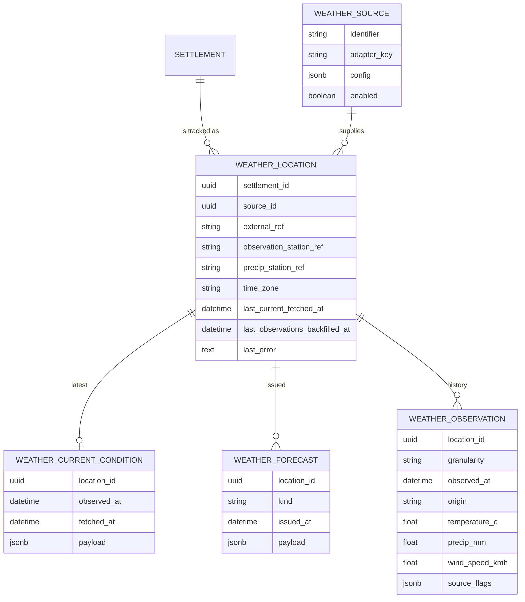

# Settlement Weather

Phase 1 of settlement weather: a source-agnostic data layer that stores current
conditions, forecasts and an observation history per settlement. Pages and charts
(later phases) read only these stored rows. Alerts, the settlement panel and
subscriptions arrive in later phases.

## Data model

Source: [weather_erd.mmd](diagrams/source/weather_erd.mmd).

- `Weather::Source`: one configured adapter (`adapter_key`, `config`, `enabled`).
- `Weather::Location`: a settlement tracked through a source. `external_ref` is the
  source's place code (Environment Canada: `NL/s0000221`). `observation_station_ref`
  is the history station (climate id). `precip_station_ref` optionally supplies
  precipitation when the main station has none. Creating a location enqueues a refresh and a backfill.
- `Weather::CurrentCondition`: latest normalised conditions, one row per location.
- `Weather::Forecast`: one row per issue and kind (`hourly`, `daily`); periods in `payload`.
- `Weather::Observation`: the history. Hourly rows are keyed by the UTC hour bucket,
  daily rows by the local date at 00:00 UTC. Measurements are nullable and nil means
  the station did not report it, never zero. `origin` is `live_feed` or `backfill_api`.

## Ingest

Source: [weather_ingest_flow.mmd](diagrams/source/weather_ingest_flow.mmd).

- `RefreshLocation` (hourly) stores the live feed, including one hourly observation per
  refresh. Source failures keep stored data and set `last_error`.
- `BackfillObservations` (daily and on onboarding) is the only path that asks the
  history API for past data. It creates missing hours, fills measurements the live
  feed lacked, and applies corrections to rows it created. It never overwrites live values
  and the live feed never replaces backfilled rows.
- `Retention` (daily) deletes observations older than 400 days and superseded forecasts
  older than 7 days, always keeping the newest forecast of each kind.

## Adapters

`Weather::Registry` is an allow-list of adapters. Hosts register more:
`BetterTogether::Weather::Registry.register('met_office', 'MyApp::MetOffice')`.
An adapter subclasses `Adapters::Base`, declares `capabilities`, and implements
`fetch_snapshot(location)` and `fetch_observations(location, granularity:, from:, to:, station_ref:)`
returning plain Hashes (see the contract comment in `adapters/base.rb`). Adapters never write to the database.

### Environment Canada

- Live feed: Datamart `citypage_weather` XML (about hourly, 24 hourly and 13 daily periods).
  Documents older than 3 hours are rejected as stale.
- History: MSC GeoMet OGC API `climate-hourly` and `climate-daily`. The API filters on station
  local time, so the request window is padded by 12 hours. Hourly wind direction is in tens of degrees.
- Known gap: the Corner Brook station reports no precipitation or visibility.
- Licence: ECCC Data Services End-use Licence. Show "Data Source: Environment and Climate Change
  Canada" with a link to the licence, and never alter alert text (relevant when alerts ship).
  Set `WEATHER_CONTACT` so the User-Agent identifies the operator.

## Settlement page

A settlement with an enabled `Weather::Location` gets a Weather tab on its show page. The tab holds a lazy
turbo-frame (`#settlement-weather`) that loads `GET /g/settlements/:id/weather` when the tab is opened. The route
is public like the settlement page, and returns 404 when the settlement has no enabled location.

The panel is built by `Weather::SettlementPanel` from stored rows only. It never calls the source, so a slow or
failing source cannot slow or break the page.

- **Current conditions** from `CurrentCondition`, with the observation time.
- **Next 24 hours** from the latest hourly `Forecast`, dropping hours that have finished.
- **7-day forecast** from the latest daily `Forecast`.
- **Past 14 days** from `Weather::HistorySeries`: the previous 14 local days plus today (marked "so far").
  An official daily observation wins; hourly rows fill whatever it lacks. A measurement no row reported stays nil.
  It shows as "Not reported" and is never charted as zero. A chart with no values at all is replaced by a note.

Charts use Chart.js through the `better-together--weather-charts` Stimulus controller. The server renders the series,
dataset names and axis units as JSON values, and each chart has a text alternative plus a data table
(`#weather-history-table`) with the same values.

Stale data (current conditions older than three hours) and a failed last update each show a notice. Attribution and a
licence link are always shown. Condition and forecast text comes from the source in English only, and is not
translated; the surrounding interface is translated into en, es, fr and uk.

## Operations

Jobs run on the `weather` queue (the host must list it in its Sidekiq queues) and `maintenance`.
Schedules are in `config/sidekiq_scheduler.yml` (`better_together:weather:*`).
